# Proceso de creación del backend de CircularGuajira

## Propósito y alcance

Este documento organiza en 16 bloques ISS la construcción del backend de **CircularGuajira**, plataforma para gestionar la cadena de reciclaje: recicladores y organizaciones, materiales y tarifas, rutas y puntos de recolección, recolecciones, pesajes y liquidaciones. La **Fase I** entrega el dominio funcional sin autenticación; la **Fase II** incorpora sesiones y autorización basada en roles (RBAC).

## Criterios técnicos

- Tecnologías: Node.js, Express, TypeScript, Sequelize y PostgreSQL o MySQL, según la configuración del proyecto.
- Organizar el código por *features* del dominio. Separar rutas, controller, service, repository, model, validaciones y pruebas cuando aplique.
- Mantener las reglas de negocio en services, la persistencia en repositories y el manejo HTTP en controllers y rutas.
- Configurar credenciales y secretos mediante variables de entorno; no guardarlos en el repositorio.
- Validar entradas, centralizar errores y probar reglas de negocio, integridad y permisos.
- Usar transacciones para operaciones que escriban registros relacionados y conservar la tarifa y los valores utilizados al generar una liquidación.

## Fase I · Business (dominio CircularGuajira)

**Objetivo:** implementar y documentar la API de negocio, verificable localmente y todavía sin autenticación.

### ISS-00 — Requisitos previos

Preparar Node.js, npm, TypeScript, Express, Sequelize y el motor relacional seleccionado. Definir configuración por ambiente y scripts de instalación, desarrollo, compilación y pruebas.

Criterios de aceptación (ISS-00)

- [x] node -v muestra v20+ (lab: v24.x)
- [x] npm -v responde
- [x] Motor de BD accesible (MySQL recomendado para el primer sync)

### Pasos

```bash
node -v && npm -v
docker ps --filter name=mysql-server
```

### Verificación del ISS

```bash
node -v && npm -v
```

**Verificación:** instalación limpia, compilación y arranque local; conexión configurable sin credenciales en el código.

#### Evidencias

**Ev1 — Node y npm:** `node -v && npm -v` devuelve v24.20.0 y 11.19.0.

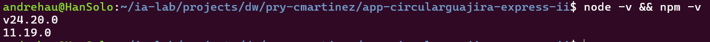

**Ev2 — MySQL:** contenedor `mysql-server` (mysql:8.0) arriba y healthy en el puerto 3306.

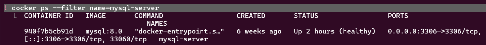

### ISS-01 — Esqueleto del proyecto

Crear la aplicación Express y la estructura por *features* para el dominio de reciclaje. Separar configuración e infraestructura compartida, y centralizar el registro de rutas.

Criterios de aceptación (ISS-01)

- [x] 2.1 Existe package.json con "type": "commonjs" y scripts build / dev
- [x] 2.2 Árbol src/ con config, database/seeders, routes, shared, features/business/collectors (auth fuera de alcance de este lab)
- [x] 2.3 Dependencias Express/TS instaladas (npm ls --depth=0)
- [x] 2.4 Existe tsconfig.json (rootDir: ./src, outDir: ./dist, strict: true)
- [x] 2.5 Existen src/server.ts y src/config/index.ts (esqueleto App)
- [x] npx tsc --noEmit sin errores al cerrar el ISS

### Pasos

```bash
npm init -y
```

Parche a `package.json`: en `scripts` quedan solo `build` y `dev`, y se asegura `"type": "commonjs"`.

```json
{
  "scripts": {
    "build": "tsc",
    "dev": "nodemon --watch src --ext ts --exec ts-node -- src/server.ts"
  },
  "type": "commonjs"
}
```

```bash
node -e "const p=require('./package.json'); console.log(p.scripts)"
```

Estructura de carpetas por features:

```bash
mkdir -p \
  src/config \
  src/database/seeders \
  src/routes \
  src/shared/errors \
  src/shared/http \
  src/shared/database \
  src/features/business/collectors
find src -type d | sort
```

Dependencias base (TypeScript en 5.9.x por compatibilidad con ts-node):

```bash
npm install express@^5.2.1 cors@^2.8.6 dotenv@^17.4.2 morgan@^1.12.1

npm install -D typescript@~5.9.2 ts-node@^10.9.2 nodemon@^3.1.14 \
  @types/node@^22.20.3 @types/express@^5.0.6 \
  @types/cors@^2.8.19 @types/morgan@^1.9.10

npm ls --depth=0
```

`tsconfig.json`:

```bash
: > tsconfig.json
cat >> tsconfig.json << 'EOF'
{
  "compilerOptions": {
    "rootDir": "./src",
    "outDir": "./dist",
    "module": "commonjs",
    "target": "ES2020",
    "lib": ["ES2020"],
    "types": ["node"],
    "esModuleInterop": true,
    "resolveJsonModule": true,
    "sourceMap": true,
    "strict": true,
    "skipLibCheck": true,
    "moduleDetection": "force",
    "isolatedModules": true,
    "forceConsistentCasingInFileNames": true
  },
  "include": ["src/**/*"],
  "exclude": ["node_modules", "dist"]
}
EOF

test -f tsconfig.json && npx tsc --showConfig | head -20
```

Servidor y App (esqueleto: `dbConnection` y el registro de rutas quedan como placeholder hasta ISS-02/03):

```bash
: > src/server.ts
cat >> src/server.ts << 'EOF'
import { App } from './config/index';

async function main() {
    const app = new App();
    await app.listen();
}

main();
EOF

: > src/config/index.ts
cat >> src/config/index.ts << 'EOF'
import dotenv from "dotenv";
import express, { Application } from "express";
import morgan from "morgan";
import cors from "cors";

dotenv.config();

export class App {
  public app: Application;

  constructor(private port?: number | string) {
    this.app = express();
    this.settings();
    this.middlewares();
    this.routes();
  }

  private settings(): void {
    this.app.set("port", this.port || process.env.PORT || 4000);
  }

  private middlewares(): void {
    this.app.use(morgan("dev"));
    this.app.use(cors());
    this.app.use(express.json());
    this.app.use(express.urlencoded({ extended: false }));
  }

  private routes(): void {
    // Placeholder: las rutas de cada feature se registran desde src/routes/index.ts (ISS-03 en adelante).
    this.app.get("/health", (_req, res) => {
      res.json({ status: "ok" });
    });
  }

  private async dbConnection(): Promise<void> {
    // Placeholder: la conexión con Sequelize y el sync se agregan en ISS-02.
  }

  async listen() {
    await this.dbConnection();
    this.app.listen(this.app.get("port"));
    console.log(`🚀 Servidor ejecutándose en puerto ${this.app.get("port")}`);
  }
}
EOF
```

### Verificación del ISS

```bash
npx tsc --noEmit
find src -type f | sort
npm run dev
curl localhost:4000/health
```

**Verificación:** servidor inicia, responde a una ruta de salud y admite el registro modular de rutas.

#### Evidencias

**Ev1 — package.json:** `cat package.json` muestra `"type": "commonjs"` y los scripts `build` y `dev`.

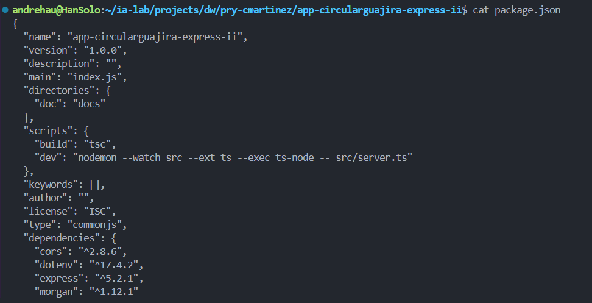

**Ev2 — Estructura src/:** `find src -type d | sort` muestra config, database/seeders, routes, shared y features/business/collectors.

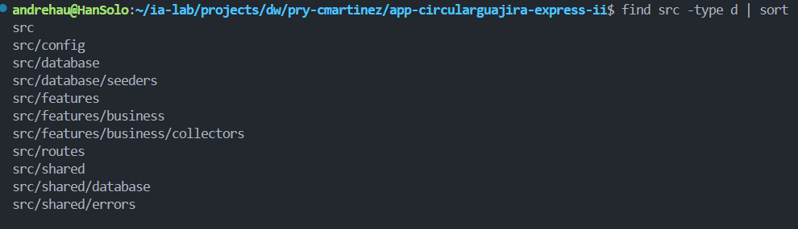

**Ev3 — Dependencias:** `npm ls --depth=0` lista express 5.2.1, cors, dotenv, morgan, typescript 5.9.3, ts-node, nodemon y los @types.

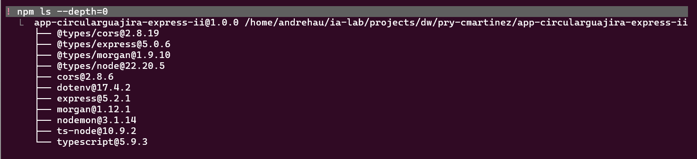

**Ev4 — tsconfig.json:** `cat tsconfig.json` muestra rootDir `./src`, outDir `./dist` y strict `true`.

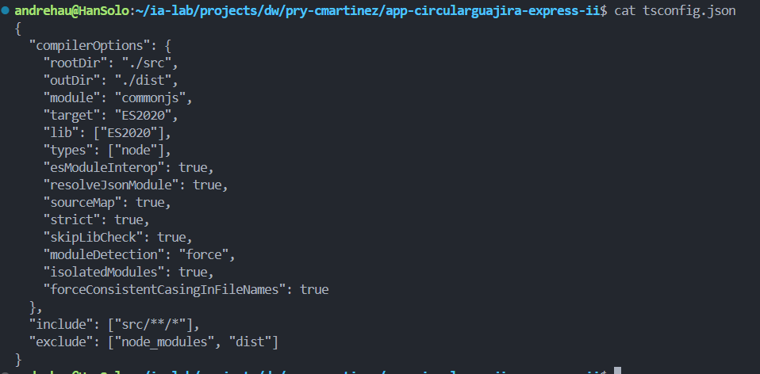

**Ev5 — Esqueleto App:** `find src -type f | sort` muestra `src/config/index.ts` y `src/server.ts`; `npm run dev` levanta nodemon y ejecuta `ts-node src/server.ts`.

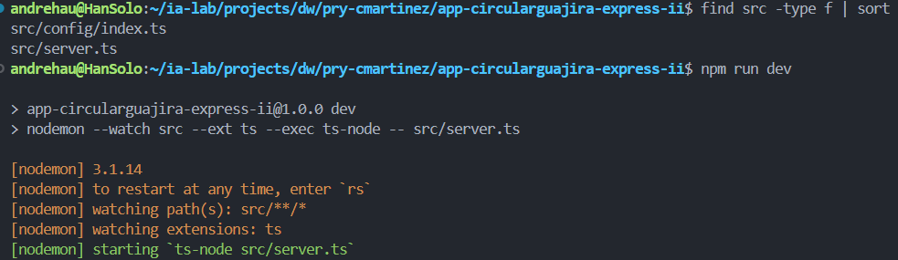

**Ev6 — Type-check:** `npx tsc --noEmit` termina sin errores.


### Commit

```bash
git add .gitignore package.json package-lock.json tsconfig.json \
  src/server.ts src/config/index.ts \
  docs/PROCESO.md docs/images/Ev1-ISS-00.png docs/images/Ev2-ISS-00.png \
  docs/images/Ev1-ISS-01.png docs/images/Ev2-ISS-01.png docs/images/Ev3-ISS-01.png \
  docs/images/Ev4-ISS-01.png docs/images/Ev5-ISS-01.png docs/images/Ev6-ISS-01.png
git commit -m "ISS-01: Esqueleto del proyecto"
git push origin main
```

Commit: [`db14ec1`](https://github.com/DW-2026-IISem/dw-2026-Andreushin/commit/db14ec17acb78c5fdee78c4daae177165bd1ba6f)

### ISS-02 — Infraestructura de base de datos

Configurar Sequelize, conexión, modelos, asociaciones y migraciones para la base relacional. Definir convenciones para claves, fechas, restricciones e índices.

Criterios de aceptación (ISS-02)

- [x] 3.1 Paquetes Sequelize/drivers instalados; existe .env con DB_ENGINE y bloques de motores
- [x] 3.2 Existe src/database/db.ts exportando sequelize, getDatabaseInfo, testConnection
- [x] 3.3 Existe carpeta src/database/seeders/ sin lógica implementada aún
- [x] npx tsc --noEmit sin errores al cerrar el ISS

### Pasos

```bash
npm install sequelize@^6.37.8 mysql2@^3.24.4 pg@^8.23.0 pg-hstore@^2.3.4 \
  tedious@^20.0.0 oracledb@^7.0.1
npm install -D @types/sequelize@^6.12.0

# .env: PORT, DB_ENGINE y bloques MYSQL_*, POSTGRES_*, MSSQL_*, ORACLE_* (no se versiona)
test -f .env && grep DB_ENGINE .env
npm ls sequelize mysql2 --depth=0

# src/database/db.ts: config por motor según DB_ENGINE, instancia sequelize,
# getDatabaseInfo (sin contraseña) y testConnection (sequelize.authenticate)
mkdir -p src/database/seeders
touch src/database/seeders/.gitkeep
```

### Verificación del ISS

```bash
npx tsc --noEmit
test -f src/database/db.ts && test -f .env && test -d src/database/seeders
npm run dev
```

**Verificación:** conexión comprobable y migraciones ejecutables; los errores no exponen secretos.

#### Evidencias

**Ev1 — Drivers y .env:** `npm ls --depth=0` lista sequelize 6.37.8, mysql2, pg, pg-hstore, tedious, oracledb y @types/sequelize; el `.env` tiene PORT, DB_ENGINE y los bloques MySQL/Postgres/MSSQL/Oracle (solo nombres de variables).

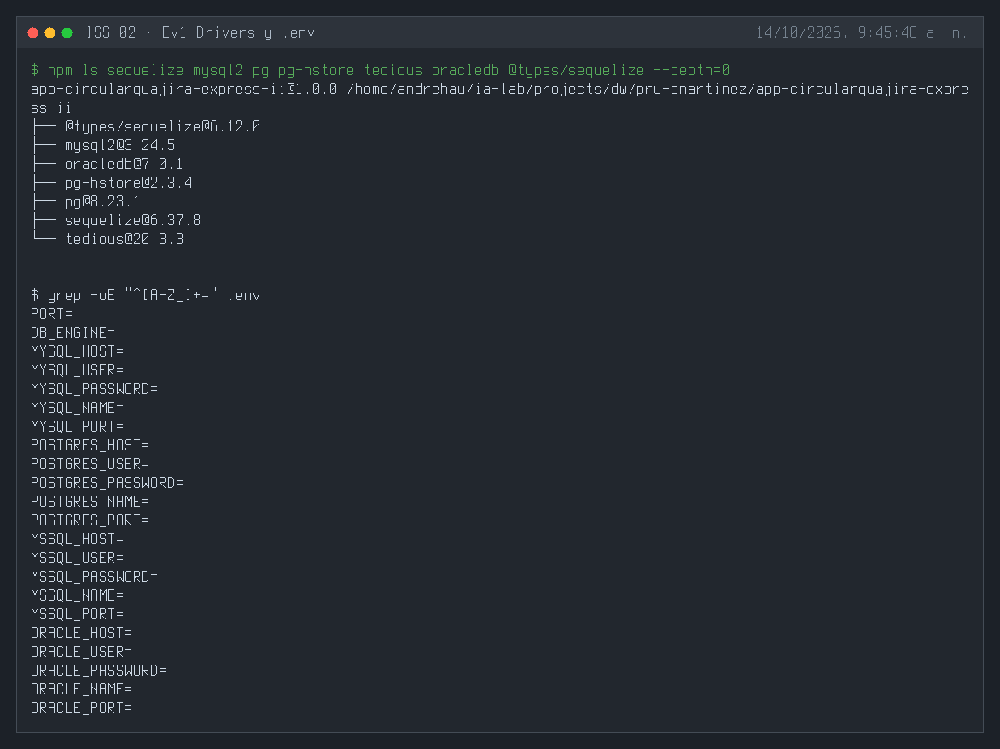

**Ev2 — db.ts:** `grep -nE '^export' src/database/db.ts` muestra `sequelize`, `getDatabaseInfo` y `testConnection`.

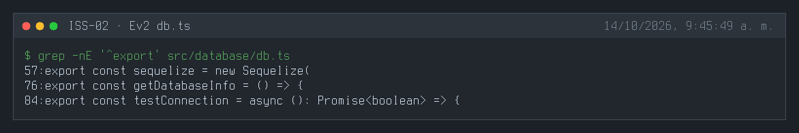

**Ev3 — Seeders:** `src/database/seeders/` solo contiene `.gitkeep`.

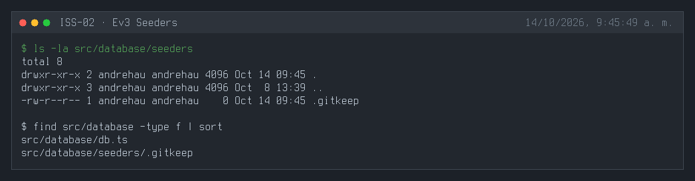

**Ev4 — Type-check y arranque:** `npx tsc --noEmit` sin errores y `npm run dev` arranca en el puerto 4000.

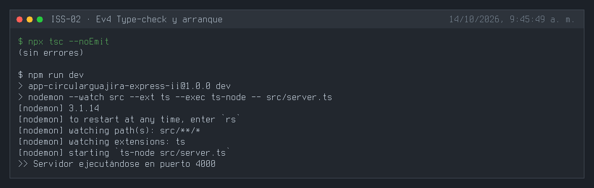

### Commit

```bash
git add package.json package-lock.json \
  src/database/db.ts src/database/seeders/.gitkeep \
  docs/PROCESO.md docs/images/Ev2-ISS-01.png \
  docs/images/Ev1-ISS-02.png docs/images/Ev2-ISS-02.png \
  docs/images/Ev3-ISS-02.png docs/images/Ev4-ISS-02.png
git commit -m "ISS-02: Infraestructura de base de datos"
git push origin main
```

Commit: [`831539d`](https://github.com/DW-2026-IISem/dw-2026-Andreushin/commit/831539d2daa1a13bf9152ed97ed9dfcb42b23da1)

### ISS-03 — Feature `collectors` (recicladores)

Implementar la gestión de recicladores y organizaciones mediante las capas Controller → Service → Repository → Model. Definir relaciones y validaciones del dominio, además de las operaciones API necesarias.

**Verificación:** persistencia, validaciones y respuestas de error probadas.

Se divide en cinco partes: A (fundación), B (getAll y getOne), C (create), D (update PUT/PATCH) y E (delete físico y lógico).

### ISS-03-A — Feature collectors: fundación

Dejar el feature listo para el CRUD: modelo `Recycler`, esqueleto de capas, carpeta `http/`, agregador de rutas y sync con la base.

Criterios de aceptación (ISS-03-A)

- [x] `recycler.model.ts` con enum `active`/`inactive` (default `inactive`) y `timestamps: true`
- [x] Esqueleto de controller, routes, service, repository y DTO; carpeta `http/` creada
- [x] `src/routes/index.ts` con `recyclersRoutes` y cableado en `src/config/index.ts` (rutas, conexión y sync)
- [x] `npm run dev` conecta, sincroniza y responde en `/health`
- [x] npx tsc --noEmit sin errores al cerrar el ISS

### Pasos

```bash
mkdir -p src/features/business/collectors/{dto,http} src/shared/{errors,http} src/routes
touch src/features/business/collectors/http/.gitkeep

# recycler.model.ts: name, documentNumber (único), recyclerType, phone, email, address, status
# dto/recycler.dto.ts: RecyclerInputDto (POST/PUT) y RecyclerPatchDto (PATCH)
# recyclers.{repository,service,controller,routes}.ts: esqueleto con bloques READ/CREATE/UPDATE/DELETE
# src/shared/errors/httpError.ts y src/shared/http/handleError.ts: errores HTTP y su respuesta JSON
# src/routes/index.ts: agregador Routes con recyclersRoutes
# src/config/index.ts: routePrv, registro de rutas, testConnection y sequelize.sync()
```

### Verificación del ISS

```bash
test -d src/features/business/collectors/http && echo HTTP_FOLDER_OK
npx tsc --noEmit
npm run dev
curl -s localhost:4000/health
```

**Verificación:** el servidor arranca, crea la tabla `recyclers` y deja el feature registrado sin endpoints todavía.

#### Evidencias

**Ev1 — Modelo Recycler:** `grep` del modelo muestra los enums, `defaultValue: "inactive"` y `timestamps: true`; `DESCRIBE recyclers` en el contenedor MySQL muestra las columnas snake_case con `document_number` único.

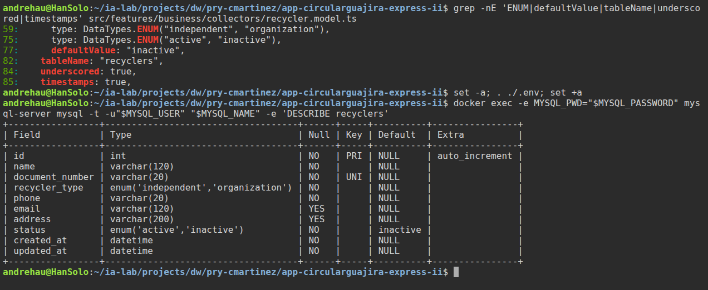

**Ev2 — Esqueleto y carpeta http:** `git ls-tree` del commit del ISS-03-A lista dto, model, controller, repository, routes, service y los errores compartidos; imprime `HTTP_FOLDER_OK`.

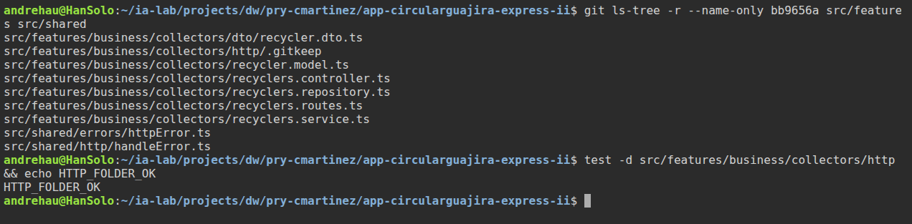

**Ev3 — Agregador y cableado:** `src/routes/index.ts` exporta `recyclersRoutes`; `config/index.ts` usa `routePrv`, `testConnection` y `sequelize.sync()`.

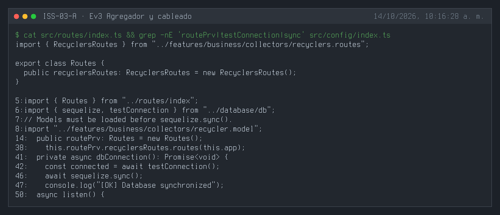

**Ev4 — npm run dev:** conecta a MySQL, sincroniza la base y `/health` responde `{"status":"ok"}`.

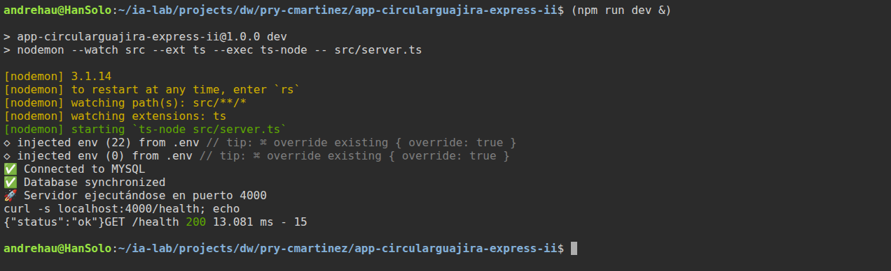

**Ev5 — Type-check:** `npx tsc --noEmit` termina sin errores.

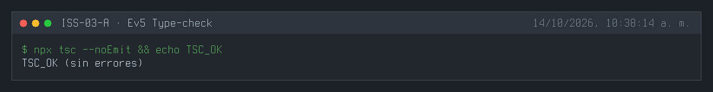

### Commit

```bash
git add src/config/index.ts src/routes/index.ts \
  src/shared/errors/httpError.ts src/shared/http/handleError.ts \
  src/features/business/collectors/recycler.model.ts \
  src/features/business/collectors/dto/recycler.dto.ts \
  src/features/business/collectors/http/.gitkeep \
  src/features/business/collectors/recyclers.repository.ts \
  src/features/business/collectors/recyclers.service.ts \
  src/features/business/collectors/recyclers.controller.ts \
  src/features/business/collectors/recyclers.routes.ts \
  docs/PROCESO.md docs/images/Ev1-ISS-03-A.png docs/images/Ev2-ISS-03-A.png \
  docs/images/Ev3-ISS-03-A.png docs/images/Ev4-ISS-03-A.png docs/images/Ev5-ISS-03-A.png
git commit -m "ISS-03-A: Feature collectors: fundación"
git push origin main
```

Commit: [`bb9656a`](https://github.com/DW-2026-IISem/dw-2026-Andreushin/commit/bb9656a42914b4373116ab5081c4f67cafdea638)

### ISS-03-B — Feature collectors: getAll y getOne

Listar los recicladores activos y obtener uno por id, pasando por controller → service → repository.

Criterios de aceptación (ISS-03-B)

- [x] Repository (`findAllActive`, `findActiveById`), service y controller con `getAll` y `getOne`
- [x] Rutas `GET /api/recyclers` y `GET /api/recyclers/:id` registradas
- [x] Archivo `http/recyclers.read.http` con las peticiones de lectura
- [x] getAll devuelve solo activos; getOne responde 200, 404 (inexistente o inactivo) y 400 (id inválido)
- [x] npx tsc --noEmit sin errores al cerrar el ISS

### Pasos

```bash
# src/shared/http/parseId.ts: valida que el id sea entero positivo (400 si no)
# recyclers.repository.ts: findAllActive y findActiveById (status = active)
# recyclers.service.ts: getAll y getOne (NotFoundError si no existe o está inactivo)
# recyclers.controller.ts: getAll y getOne bajo READ, errores vía handleError
# recyclers.routes.ts: GET /api/recyclers y GET /api/recyclers/:id
# http/recyclers.read.http: peticiones de prueba
```

### Verificación del ISS

```bash
npm run dev
curl -s http://localhost:4000/api/recyclers
curl -s http://localhost:4000/api/recyclers/1
```

**Verificación:** la lista excluye los inactivos y los errores de id llegan como JSON con su código HTTP.

#### Evidencias

**Ev1 — Capas:** `grep` muestra `findAllActive`/`findActiveById` en el repository, `getAll`/`getOne` en service y controller.

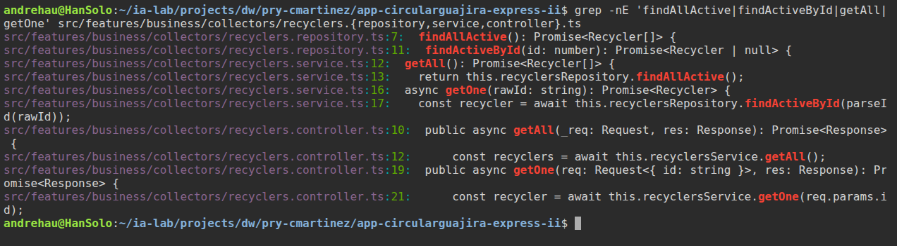

**Ev2 — Rutas GET:** `recyclers.routes.ts` registra `/api/recyclers` y `/api/recyclers/:id` con `.get`.

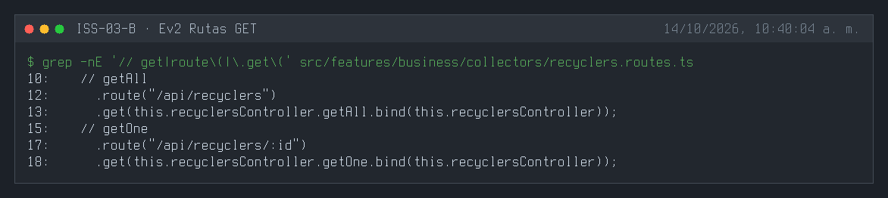

**Ev3 — Archivo HTTP:** `recyclers.read.http` con getAll, getOne, id inexistente e id inválido.

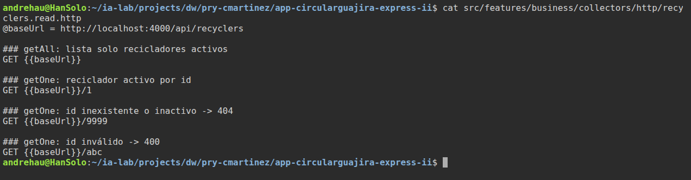

**Ev4 — Verificación curl:** getAll lista los ids 1 y 2 (activos); `/1` → 200, `/3` (inactivo) → 404 y `/abc` → 400 con su mensaje.

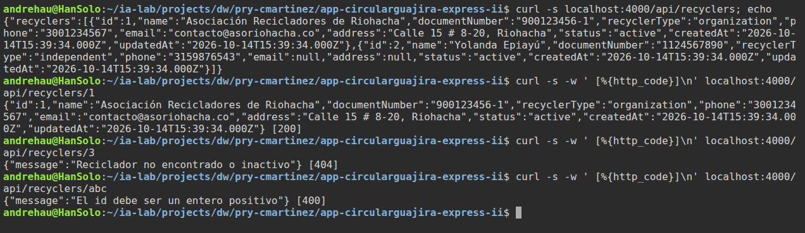

**Ev5 — Type-check:** `npx tsc --noEmit` termina sin errores.


### Commit

```bash
git add src/shared/http/parseId.ts \
  src/features/business/collectors/recyclers.repository.ts \
  src/features/business/collectors/recyclers.service.ts \
  src/features/business/collectors/recyclers.controller.ts \
  src/features/business/collectors/recyclers.routes.ts \
  src/features/business/collectors/http/recyclers.read.http \
  docs/PROCESO.md docs/images/Ev1-ISS-03-B.png docs/images/Ev2-ISS-03-B.png \
  docs/images/Ev3-ISS-03-B.png docs/images/Ev4-ISS-03-B.png docs/images/Ev5-ISS-03-B.png
git commit -m "ISS-03-B: Feature collectors: getAll y getOne"
git push origin main
```

Commit: [`edaef70`](https://github.com/DW-2026-IISem/dw-2026-Andreushin/commit/edaef701472e36e90b9315601e05abe5b625dfd9)

### ISS-03-C — Feature collectors: create

Dar de alta recicladores vía API validando el cuerpo y la unicidad del documento.

Criterios de aceptación (ISS-03-C)

- [x] Validación `parseRecyclerInput`, repository `create`, service con 409 por documento duplicado y controller con 201
- [x] Ruta `POST /api/recyclers` registrada
- [x] Archivo `http/recyclers.create.http` con altas válidas e inválidas
- [x] create responde 201 (sin `status` queda `inactive`), 409 si el documento existe y 400 ante campos faltantes o inválidos
- [x] npx tsc --noEmit sin errores al cerrar el ISS

### Pasos

```bash
# dto/recycler.validation.ts: parseRecyclerInput (obligatorios, longitudes, formato de documento,
#   teléfono y email, enums recyclerType/status) -> BadRequestError
# recyclers.repository.ts: findByDocumentNumber y create
# recyclers.service.ts: create + ensureDocumentIsFree (ConflictError)
# recyclers.controller.ts: create bajo CREATE, responde 201
# recyclers.routes.ts: POST /api/recyclers
# http/recyclers.create.http: peticiones de prueba
```

### Verificación del ISS

```bash
curl -s -X POST localhost:4000/api/recyclers -H "Content-Type: application/json" \
  -d '{"name":"Rosa Uriana","documentNumber":"1125678901","recyclerType":"independent","phone":"3112345678"}'
```

**Verificación:** el alta persiste solo datos válidos y el documento no se repite.

#### Evidencias

**Ev1 — Capas create:** `grep` muestra `parseRecyclerInput`, `create` en repository/service/controller, `ensureDocumentIsFree` con `ConflictError` y `status(201)`.

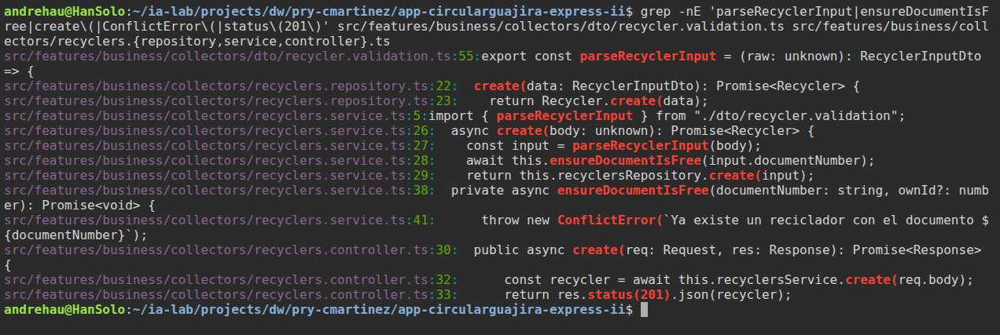

**Ev2 — Ruta POST:** `recyclers.routes.ts` registra `/api/recyclers` con `.post`.

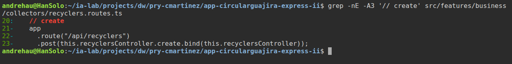

**Ev3 — Archivo HTTP:** `recyclers.create.http` con alta activa, alta sin status, documento duplicado y tipo inválido.

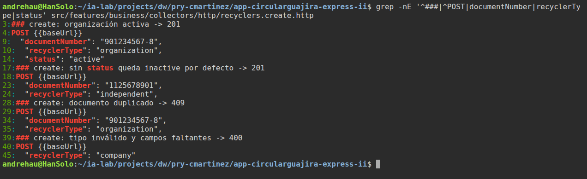

**Ev4 — Verificación curl:** dos altas → 201 (la segunda queda `inactive`), documento repetido → 409, sin documento → 400 y `recyclerType` inválido → 400.

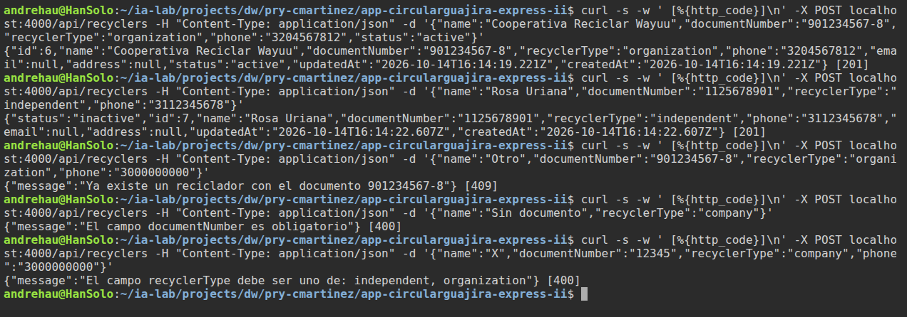

**Ev5 — Type-check:** `npx tsc --noEmit` termina sin errores.


### Commit

```bash
git add src/features/business/collectors/dto/recycler.validation.ts \
  src/features/business/collectors/recyclers.repository.ts \
  src/features/business/collectors/recyclers.service.ts \
  src/features/business/collectors/recyclers.controller.ts \
  src/features/business/collectors/recyclers.routes.ts \
  src/features/business/collectors/http/recyclers.create.http \
  docs/PROCESO.md docs/images/Ev1-ISS-03-C.png docs/images/Ev2-ISS-03-C.png \
  docs/images/Ev3-ISS-03-C.png docs/images/Ev4-ISS-03-C.png docs/images/Ev5-ISS-03-C.png
git commit -m "ISS-03-C: Feature collectors: create"
git push origin main
```

Commit: [`b7f3fc6`](https://github.com/DW-2026-IISem/dw-2026-Andreushin/commit/b7f3fc66d778ecf1c61167419d8c34789e108842)

### ISS-03-D — Feature collectors: update PUT y PATCH

Actualizar recicladores de forma completa (PUT) y parcial (PATCH), manteniendo la unicidad del documento.

Criterios de aceptación (ISS-03-D)

- [x] Validación `parseRecyclerPatch`, repository `findById`/`update`, service y controller con `update` y `patch`
- [x] Rutas `PUT` y `PATCH /api/recyclers/:id` registradas
- [x] Archivo `http/recyclers.update.http` con casos válidos e inválidos
- [x] PUT/PATCH responden 200; 400 por campos faltantes o cuerpo vacío, 409 por documento ajeno y 404 si no existe
- [x] npx tsc --noEmit sin errores al cerrar el ISS

### Pasos

```bash
# dto/recycler.validation.ts: parseRecyclerPatch (valida solo los campos enviados, exige al menos uno)
# recyclers.repository.ts: findById (cualquier estado, permite reactivar) y update
# recyclers.service.ts: update (PUT, payload completo) y patch (PATCH), findExisting -> 404,
#   ensureDocumentIsFree excluyendo el propio id -> 409
# recyclers.controller.ts: update y patch bajo UPDATE, responden 200
# recyclers.routes.ts: PUT y PATCH /api/recyclers/:id
# http/recyclers.update.http: peticiones de prueba
```

### Verificación del ISS

```bash
curl -s -X PATCH localhost:4000/api/recyclers/3 -H "Content-Type: application/json" \
  -d '{"status":"active","email":"luis.pushaina@correo.co"}'
```

**Verificación:** PUT exige el payload completo, PATCH cambia solo lo enviado y ningún cambio duplica un documento.

#### Evidencias

**Ev1 — Capas update:** `grep` muestra `parseRecyclerPatch`, `findById`, `findExisting` y los métodos `update`/`patch` en repository, service y controller.

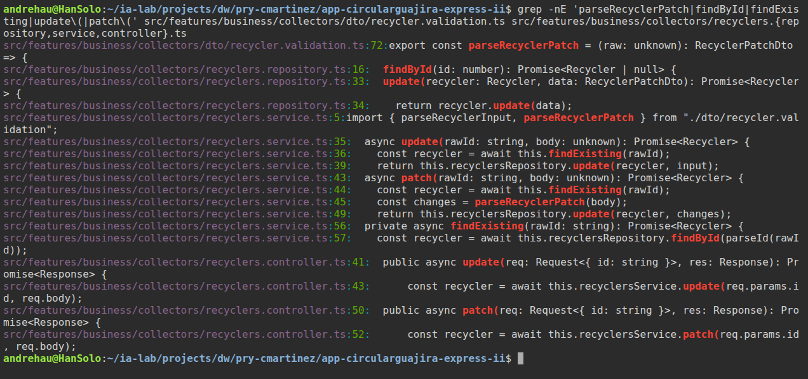

**Ev2 — Rutas PUT/PATCH:** `recyclers.routes.ts` registra `/api/recyclers/:id` con `.put` y `.patch`.

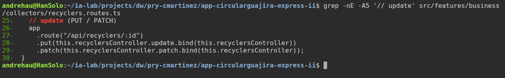

**Ev3 — Archivo HTTP:** `recyclers.update.http` con los seis casos de PUT y PATCH.

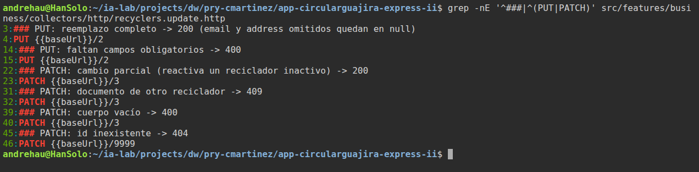

**Ev4 — Verificación curl:** PUT id 2 → 200 (email/address en null), PUT incompleto → 400, PATCH id 3 reactiva y agrega email → 200, documento ajeno → 409, cuerpo vacío → 400, id 9999 → 404.

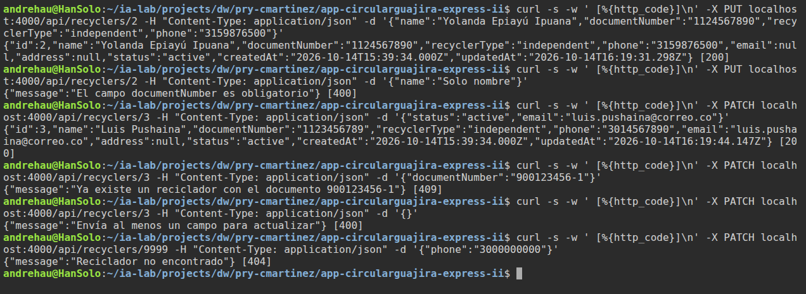

**Ev5 — Type-check:** `npx tsc --noEmit` termina sin errores.


### Commit

```bash
git add src/features/business/collectors/dto/recycler.validation.ts \
  src/features/business/collectors/recyclers.repository.ts \
  src/features/business/collectors/recyclers.service.ts \
  src/features/business/collectors/recyclers.controller.ts \
  src/features/business/collectors/recyclers.routes.ts \
  src/features/business/collectors/http/recyclers.update.http \
  docs/PROCESO.md docs/images/Ev1-ISS-03-D.png docs/images/Ev2-ISS-03-D.png \
  docs/images/Ev3-ISS-03-D.png docs/images/Ev4-ISS-03-D.png docs/images/Ev5-ISS-03-D.png
git commit -m "ISS-03-D: Feature collectors: update PUT y PATCH"
git push origin main
```

Commit: [`f2cea67`](https://github.com/DW-2026-IISem/dw-2026-Andreushin/commit/f2cea6791629cea2689bd363061fd46a62a1b589)

### ISS-03-E — Feature collectors: delete físico y lógico

Eliminar recicladores de forma física (`DELETE`) o lógica (`status = inactive`), cerrando el CRUD del feature.

Criterios de aceptación (ISS-03-E)

- [x] Repository `delete`, service y controller con `delete` (físico) y `deactivate` (lógico)
- [x] Rutas `DELETE /api/recyclers/:id` y `PATCH /api/recyclers/:id/deactivate` registradas
- [x] Archivo `http/recyclers.delete.http` con baja lógica, listado y borrado físico
- [x] deactivate → 200 y el reciclador sale del listado; delete → 200 y luego 404; id inválido → 400
- [x] npx tsc --noEmit sin errores al cerrar el ISS

### Pasos

```bash
# recyclers.repository.ts: delete (destroy)
# recyclers.service.ts: delete (físico) y deactivate (update status = inactive), ambos con findExisting -> 404
# recyclers.controller.ts: delete y deactivate bajo DELETE, responden 200
# recyclers.routes.ts: DELETE /api/recyclers/:id y PATCH /api/recyclers/:id/deactivate
# http/recyclers.delete.http: peticiones de prueba
```

### Verificación del ISS

```bash
curl -i -X PATCH http://localhost:4000/api/recyclers/6/deactivate
curl -i http://localhost:4000/api/recyclers
curl -i -X DELETE http://localhost:4000/api/recyclers/7
```

**Verificación:** la baja lógica conserva el registro fuera de los listados y el borrado físico lo elimina.

#### Evidencias

**Ev1 — Capas delete:** `grep` muestra `delete` con `destroy()` en el repository y `delete`/`deactivate` (status `"inactive"`) en service y controller.

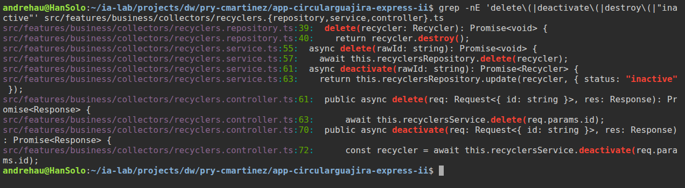

**Ev2 — Rutas DELETE/deactivate:** `recyclers.routes.ts` registra `.delete` en `/api/recyclers/:id` y `.patch` en `/api/recyclers/:id/deactivate`.

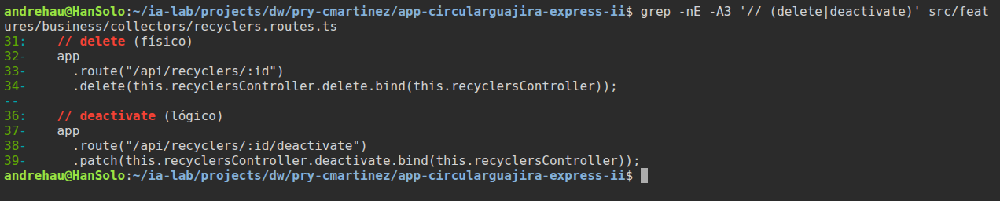

**Ev3 — Archivo HTTP:** `recyclers.delete.http` con deactivate, getAll y dos DELETE.

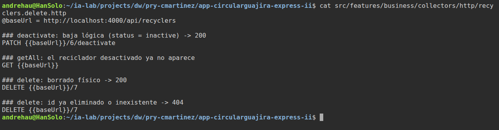

**Ev4 — Verificación curl:** deactivate del id 6 → 200 con `status: inactive`; getAll ya no lo lista; DELETE id 7 → 200, repetido → 404; `/abc/deactivate` → 400.

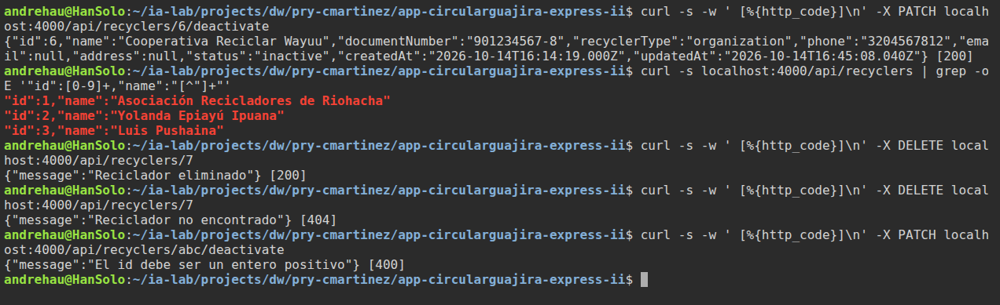

**Ev5 — Type-check:** `npx tsc --noEmit` termina sin errores.


### Commit

```bash
git add src/features/business/collectors/recyclers.repository.ts \
  src/features/business/collectors/recyclers.service.ts \
  src/features/business/collectors/recyclers.controller.ts \
  src/features/business/collectors/recyclers.routes.ts \
  src/features/business/collectors/http/recyclers.delete.http \
  docs/PROCESO.md docs/images/Ev1-ISS-03-E.png docs/images/Ev2-ISS-03-E.png \
  docs/images/Ev3-ISS-03-E.png docs/images/Ev4-ISS-03-E.png docs/images/Ev5-ISS-03-E.png
git commit -m "ISS-03-E: Feature collectors: delete físico y lógico"
git push origin main
```

Commit: [`575f7b6`](https://github.com/DW-2026-IISem/dw-2026-Andreushin/commit/575f7b69943ead8570ac3daab7e6b5c579da01b4)

### ISS-04 — Seeders con Faker

Crear seeders repetibles con datos de desarrollo para materiales, rutas, tarifas vigentes y recicladores. Mantener las relaciones válidas y evitar duplicados al volver a ejecutarlos.

**Verificación:** los seeders se ejecutan en orden y generan datos relacionados utilizables en pruebas.

En este ISS se crea el runner y el seeder de recicladores (única feature existente). Materiales, tarifas y rutas suman su seeder en ISS-06 e ISS-07 con el mismo patrón: archivo `<plural>.seeder.ts` en el feature, clave en `counts.ts` y llamada en el runner.

Criterios de aceptación (ISS-04)

- [x] `collectors/recyclers.seeder.ts` con @faker-js/faker, recibe `count` y es idempotente
- [x] `src/database/seeders/index.ts` (SeedersRunner) llama a los seeders de las features; script `db:seed` en package.json
- [x] `src/database/seeders/counts.ts` con la cantidad por entidad (default / env / CLI)
- [x] `npm run db:seed` funciona y al repetirlo no duplica
- [x] Se puede variar la cantidad: `npm run db:seed -- --recyclers=N` o `SEED_RECYCLERS=N`
- [x] npx tsc --noEmit sin errores al cerrar el ISS

### Pasos

```bash
npm install -D @faker-js/faker@^10.6.0

# features/business/collectors/recyclers.seeder.ts: seedRecyclers(count) con fakerES; count es el total
#   objetivo e inserta solo lo que falta. Replica los formatos de la validación: cédula o NIT con
#   dígito de verificación (únicos), celular 3XXXXXXXXX, municipios de La Guajira, ~80 % activos
# src/database/seeders/counts.ts: SeedCounts, DEFAULT_SEED_COUNTS y resolveSeedCounts (CLI > env > default)
# src/database/seeders/index.ts: runAllSeeders (testConnection, sync sin alter, seeders en orden)
# package.json -> "db:seed": "ts-node -- src/database/seeders/index.ts"
git rm src/database/seeders/.gitkeep
```

### Verificación del ISS

```bash
npm run db:seed
npm run db:seed -- --recyclers=25
SEED_RECYCLERS=5 npm run db:seed
npx tsc --noEmit
```

#### Evidencias

**Ev1 — Seeder del feature:** `grep` muestra el import de `fakerES`, los formatos de NIT/cédula y celular, `seedRecyclers(count)`, el cálculo `count - existing` y `bulkCreate`.

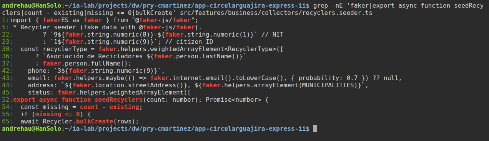

**Ev2 — Runner y script:** `index.ts` importa `seedRecyclers` y `resolveSeedCounts`, hace `sync()` y llama al seeder; `package.json` tiene `db:seed`.

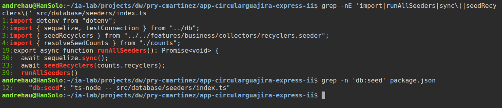

**Ev3 — Conteos:** `counts.ts` con `recyclers: 10` por defecto, lectura de `SEED_<ENTIDAD>` y de `--<entidad>=N`.

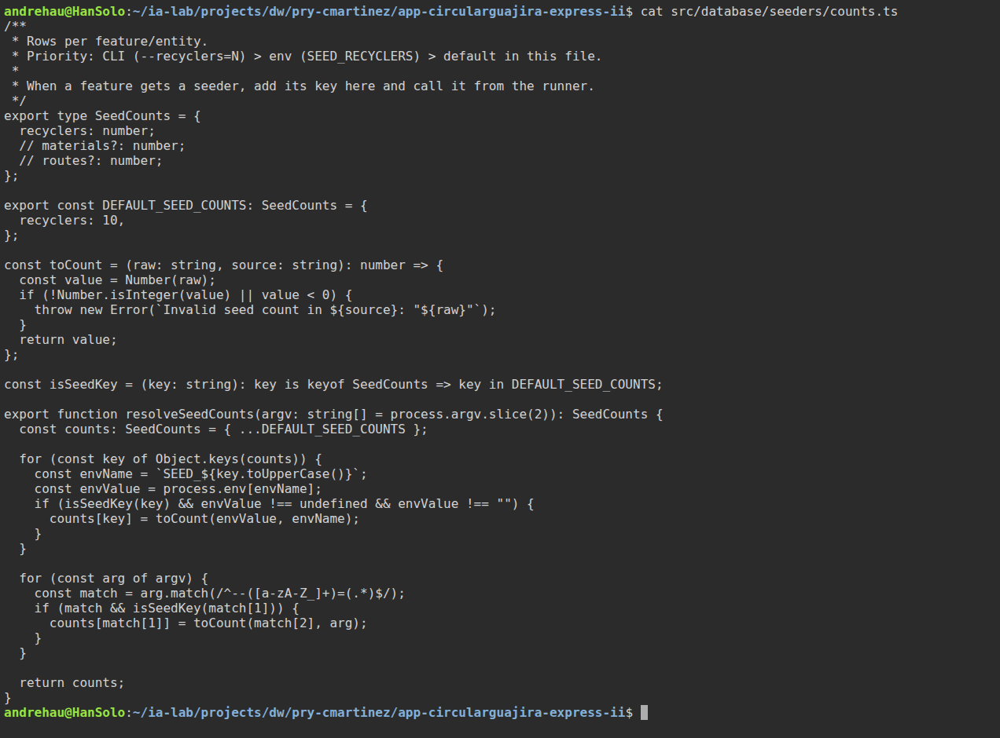

**Ev4 — db:seed:** la primera ejecución inserta 6 filas hasta completar 10; la segunda responde `already present ... skipped`.

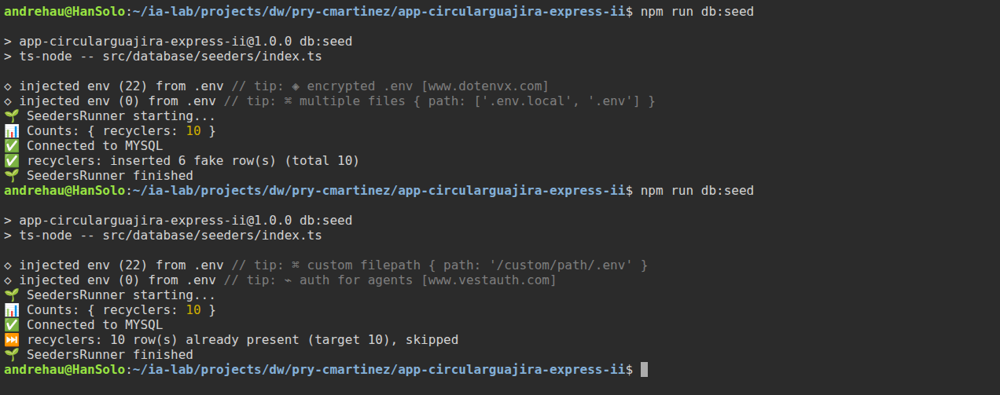

**Ev5 — Cantidad variable:** `--recyclers=25` inserta 5 (había 20 de una corrida previa con `--recyclers=20`), `SEED_RECYCLERS=5` se omite y MySQL cuenta 23 activos y 2 inactivos.

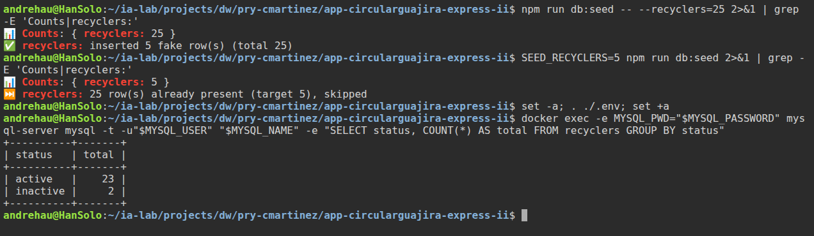

**Ev6 — Type-check:** `npx tsc --noEmit` termina sin errores.


### Commit

```bash
git add package.json package-lock.json \
  src/features/business/collectors/recyclers.seeder.ts \
  src/database/seeders/counts.ts src/database/seeders/index.ts \
  docs/PROCESO.md docs/images/Ev1-ISS-04.png docs/images/Ev2-ISS-04.png \
  docs/images/Ev3-ISS-04.png docs/images/Ev4-ISS-04.png docs/images/Ev5-ISS-04.png \
  docs/images/Ev6-ISS-04.png
git commit -m "ISS-04: Seeders con Faker"
git push origin main
```

### ISS-05 — Swagger / OpenAPI

Documentar rutas, parámetros, cuerpos, respuestas y errores mediante Swagger/OpenAPI. Mantener la especificación alineada con los endpoints implementados.

**Verificación:** documentación cargada y endpoints de la Fase I consultables.

### ISS-06 — Feature `materials` (materiales y `TarifaMaterial`)

Implementar el catálogo de materiales reciclables y sus tarifas, incluidas las fechas de vigencia. Definir cómo se determina la tarifa aplicable a una operación.

**Verificación:** relaciones y vigencia validadas; no se aplica una tarifa fuera del período establecido.

### ISS-07 — Feature `routes` (rutas y puntos de recolección)

Implementar la coordinación de rutas y sus puntos asociados, con validaciones de pertenencia y operaciones de consulta y administración.

**Verificación:** se pueden administrar y consultar rutas sin asociaciones inválidas.

### ISS-08 — Features `weighing` / `settlements` (recolección, pesaje y liquidación)

Implementar el flujo central: registrar la recolección, pesar por material, descontar la tara para obtener el peso neto, aplicar la tarifa vigente y generar una liquidación verificable. Guardar los valores y referencias usados en el cálculo para mantener trazabilidad; ejecutar escrituras relacionadas en una transacción.

**Verificación:** pruebas de peso neto, importe, tarifa aplicable, entradas inválidas y consistencia ante fallos.

### Compuerta `CIERRE-BUSINESS`

La Fase I se cierra cuando las features están integradas, las migraciones y seeders funcionan, OpenAPI documenta la API y las pruebas cubren el flujo desde la recolección hasta la liquidación. El dominio debe poder probarse sin autenticación en desarrollo. Registrar pendientes antes de iniciar la Fase II.

## Fase II · Auth con RBAC (planta y logística)

**Objetivo:** proteger la API y aplicar permisos por rol y recurso. Roles iniciales: `ADMIN`, `LOGISTICA`, `BASCULA`, `PLANTA` y `FINANZAS`.

### ISS-09 — Auth base (seguridad y modelos)

Definir la configuración de seguridad, el hashing de contraseñas y los modelos base de autenticación y autorización. Establecer validación de credenciales y respuestas seguras ante errores.

**Verificación:** secretos configurables por ambiente y contraseñas persistidas únicamente como hashes.

### ISS-10 — Feature `users` (identidad y contraseña)

Gestionar las identidades del personal de báscula, planta, logística y finanzas. Definir validaciones, unicidad y estados de usuario; no devolver ni registrar contraseñas en texto plano.

**Verificación:** altas y consultas cumplen las reglas de identidad y protegen credenciales.

### ISS-11 — Features `roles` y `resources`

Registrar los roles iniciales y los recursos/acciones protegidos. Incluir, entre otros, `POST /recolecciones`, `POST /pesajes`, `POST /lotes-material` y `POST /liquidaciones`. Definir la matriz de acceso según las responsabilidades del negocio.

**Verificación:** roles y recursos se inicializan de forma repetible y la matriz queda documentada.

### ISS-12 — Features `roleUsers` y `resourceRoles`

Implementar la asignación de roles a usuarios y de recursos/acciones a roles, respetando integridad y mínimo privilegio.

**Verificación:** asignaciones persistidas y permisos efectivos derivados correctamente.

### ISS-13 — Middlewares de acceso

Incorporar middlewares de autenticación y autorización en las rutas. Aplicar la matriz de acceso; por ejemplo, limitar el registro de pesajes a `BASCULA` y la aprobación de liquidaciones a `FINANZAS`.

**Verificación:** pruebas de acceso permitido y denegado por endpoint; las solicitudes no autorizadas no ejecutan la operación.

### ISS-14 — Feature `refreshTokens` (sesiones)

Gestionar sesiones y tokens de renovación, con expiración, rotación y revocación. Proteger su almacenamiento y evitar renovar sesiones invalidadas.

**Verificación:** renovación, expiración y revocación probadas.

### ISS-15 — Feature `session` (login y perfil)

Implementar inicio de sesión, renovación de sesión y consulta del perfil autenticado con roles y permisos efectivos. Excluir credenciales e información sensible de las respuestas.

**Verificación:** pruebas de login válido e inválido, perfil protegido y permisos devueltos.

### Compuerta `CIERRE-AUTH`

El backend se cierra cuando las features de negocio continúan funcionando protegidas por RBAC, los flujos de sesión están integrados, cada rol tiene permisos explícitos y existen pruebas de autenticación, autorización y negocio. Actualizar OpenAPI con los requisitos de autenticación y documentar la configuración necesaria para ejecutar el proyecto.

## Secuencia y entregables

1. Completar los bloques en orden, incorporando pruebas y migraciones con cada feature.
2. Integrar y verificar el dominio antes de habilitar seguridad: `CIERRE-BUSINESS`.
3. Incorporar usuarios, roles, permisos y sesiones; proteger las rutas y repetir las pruebas de negocio: `CIERRE-AUTH`.
4. Entregar en cada bloque código integrado, pruebas y documentación o configuración pertinente; registrar decisiones y pendientes del alcance.
