# Proceso de creación del backend de CircularGuajira

## Propósito y alcance

Este documento organiza en 16 bloques ISS la construcción del backend de **CircularGuajira**, plataforma para gestionar la cadena de reciclaje: recicladores y organizaciones, materiales y tarifas, rutas y puntos de recolección, recolecciones, pesajes y liquidaciones. La **Fase I** entrega el dominio funcional sin autenticación; la **Fase II** incorpora sesiones y autorización basada en roles (RBAC).

## Criterios técnicos

- Tecnologías: Node.js, Express, TypeScript, Sequelize y PostgreSQL o MySQL, según la configuración del proyecto.
- Organizar el código por *features* del dominio. Separar rutas, controller, service, repository, model, validaciones y pruebas cuando aplique.
- Mantener las reglas de negocio en services, la persistencia en repositories y el manejo HTTP en controllers y rutas.
- Configurar credenciales y secretos mediante variables de entorno; no guardarlos en el repositorio.
- Validar entradas, centralizar errores y probar reglas de negocio, integridad y permisos.
- Usar transacciones para operaciones que escriban registros relacionados y conservar la tarifa y los valores utilizados al generar una liquidación.

## Fase I · Business (dominio CircularGuajira)

**Objetivo:** implementar y documentar la API de negocio, verificable localmente y todavía sin autenticación.

### ISS-00 — Requisitos previos

Preparar Node.js, npm, TypeScript, Express, Sequelize y el motor relacional seleccionado. Definir configuración por ambiente y scripts de instalación, desarrollo, compilación y pruebas.

Criterios de aceptación (ISS-00)

- [x] node -v muestra v20+ (lab: v24.x)
- [x] npm -v responde
- [x] Motor de BD accesible (MySQL recomendado para el primer sync)

### Pasos

```bash
node -v && npm -v
docker ps --filter name=mysql-server
```

### Verificación del ISS

```bash
node -v && npm -v
```

**Verificación:** instalación limpia, compilación y arranque local; conexión configurable sin credenciales en el código.

#### Evidencias

**Ev1 — Node y npm:** `node -v && npm -v` devuelve v24.20.0 y 11.19.0.


**Ev2 — MySQL:** contenedor `mysql-server` (mysql:8.0) arriba y healthy en el puerto 3306.


### ISS-01 — Esqueleto del proyecto

Crear la aplicación Express y la estructura por *features* para el dominio de reciclaje. Separar configuración e infraestructura compartida, y centralizar el registro de rutas.

Criterios de aceptación (ISS-01)

- [x] 2.1 Existe package.json con "type": "commonjs" y scripts build / dev
- [x] 2.2 Árbol src/ con config, database/seeders, routes, shared, features/business/collectors (auth fuera de alcance de este lab)
- [x] 2.3 Dependencias Express/TS instaladas (npm ls --depth=0)
- [x] 2.4 Existe tsconfig.json (rootDir: ./src, outDir: ./dist, strict: true)
- [x] 2.5 Existen src/server.ts y src/config/index.ts (esqueleto App)
- [x] npx tsc --noEmit sin errores al cerrar el ISS

### Pasos

```bash
npm init -y
```

Parche a `package.json`: en `scripts` quedan solo `build` y `dev`, y se asegura `"type": "commonjs"`.

```json
{
  "scripts": {
    "build": "tsc",
    "dev": "nodemon --watch src --ext ts --exec ts-node -- src/server.ts"
  },
  "type": "commonjs"
}
```

```bash
node -e "const p=require('./package.json'); console.log(p.scripts)"
```

Estructura de carpetas por features:

```bash
mkdir -p \
  src/config \
  src/database/seeders \
  src/routes \
  src/shared/errors \
  src/shared/http \
  src/shared/database \
  src/features/business/collectors
find src -type d | sort
```

Dependencias base (TypeScript en 5.9.x por compatibilidad con ts-node):

```bash
npm install express@^5.2.1 cors@^2.8.6 dotenv@^17.4.2 morgan@^1.12.1

npm install -D typescript@~5.9.2 ts-node@^10.9.2 nodemon@^3.1.14 \
  @types/node@^22.20.3 @types/express@^5.0.6 \
  @types/cors@^2.8.19 @types/morgan@^1.9.10

npm ls --depth=0
```

`tsconfig.json`:

```bash
: > tsconfig.json
cat >> tsconfig.json << 'EOF'
{
  "compilerOptions": {
    "rootDir": "./src",
    "outDir": "./dist",
    "module": "commonjs",
    "target": "ES2020",
    "lib": ["ES2020"],
    "types": ["node"],
    "esModuleInterop": true,
    "resolveJsonModule": true,
    "sourceMap": true,
    "strict": true,
    "skipLibCheck": true,
    "moduleDetection": "force",
    "isolatedModules": true,
    "forceConsistentCasingInFileNames": true
  },
  "include": ["src/**/*"],
  "exclude": ["node_modules", "dist"]
}
EOF

test -f tsconfig.json && npx tsc --showConfig | head -20
```

Servidor y App (esqueleto: `dbConnection` y el registro de rutas quedan como placeholder hasta ISS-02/03):

```bash
: > src/server.ts
cat >> src/server.ts << 'EOF'
import { App } from './config/index';

async function main() {
    const app = new App();
    await app.listen();
}

main();
EOF

: > src/config/index.ts
cat >> src/config/index.ts << 'EOF'
import dotenv from "dotenv";
import express, { Application } from "express";
import morgan from "morgan";
import cors from "cors";

dotenv.config();

export class App {
  public app: Application;

  constructor(private port?: number | string) {
    this.app = express();
    this.settings();
    this.middlewares();
    this.routes();
  }

  private settings(): void {
    this.app.set("port", this.port || process.env.PORT || 4000);
  }

  private middlewares(): void {
    this.app.use(morgan("dev"));
    this.app.use(cors());
    this.app.use(express.json());
    this.app.use(express.urlencoded({ extended: false }));
  }

  private routes(): void {
    // Placeholder: las rutas de cada feature se registran desde src/routes/index.ts (ISS-03 en adelante).
    this.app.get("/health", (_req, res) => {
      res.json({ status: "ok" });
    });
  }

  private async dbConnection(): Promise<void> {
    // Placeholder: la conexión con Sequelize y el sync se agregan en ISS-02.
  }

  async listen() {
    await this.dbConnection();
    this.app.listen(this.app.get("port"));
    console.log(`🚀 Servidor ejecutándose en puerto ${this.app.get("port")}`);
  }
}
EOF
```

### Verificación del ISS

```bash
npx tsc --noEmit
find src -type f | sort
npm run dev
curl localhost:4000/health
```

**Verificación:** servidor inicia, responde a una ruta de salud y admite el registro modular de rutas.

#### Evidencias

**Ev1 — package.json:** `cat package.json` muestra `"type": "commonjs"` y los scripts `build` y `dev`.


**Ev2 — Estructura src/:** `find src -type d | sort` muestra config, database/seeders, routes, shared y features/business/collectors.


**Ev3 — Dependencias:** `npm ls --depth=0` lista express 5.2.1, cors, dotenv, morgan, typescript 5.9.3, ts-node, nodemon y los @types.


**Ev4 — tsconfig.json:** `cat tsconfig.json` muestra rootDir `./src`, outDir `./dist` y strict `true`.


**Ev5 — Esqueleto App:** `find src -type f | sort` muestra `src/config/index.ts` y `src/server.ts`; `npm run dev` levanta nodemon y ejecuta `ts-node src/server.ts`.


**Ev6 — Type-check:** `npx tsc --noEmit` termina sin errores.


### Commit

```bash
git add .gitignore package.json package-lock.json tsconfig.json \
  src/server.ts src/config/index.ts \
  docs/PROCESO.md docs/images/Ev1-ISS-00.png docs/images/Ev2-ISS-00.png \
  docs/images/Ev1-ISS-01.png docs/images/Ev2-ISS-01.png docs/images/Ev3-ISS-01.png \
  docs/images/Ev4-ISS-01.png docs/images/Ev5-ISS-01.png docs/images/Ev6-ISS-01.png
git commit -m "ISS-01: Esqueleto del proyecto"
git push origin main
```

Commit: [`db14ec1`](https://github.com/DW-2026-IISem/dw-2026-Andreushin/commit/db14ec17acb78c5fdee78c4daae177165bd1ba6f)

### ISS-02 — Infraestructura de base de datos

Configurar Sequelize, conexión, modelos, asociaciones y migraciones para la base relacional. Definir convenciones para claves, fechas, restricciones e índices.

Criterios de aceptación (ISS-02)

- [x] 3.1 Paquetes Sequelize/drivers instalados; existe .env con DB_ENGINE y bloques de motores
- [x] 3.2 Existe src/database/db.ts exportando sequelize, getDatabaseInfo, testConnection
- [x] 3.3 Existe carpeta src/database/seeders/ sin lógica implementada aún
- [x] npx tsc --noEmit sin errores al cerrar el ISS

### Pasos

```bash
npm install sequelize@^6.37.8 mysql2@^3.24.4 pg@^8.23.0 pg-hstore@^2.3.4 \
  tedious@^20.0.0 oracledb@^7.0.1
npm install -D @types/sequelize@^6.12.0

# .env: PORT, DB_ENGINE y bloques MYSQL_*, POSTGRES_*, MSSQL_*, ORACLE_* (no se versiona)
test -f .env && grep DB_ENGINE .env
npm ls sequelize mysql2 --depth=0

# src/database/db.ts: config por motor según DB_ENGINE, instancia sequelize,
# getDatabaseInfo (sin contraseña) y testConnection (sequelize.authenticate)
mkdir -p src/database/seeders
touch src/database/seeders/.gitkeep
```

### Verificación del ISS

```bash
npx tsc --noEmit
test -f src/database/db.ts && test -f .env && test -d src/database/seeders
npm run dev
```

**Verificación:** conexión comprobable y migraciones ejecutables; los errores no exponen secretos.

#### Evidencias

**Ev1 — Drivers y .env:** `npm ls --depth=0` lista sequelize 6.37.8, mysql2, pg, pg-hstore, tedious, oracledb y @types/sequelize; el `.env` tiene PORT, DB_ENGINE y los bloques MySQL/Postgres/MSSQL/Oracle (solo nombres de variables).


**Ev2 — db.ts:** `grep -nE '^export' src/database/db.ts` muestra `sequelize`, `getDatabaseInfo` y `testConnection`.


**Ev3 — Seeders:** `src/database/seeders/` solo contiene `.gitkeep`.


**Ev4 — Type-check y arranque:** `npx tsc --noEmit` sin errores y `npm run dev` arranca en el puerto 4000.


### Commit

```bash
git add package.json package-lock.json \
  src/database/db.ts src/database/seeders/.gitkeep \
  docs/PROCESO.md docs/images/Ev2-ISS-01.png \
  docs/images/Ev1-ISS-02.png docs/images/Ev2-ISS-02.png \
  docs/images/Ev3-ISS-02.png docs/images/Ev4-ISS-02.png
git commit -m "ISS-02: Infraestructura de base de datos"
git push origin main
```

Commit: [`831539d`](https://github.com/DW-2026-IISem/dw-2026-Andreushin/commit/831539d2daa1a13bf9152ed97ed9dfcb42b23da1)

### ISS-03 — Feature `collectors` (recicladores)

Implementar la gestión de recicladores y organizaciones mediante las capas Controller → Service → Repository → Model. Definir relaciones y validaciones del dominio, además de las operaciones API necesarias.

**Verificación:** persistencia, validaciones y respuestas de error probadas.

Se divide en cinco partes: A (fundación), B (getAll y getOne), C (create), D (update PUT/PATCH) y E (delete físico y lógico).

### ISS-03-A — Feature collectors: fundación

Dejar el feature listo para el CRUD: modelo `Recycler`, esqueleto de capas, carpeta `http/`, agregador de rutas y sync con la base.

Criterios de aceptación (ISS-03-A)

- [x] `recycler.model.ts` con enum `active`/`inactive` (default `inactive`) y `timestamps: true`
- [x] Esqueleto de controller, routes, service, repository y DTO; carpeta `http/` creada
- [x] `src/routes/index.ts` con `recyclersRoutes` y cableado en `src/config/index.ts` (rutas, conexión y sync)
- [x] `npm run dev` conecta, sincroniza y responde en `/health`
- [x] npx tsc --noEmit sin errores al cerrar el ISS

### Pasos

```bash
mkdir -p src/features/business/collectors/{dto,http} src/shared/{errors,http} src/routes
touch src/features/business/collectors/http/.gitkeep

# recycler.model.ts: name, documentNumber (único), recyclerType, phone, email, address, status
# dto/recycler.dto.ts: RecyclerInputDto (POST/PUT) y RecyclerPatchDto (PATCH)
# recyclers.{repository,service,controller,routes}.ts: esqueleto con bloques READ/CREATE/UPDATE/DELETE
# src/shared/errors/httpError.ts y src/shared/http/handleError.ts: errores HTTP y su respuesta JSON
# src/routes/index.ts: agregador Routes con recyclersRoutes
# src/config/index.ts: routePrv, registro de rutas, testConnection y sequelize.sync()
```

### Verificación del ISS

```bash
test -d src/features/business/collectors/http && echo HTTP_FOLDER_OK
npx tsc --noEmit
npm run dev
curl -s localhost:4000/health
```

**Verificación:** el servidor arranca, crea la tabla `recyclers` y deja el feature registrado sin endpoints todavía.

#### Evidencias

**Ev1 — Modelo Recycler:** `grep` del modelo muestra los enums, `defaultValue: "inactive"` y `timestamps: true`; `DESCRIBE recyclers` en el contenedor MySQL muestra las columnas snake_case con `document_number` único.


**Ev2 — Esqueleto y carpeta http:** `git ls-tree` del commit del ISS-03-A lista dto, model, controller, repository, routes, service y los errores compartidos; imprime `HTTP_FOLDER_OK`.


**Ev3 — Agregador y cableado:** `src/routes/index.ts` exporta `recyclersRoutes`; `config/index.ts` usa `routePrv`, `testConnection` y `sequelize.sync()`.


**Ev4 — npm run dev:** conecta a MySQL, sincroniza la base y `/health` responde `{"status":"ok"}`.


**Ev5 — Type-check:** `npx tsc --noEmit` termina sin errores.


### Commit

```bash
git add src/config/index.ts src/routes/index.ts \
  src/shared/errors/httpError.ts src/shared/http/handleError.ts \
  src/features/business/collectors/recycler.model.ts \
  src/features/business/collectors/dto/recycler.dto.ts \
  src/features/business/collectors/http/.gitkeep \
  src/features/business/collectors/recyclers.repository.ts \
  src/features/business/collectors/recyclers.service.ts \
  src/features/business/collectors/recyclers.controller.ts \
  src/features/business/collectors/recyclers.routes.ts \
  docs/PROCESO.md docs/images/Ev1-ISS-03-A.png docs/images/Ev2-ISS-03-A.png \
  docs/images/Ev3-ISS-03-A.png docs/images/Ev4-ISS-03-A.png docs/images/Ev5-ISS-03-A.png
git commit -m "ISS-03-A: Feature collectors: fundación"
git push origin main
```

Commit: [`bb9656a`](https://github.com/DW-2026-IISem/dw-2026-Andreushin/commit/bb9656a42914b4373116ab5081c4f67cafdea638)

### ISS-03-B — Feature collectors: getAll y getOne

Listar los recicladores activos y obtener uno por id, pasando por controller → service → repository.

Criterios de aceptación (ISS-03-B)

- [x] Repository (`findAllActive`, `findActiveById`), service y controller con `getAll` y `getOne`
- [x] Rutas `GET /api/recyclers` y `GET /api/recyclers/:id` registradas
- [x] Archivo `http/recyclers.read.http` con las peticiones de lectura
- [x] getAll devuelve solo activos; getOne responde 200, 404 (inexistente o inactivo) y 400 (id inválido)
- [x] npx tsc --noEmit sin errores al cerrar el ISS

### Pasos

```bash
# src/shared/http/parseId.ts: valida que el id sea entero positivo (400 si no)
# recyclers.repository.ts: findAllActive y findActiveById (status = active)
# recyclers.service.ts: getAll y getOne (NotFoundError si no existe o está inactivo)
# recyclers.controller.ts: getAll y getOne bajo READ, errores vía handleError
# recyclers.routes.ts: GET /api/recyclers y GET /api/recyclers/:id
# http/recyclers.read.http: peticiones de prueba
```

### Verificación del ISS

```bash
npm run dev
curl -s http://localhost:4000/api/recyclers
curl -s http://localhost:4000/api/recyclers/1
```

**Verificación:** la lista excluye los inactivos y los errores de id llegan como JSON con su código HTTP.

#### Evidencias

**Ev1 — Capas:** `grep` muestra `findAllActive`/`findActiveById` en el repository, `getAll`/`getOne` en service y controller.


**Ev2 — Rutas GET:** `recyclers.routes.ts` registra `/api/recyclers` y `/api/recyclers/:id` con `.get`.


**Ev3 — Archivo HTTP:** `recyclers.read.http` con getAll, getOne, id inexistente e id inválido.


**Ev4 — Verificación curl:** getAll lista los ids 1 y 2 (activos); `/1` → 200, `/3` (inactivo) → 404 y `/abc` → 400 con su mensaje.


**Ev5 — Type-check:** `npx tsc --noEmit` termina sin errores.


### Commit

```bash
git add src/shared/http/parseId.ts \
  src/features/business/collectors/recyclers.repository.ts \
  src/features/business/collectors/recyclers.service.ts \
  src/features/business/collectors/recyclers.controller.ts \
  src/features/business/collectors/recyclers.routes.ts \
  src/features/business/collectors/http/recyclers.read.http \
  docs/PROCESO.md docs/images/Ev1-ISS-03-B.png docs/images/Ev2-ISS-03-B.png \
  docs/images/Ev3-ISS-03-B.png docs/images/Ev4-ISS-03-B.png docs/images/Ev5-ISS-03-B.png
git commit -m "ISS-03-B: Feature collectors: getAll y getOne"
git push origin main
```

Commit: [`edaef70`](https://github.com/DW-2026-IISem/dw-2026-Andreushin/commit/edaef701472e36e90b9315601e05abe5b625dfd9)

### ISS-03-C — Feature collectors: create

Dar de alta recicladores vía API validando el cuerpo y la unicidad del documento.

Criterios de aceptación (ISS-03-C)

- [x] Validación `parseRecyclerInput`, repository `create`, service con 409 por documento duplicado y controller con 201
- [x] Ruta `POST /api/recyclers` registrada
- [x] Archivo `http/recyclers.create.http` con altas válidas e inválidas
- [x] create responde 201 (sin `status` queda `inactive`), 409 si el documento existe y 400 ante campos faltantes o inválidos
- [x] npx tsc --noEmit sin errores al cerrar el ISS

### Pasos

```bash
# dto/recycler.validation.ts: parseRecyclerInput (obligatorios, longitudes, formato de documento,
#   teléfono y email, enums recyclerType/status) -> BadRequestError
# recyclers.repository.ts: findByDocumentNumber y create
# recyclers.service.ts: create + ensureDocumentIsFree (ConflictError)
# recyclers.controller.ts: create bajo CREATE, responde 201
# recyclers.routes.ts: POST /api/recyclers
# http/recyclers.create.http: peticiones de prueba
```

### Verificación del ISS

```bash
curl -s -X POST localhost:4000/api/recyclers -H "Content-Type: application/json" \
  -d '{"name":"Rosa Uriana","documentNumber":"1125678901","recyclerType":"independent","phone":"3112345678"}'
```

**Verificación:** el alta persiste solo datos válidos y el documento no se repite.

#### Evidencias

**Ev1 — Capas create:** `grep` muestra `parseRecyclerInput`, `create` en repository/service/controller, `ensureDocumentIsFree` con `ConflictError` y `status(201)`.


**Ev2 — Ruta POST:** `recyclers.routes.ts` registra `/api/recyclers` con `.post`.


**Ev3 — Archivo HTTP:** `recyclers.create.http` con alta activa, alta sin status, documento duplicado y tipo inválido.


**Ev4 — Verificación curl:** dos altas → 201 (la segunda queda `inactive`), documento repetido → 409, sin documento → 400 y `recyclerType` inválido → 400.


**Ev5 — Type-check:** `npx tsc --noEmit` termina sin errores.


### Commit

```bash
git add src/features/business/collectors/dto/recycler.validation.ts \
  src/features/business/collectors/recyclers.repository.ts \
  src/features/business/collectors/recyclers.service.ts \
  src/features/business/collectors/recyclers.controller.ts \
  src/features/business/collectors/recyclers.routes.ts \
  src/features/business/collectors/http/recyclers.create.http \
  docs/PROCESO.md docs/images/Ev1-ISS-03-C.png docs/images/Ev2-ISS-03-C.png \
  docs/images/Ev3-ISS-03-C.png docs/images/Ev4-ISS-03-C.png docs/images/Ev5-ISS-03-C.png
git commit -m "ISS-03-C: Feature collectors: create"
git push origin main
```

Commit: [`b7f3fc6`](https://github.com/DW-2026-IISem/dw-2026-Andreushin/commit/b7f3fc66d778ecf1c61167419d8c34789e108842)

### ISS-03-D — Feature collectors: update PUT y PATCH

Actualizar recicladores de forma completa (PUT) y parcial (PATCH), manteniendo la unicidad del documento.

Criterios de aceptación (ISS-03-D)

- [x] Validación `parseRecyclerPatch`, repository `findById`/`update`, service y controller con `update` y `patch`
- [x] Rutas `PUT` y `PATCH /api/recyclers/:id` registradas
- [x] Archivo `http/recyclers.update.http` con casos válidos e inválidos
- [x] PUT/PATCH responden 200; 400 por campos faltantes o cuerpo vacío, 409 por documento ajeno y 404 si no existe
- [x] npx tsc --noEmit sin errores al cerrar el ISS

### Pasos

```bash
# dto/recycler.validation.ts: parseRecyclerPatch (valida solo los campos enviados, exige al menos uno)
# recyclers.repository.ts: findById (cualquier estado, permite reactivar) y update
# recyclers.service.ts: update (PUT, payload completo) y patch (PATCH), findExisting -> 404,
#   ensureDocumentIsFree excluyendo el propio id -> 409
# recyclers.controller.ts: update y patch bajo UPDATE, responden 200
# recyclers.routes.ts: PUT y PATCH /api/recyclers/:id
# http/recyclers.update.http: peticiones de prueba
```

### Verificación del ISS

```bash
curl -s -X PATCH localhost:4000/api/recyclers/3 -H "Content-Type: application/json" \
  -d '{"status":"active","email":"luis.pushaina@correo.co"}'
```

**Verificación:** PUT exige el payload completo, PATCH cambia solo lo enviado y ningún cambio duplica un documento.

#### Evidencias

**Ev1 — Capas update:** `grep` muestra `parseRecyclerPatch`, `findById`, `findExisting` y los métodos `update`/`patch` en repository, service y controller.


**Ev2 — Rutas PUT/PATCH:** `recyclers.routes.ts` registra `/api/recyclers/:id` con `.put` y `.patch`.


**Ev3 — Archivo HTTP:** `recyclers.update.http` con los seis casos de PUT y PATCH.


**Ev4 — Verificación curl:** PUT id 2 → 200 (email/address en null), PUT incompleto → 400, PATCH id 3 reactiva y agrega email → 200, documento ajeno → 409, cuerpo vacío → 400, id 9999 → 404.


**Ev5 — Type-check:** `npx tsc --noEmit` termina sin errores.


### Commit

```bash
git add src/features/business/collectors/dto/recycler.validation.ts \
  src/features/business/collectors/recyclers.repository.ts \
  src/features/business/collectors/recyclers.service.ts \
  src/features/business/collectors/recyclers.controller.ts \
  src/features/business/collectors/recyclers.routes.ts \
  src/features/business/collectors/http/recyclers.update.http \
  docs/PROCESO.md docs/images/Ev1-ISS-03-D.png docs/images/Ev2-ISS-03-D.png \
  docs/images/Ev3-ISS-03-D.png docs/images/Ev4-ISS-03-D.png docs/images/Ev5-ISS-03-D.png
git commit -m "ISS-03-D: Feature collectors: update PUT y PATCH"
git push origin main
```

Commit: [`f2cea67`](https://github.com/DW-2026-IISem/dw-2026-Andreushin/commit/f2cea6791629cea2689bd363061fd46a62a1b589)

### ISS-03-E — Feature collectors: delete físico y lógico

Eliminar recicladores de forma física (`DELETE`) o lógica (`status = inactive`), cerrando el CRUD del feature.

Criterios de aceptación (ISS-03-E)

- [x] Repository `delete`, service y controller con `delete` (físico) y `deactivate` (lógico)
- [x] Rutas `DELETE /api/recyclers/:id` y `PATCH /api/recyclers/:id/deactivate` registradas
- [x] Archivo `http/recyclers.delete.http` con baja lógica, listado y borrado físico
- [x] deactivate → 200 y el reciclador sale del listado; delete → 200 y luego 404; id inválido → 400
- [x] npx tsc --noEmit sin errores al cerrar el ISS

### Pasos

```bash
# recyclers.repository.ts: delete (destroy)
# recyclers.service.ts: delete (físico) y deactivate (update status = inactive), ambos con findExisting -> 404
# recyclers.controller.ts: delete y deactivate bajo DELETE, responden 200
# recyclers.routes.ts: DELETE /api/recyclers/:id y PATCH /api/recyclers/:id/deactivate
# http/recyclers.delete.http: peticiones de prueba
```

### Verificación del ISS

```bash
curl -i -X PATCH http://localhost:4000/api/recyclers/6/deactivate
curl -i http://localhost:4000/api/recyclers
curl -i -X DELETE http://localhost:4000/api/recyclers/7
```

**Verificación:** la baja lógica conserva el registro fuera de los listados y el borrado físico lo elimina.

#### Evidencias

**Ev1 — Capas delete:** `grep` muestra `delete` con `destroy()` en el repository y `delete`/`deactivate` (status `"inactive"`) en service y controller.


**Ev2 — Rutas DELETE/deactivate:** `recyclers.routes.ts` registra `.delete` en `/api/recyclers/:id` y `.patch` en `/api/recyclers/:id/deactivate`.


**Ev3 — Archivo HTTP:** `recyclers.delete.http` con deactivate, getAll y dos DELETE.


**Ev4 — Verificación curl:** deactivate del id 6 → 200 con `status: inactive`; getAll ya no lo lista; DELETE id 7 → 200, repetido → 404; `/abc/deactivate` → 400.


**Ev5 — Type-check:** `npx tsc --noEmit` termina sin errores.


### Commit

```bash
git add src/features/business/collectors/recyclers.repository.ts \
  src/features/business/collectors/recyclers.service.ts \
  src/features/business/collectors/recyclers.controller.ts \
  src/features/business/collectors/recyclers.routes.ts \
  src/features/business/collectors/http/recyclers.delete.http \
  docs/PROCESO.md docs/images/Ev1-ISS-03-E.png docs/images/Ev2-ISS-03-E.png \
  docs/images/Ev3-ISS-03-E.png docs/images/Ev4-ISS-03-E.png docs/images/Ev5-ISS-03-E.png
git commit -m "ISS-03-E: Feature collectors: delete físico y lógico"
git push origin main
```

Commit: [`575f7b6`](https://github.com/DW-2026-IISem/dw-2026-Andreushin/commit/575f7b69943ead8570ac3daab7e6b5c579da01b4)

### ISS-04 — Seeders con Faker

Crear seeders repetibles con datos de desarrollo para materiales, rutas, tarifas vigentes y recicladores. Mantener las relaciones válidas y evitar duplicados al volver a ejecutarlos.

**Verificación:** los seeders se ejecutan en orden y generan datos relacionados utilizables en pruebas.

En este ISS se crea el runner y el seeder de recicladores (única feature existente). Materiales, tarifas y rutas suman su seeder en ISS-06 e ISS-07 con el mismo patrón: archivo `<plural>.seeder.ts` en el feature, clave en `counts.ts` y llamada en el runner.

Criterios de aceptación (ISS-04)

- [x] `collectors/recyclers.seeder.ts` con @faker-js/faker, recibe `count` y es idempotente
- [x] `src/database/seeders/index.ts` (SeedersRunner) llama a los seeders de las features; script `db:seed` en package.json
- [x] `src/database/seeders/counts.ts` con la cantidad por entidad (default / env / CLI)
- [x] `npm run db:seed` funciona y al repetirlo no duplica
- [x] Se puede variar la cantidad: `npm run db:seed -- --recyclers=N` o `SEED_RECYCLERS=N`
- [x] npx tsc --noEmit sin errores al cerrar el ISS

### Pasos

```bash
npm install -D @faker-js/faker@^10.6.0

# features/business/collectors/recyclers.seeder.ts: seedRecyclers(count) con fakerES; count es el total
#   objetivo e inserta solo lo que falta. Replica los formatos de la validación: cédula o NIT con
#   dígito de verificación (únicos), celular 3XXXXXXXXX, municipios de La Guajira, ~80 % activos
# src/database/seeders/counts.ts: SeedCounts, DEFAULT_SEED_COUNTS y resolveSeedCounts (CLI > env > default)
# src/database/seeders/index.ts: runAllSeeders (testConnection, sync sin alter, seeders en orden)
# package.json -> "db:seed": "ts-node -- src/database/seeders/index.ts"
git rm src/database/seeders/.gitkeep
```

### Verificación del ISS

```bash
npm run db:seed
npm run db:seed -- --recyclers=25
SEED_RECYCLERS=5 npm run db:seed
npx tsc --noEmit
```

#### Evidencias

**Ev1 — Seeder del feature:** `grep` muestra el import de `fakerES`, los formatos de NIT/cédula y celular, `seedRecyclers(count)`, el cálculo `count - existing` y `bulkCreate`.


**Ev2 — Runner y script:** `index.ts` importa `seedRecyclers` y `resolveSeedCounts`, hace `sync()` y llama al seeder; `package.json` tiene `db:seed`.


**Ev3 — Conteos:** `counts.ts` con `recyclers: 10` por defecto, lectura de `SEED_<ENTIDAD>` y de `--<entidad>=N`.


**Ev4 — db:seed:** la primera ejecución inserta 6 filas hasta completar 10; la segunda responde `already present ... skipped`.


**Ev5 — Cantidad variable:** `--recyclers=25` inserta 5 (había 20 de una corrida previa con `--recyclers=20`), `SEED_RECYCLERS=5` se omite y MySQL cuenta 23 activos y 2 inactivos.


**Ev6 — Type-check:** `npx tsc --noEmit` termina sin errores.


### Commit

```bash
git add package.json package-lock.json \
  src/features/business/collectors/recyclers.seeder.ts \
  src/database/seeders/counts.ts src/database/seeders/index.ts \
  docs/PROCESO.md docs/images/Ev1-ISS-04.png docs/images/Ev2-ISS-04.png \
  docs/images/Ev3-ISS-04.png docs/images/Ev4-ISS-04.png docs/images/Ev5-ISS-04.png \
  docs/images/Ev6-ISS-04.png
git commit -m "ISS-04: Seeders con Faker"
git push origin main
```

Commit: [`eb32d21`](https://github.com/DW-2026-IISem/dw-2026-Andreushin/commit/eb32d211f99dfeb2ea86db901905cefc5bffa485)

### ISS-05 — Swagger / OpenAPI

Documentar rutas, parámetros, cuerpos, respuestas y errores mediante Swagger/OpenAPI. Mantener la especificación alineada con los endpoints implementados.

**Verificación:** documentación cargada y endpoints de la Fase I consultables.

Cada feature documenta su API en `<plural>.swagger.ts`; un registry externo (`src/swagger`) las fusiona, igual que el SeedersRunner. Materiales y rutas se suman en ISS-06 e ISS-07.

Criterios de aceptación (ISS-05)

- [x] `collectors/recyclers.swagger.ts` con tags, paths y schemas de Recycler; endpoints marcados SIN AUTH
- [x] `src/swagger/index.ts` fusiona los módulos de las features (`buildOpenApiDocument`) y monta la UI (`setupSwagger`)
- [x] La App llama a `setupSwagger` desde el método `docs()`
- [x] `GET /api/docs` muestra Swagger UI
- [x] `GET /api/docs.json` devuelve el documento OpenAPI
- [x] npx tsc --noEmit sin errores al cerrar el ISS

### Pasos

```bash
npm install swagger-ui-express@^5.0.1
npm install -D @types/swagger-ui-express@^4.1.8
mkdir -p src/swagger

# features/business/collectors/recyclers.swagger.ts: tag Recicladores, 7 operaciones con sus
#   códigos reales (200/201/400/404/409) y schemas Recycler, RecyclerInput y RecyclerPatch
# src/swagger/index.ts: featureSwaggerModules, ErrorResponse compartido, buildOpenApiDocument
#   (OpenAPI 3.0.3) y setupSwagger (/api/docs y /api/docs.json)
# src/config/index.ts: import de setupSwagger, this.docs() en el constructor y método docs()
```

### Verificación del ISS

```bash
curl -s http://localhost:4000/api/docs.json | head -c 400
# navegador: http://localhost:4000/api/docs
npx tsc --noEmit
```

#### Evidencias

**Ev1 — Docs del feature:** `recyclers.swagger.ts` exporta `recyclersSwagger` con `tags`, los paths `/api/recyclers`, `/{id}` y `/{id}/deactivate`, cada operación con "SIN AUTH" y los schemas `Recycler`, `RecyclerInput` y `RecyclerPatch`.

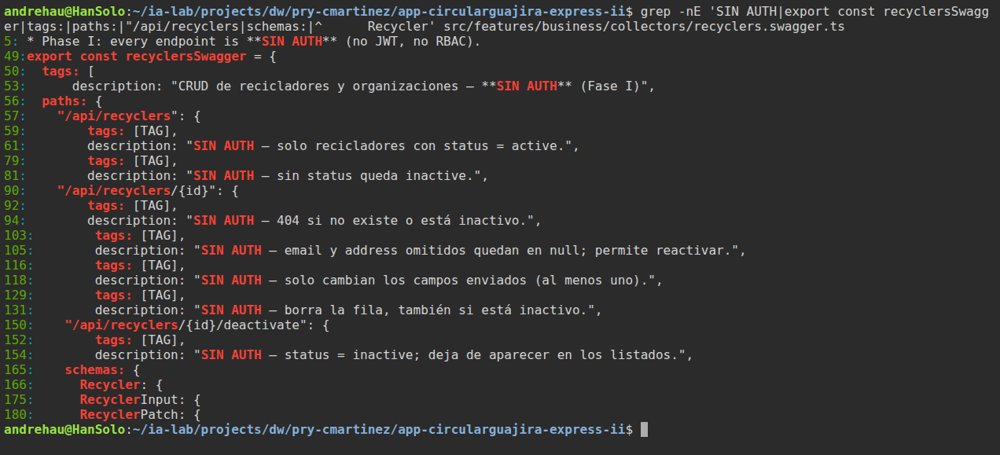

**Ev2 — Registry:** `src/swagger/index.ts` importa `recyclersSwagger`, lo fusiona con `Object.assign` en `buildOpenApiDocument` (OpenAPI 3.0.3, "CircularGuajira API") y `setupSwagger` monta `/api/docs.json` y `/api/docs`.

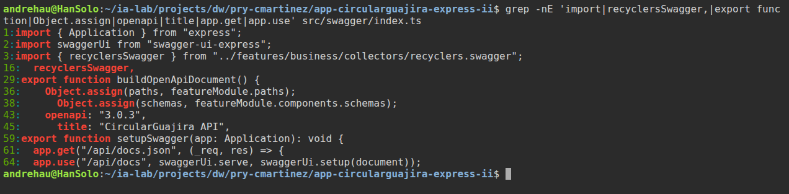

**Ev3 — Montaje en la App:** `config/index.ts` importa `setupSwagger`, llama a `this.docs()` y el método `docs()` lo invoca.

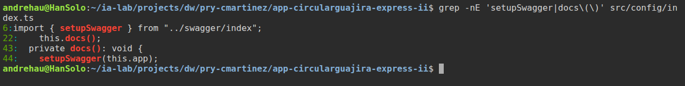

**Ev4 — Swagger UI:** el navegador en `http://localhost:4000/api/docs` muestra "CircularGuajira API", el tag Recicladores (SIN AUTH) con los 7 endpoints y los 4 schemas.

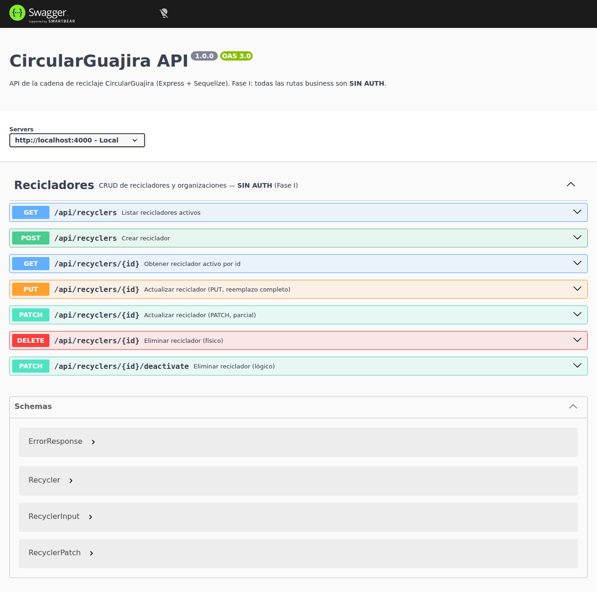

**Ev5 — OpenAPI JSON:** `/api/docs.json` responde 200 `application/json`, con `openapi 3.0.3`, los tres paths con sus métodos y los schemas.

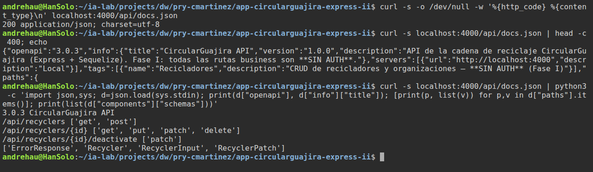

**Ev6 — Type-check:** `npx tsc --noEmit` termina sin errores.


### Commit

```bash
git add package.json package-lock.json \
  src/features/business/collectors/recyclers.swagger.ts \
  src/swagger/index.ts src/config/index.ts \
  docs/PROCESO.md docs/images/Ev1-ISS-05.png docs/images/Ev2-ISS-05.png \
  docs/images/Ev3-ISS-05.png docs/images/Ev4-ISS-05.png docs/images/Ev5-ISS-05.png \
  docs/images/Ev6-ISS-05.png
git commit -m "ISS-05: Swagger / OpenAPI"
git push origin main
```

Commit: [`4b8776e`](https://github.com/DW-2026-IISem/dw-2026-Andreushin/commit/4b8776e4f17288849f04732be07d31f78b098af3)

### ISS-06 — Feature `materials` (materiales y `TarifaMaterial`)

Implementar el catálogo de materiales reciclables y sus tarifas, incluidas las fechas de vigencia. Definir cómo se determina la tarifa aplicable a una operación.

**Verificación:** relaciones y vigencia validadas; no se aplica una tarifa fuera del período establecido.

Material es el catálogo (CRUD como recicladores). MaterialRate es el precio por kg con periodo `validFrom`–`validTo` (`validTo` null = vigente sin cierre). Regla de tarifa aplicable: la del periodo que contiene la fecha de la operación; si ninguno la contiene, no hay tarifa (404). El historial es solo de inserción para que las liquidaciones (ISS-08) sean verificables: una corrección es una tarifa nueva.

Criterios de aceptación (ISS-06)

- [x] Modelos `Material` (nombre único, status, timestamps) y `MaterialRate` (FK RESTRICT a materials, DECIMAL, fechas DATEONLY) con su asociación 1:N
- [x] CRUD de materiales por capas: getAll, getOne, create, PUT/PATCH (sin status), delete físico y lógico
- [x] Tarifas: al registrar una nueva se cierra la abierta anterior en una transacción, se rechazan cruces (409) y la tarifa aplicable depende de la fecha (404 fuera de periodo)
- [x] Carpeta `http/` con lectura, alta, actualización, borrado y tarifas
- [x] Cableado en `src/routes/index.ts` y `src/config/index.ts` (asociaciones + rutas)
- [x] Seeders de materiales y tarifas registrados en el SeedersRunner y `counts.ts`
- [x] Swagger de materiales y tarifas registrado en `src/swagger`
- [x] npx tsc --noEmit sin errores al cerrar el ISS

### Pasos

```bash
mkdir -p src/features/business/materials/{dto,http} src/shared/database

# src/shared/http/validation.ts: validadores comunes (asBody, requiredText, oneOf, requiredDate,
#   positiveAmount); recycler.validation.ts pasa a usarlos
# src/shared/database/transaction.ts: withTransaction (commit o rollback de escrituras relacionadas)
# materials/material.model.ts y material-rate.model.ts; materials.associations.ts (hasMany/belongsTo, RESTRICT)
# materials/dto/: material.dto.ts y material.validation.ts
# materials.repository.ts y material-rates.repository.ts (findApplicable, close con transacción)
# materials.service.ts: CRUD, nombre único (409), sin borrado físico si hay tarifas (409)
# material-rates.service.ts: historial, tarifa aplicable (fecha por defecto: hoy en Colombia) y alta
#   con cierre automático + control de cruces dentro de withTransaction
# materials.controller.ts, material-rates.controller.ts y materials.routes.ts (/api/materials...)
# materials.seeder.ts: catálogo real (PET, Cartón, Aluminio...) y 3 periodos mensuales por material
# counts.ts: materials y materialRates (SEED_MATERIAL_RATES); index.ts: llamadas en orden
# materials.swagger.ts + registro en src/swagger/index.ts
```

### Verificación del ISS

```bash
curl -s -X POST localhost:4000/api/materials/1/rates -H "Content-Type: application/json" \
  -d '{"pricePerKg":1200,"validFrom":"2026-10-01"}'
curl -s "localhost:4000/api/materials/1/rates/current?date=2026-09-15"
npm run db:seed
npx tsc --noEmit
```

#### Evidencias

**Ev1 — Modelos y relación:** `grep` muestra nombre único, default `inactive`, FK con `onDelete: "RESTRICT"`, `DECIMAL(12, 2)`, `DATEONLY`, índice único (material, validFrom) y `hasMany`/`belongsTo`; `information_schema` confirma la FK `material_rates → materials` con RESTRICT / CASCADE.

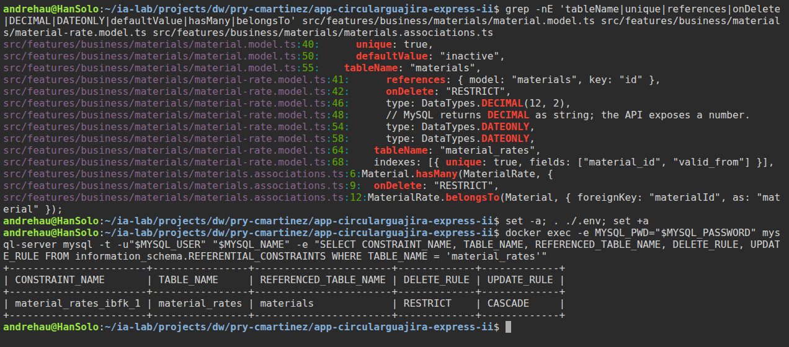

**Ev2 — CRUD de materiales:** alta de PET y Cartón (201), nombre repetido (409), sin nombre (400), getAll, PUT y PATCH (200), PATCH vacío (400), deactivate de Cartón (200), getOne de Cartón inactivo (404) y borrado físico (200).

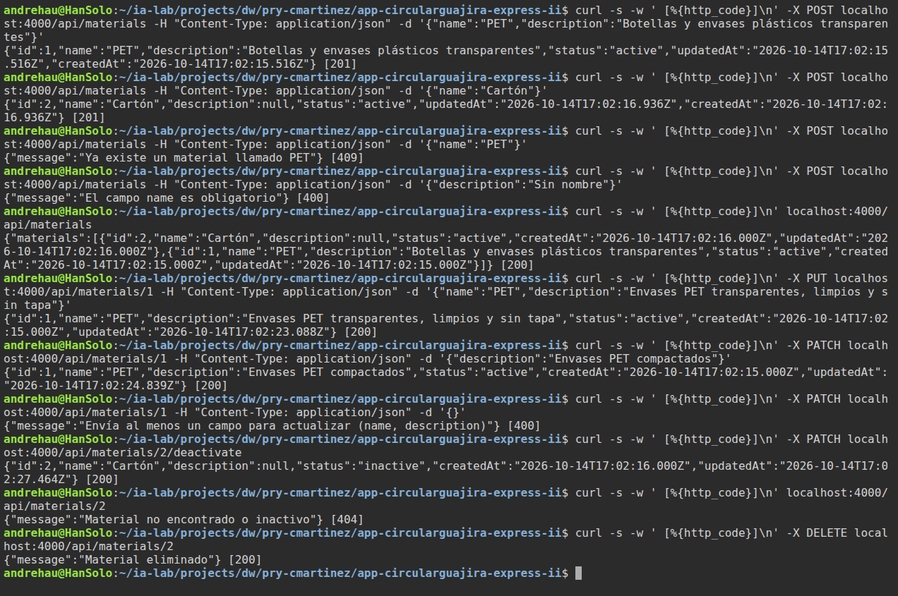

**Ev3 — Tarifas y vigencia:** tarifa desde 2026-09-01 (201); la del 2026-10-01 (201) cierra la anterior en 2026-09-30; periodo cruzado (409); historial; aplicable hoy = 1200, el 2026-09-15 = 1150 y el 2026-08-31 sin tarifa (404); borrar PET con tarifas (409).

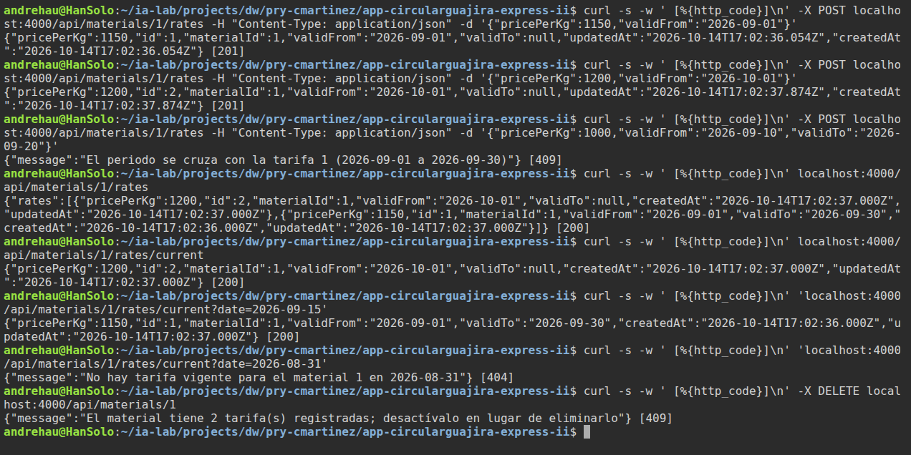

**Ev4 — Carpeta http:** cinco archivos `.http` con los casos de lectura, alta, actualización, borrado y tarifas.

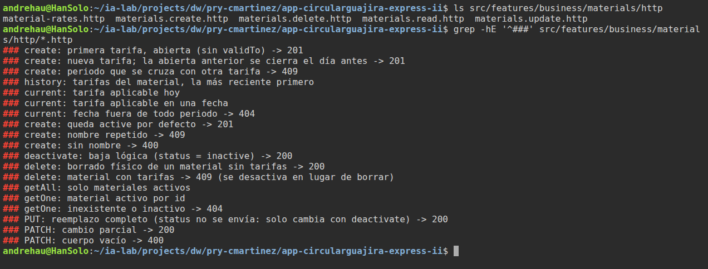

**Ev5 — Cableado:** `routes/index.ts` con `materialsRoutes`; config, swagger y seeders importan las asociaciones, rutas, docs y seeders de materials.

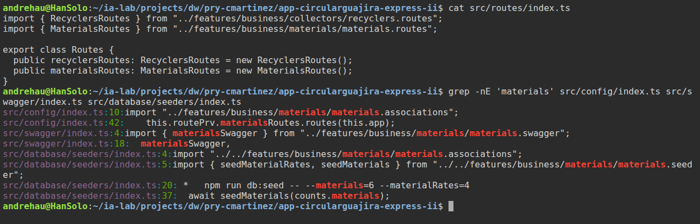

**Ev6 — Seeders:** `npm run db:seed` inserta 9 materiales (total 10, PET ya existía) y 27 tarifas (3 periodos mensuales por material, PET se omite por tener historial); MySQL muestra cada material con sus tarifas de 2026-08-01 a 2026-10-01.

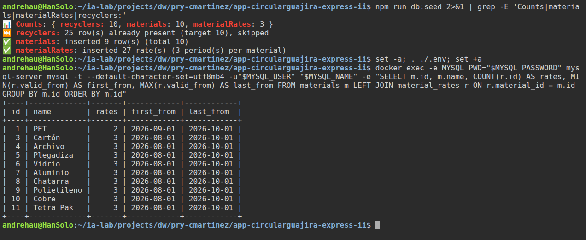

**Ev7 — Swagger:** `/api/docs` muestra los tags Materiales y Tarifas de material (SIN AUTH) con sus 10 endpoints y los schemas `Material*` y `MaterialRate*`.

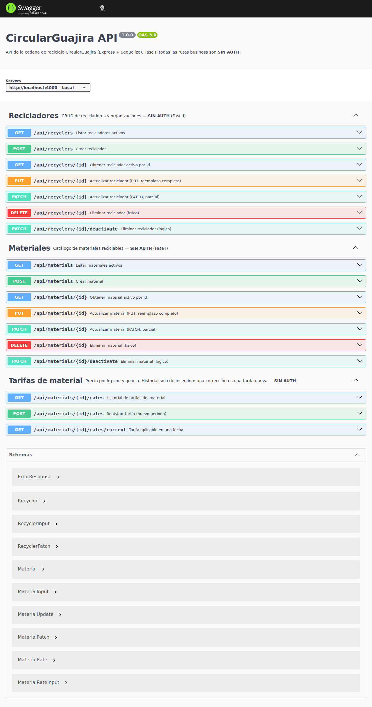

**Ev8 — Type-check:** `npx tsc --noEmit` termina sin errores.


### Commit

```bash
git add src/shared/http/validation.ts src/shared/database/transaction.ts \
  src/features/business/collectors/dto/recycler.validation.ts \
  src/features/business/materials \
  src/routes/index.ts src/config/index.ts src/swagger/index.ts \
  src/database/seeders/counts.ts src/database/seeders/index.ts \
  docs/PROCESO.md docs/images/Ev1-ISS-06.png docs/images/Ev2-ISS-06.png \
  docs/images/Ev3-ISS-06.png docs/images/Ev4-ISS-06.png docs/images/Ev5-ISS-06.png \
  docs/images/Ev6-ISS-06.png docs/images/Ev7-ISS-06.png docs/images/Ev8-ISS-06.png
git commit -m "ISS-06: Feature materials (materiales y TarifaMaterial)"
git push origin main
```

Commit: [`c0c4b00`](https://github.com/DW-2026-IISem/dw-2026-Andreushin/commit/c0c4b00feb8dd0bf3caa930b715115f4071e1384)

### ISS-07 — Feature `routes` (rutas y puntos de recolección)

Implementar la coordinación de rutas y sus puntos asociados, con validaciones de pertenencia y operaciones de consulta y administración.

**Verificación:** se pueden administrar y consultar rutas sin asociaciones inválidas.

Ruta = recorrido de recolección en un municipio; PuntoRecoleccion = parada de la ruta con un orden de visita único dentro de ella. Regla de pertenencia (equivale a la validación del tipo activo de StoreLab): un punto solo se asigna a una ruta existente (404) y activa (400), y su orden de visita no se repite en esa ruta (409). La misma regla (`assertActiveRoute`) la usará la recolección del ISS-08.

Criterios de aceptación (ISS-07)

- [x] Modelos `Route` (nombre único, municipio, status) y `CollectionPoint` (FK RESTRICT `route_id`, índice único ruta + orden de visita) con su asociación 1:N
- [x] CRUD de rutas por capas: getAll, getOne, create, PUT/PATCH (sin status), delete físico (409 si tiene puntos) y lógico
- [x] CRUD de puntos con validación de pertenencia a ruta activa y orden de visita único; consulta de puntos por ruta en orden
- [x] Carpeta `http/` con lectura, alta, actualización y borrado
- [x] Cableado en `src/routes/index.ts` y `src/config/index.ts` (asociaciones + rutas)
- [x] Seeders de rutas y puntos registrados en el SeedersRunner y `counts.ts`
- [x] Swagger de rutas y puntos registrado en `src/swagger`
- [x] npx tsc --noEmit sin errores al cerrar el ISS

### Pasos

```bash
mkdir -p src/features/business/routes/{dto,http}

# src/shared/http/validation.ts: positiveInt (routeId y visitOrder del body)
# routes/route.model.ts y collection-point.model.ts; routes.associations.ts (hasMany/belongsTo, RESTRICT)
# routes/dto/: route.dto.ts y route.validation.ts (create/PUT/PATCH de ambas entidades)
# routes.repository.ts y collection-points.repository.ts
# routes.service.ts: CRUD, nombre único (409), sin borrado físico con puntos (409), assertActiveRoute
# collection-points.service.ts: CRUD, pertenencia a ruta activa y orden de visita libre por ruta
# routes.controller.ts, collection-points.controller.ts y routes.routes.ts
#   (/api/routes, /api/routes/:id/points, /api/collection-points)
# routes.seeder.ts: rutas reales de La Guajira y 4 puntos por ruta en orden 1..4
# counts.ts: routes y collectionPoints; index.ts: llamadas en orden
# routes.swagger.ts + registro en src/swagger/index.ts
```

### Verificación del ISS

```bash
curl -s -X POST localhost:4000/api/collection-points -H "Content-Type: application/json" \
  -d '{"routeId":1,"name":"Tienda La Esquina","address":"Calle 2 # 7-15, Riohacha","visitOrder":1}'
curl -s localhost:4000/api/routes/1/points
npm run db:seed
npx tsc --noEmit
```

#### Evidencias

**Ev1 — Modelos y relación:** `grep` muestra nombre único, FK `references routes` con `onDelete: "RESTRICT"`, índice único (`route_id`, `visit_order`) y `hasMany`/`belongsTo`; `information_schema` confirma la FK `collection_points → routes` con RESTRICT / CASCADE.

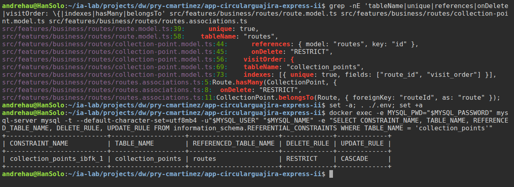

**Ev2 — CRUD de rutas:** alta de Riohacha Centro y Maicao Comercial (201), nombre repetido (409), sin municipio (400), getAll, PUT y PATCH (200), PATCH vacío (400), deactivate de Maicao (200) y getOne de la ruta inactiva (404).

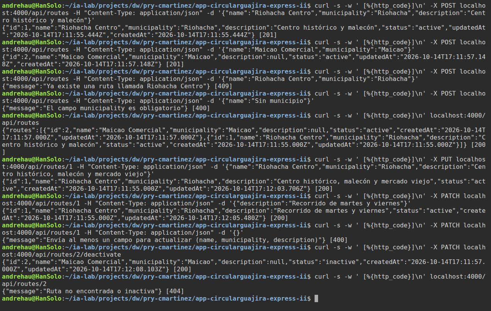

**Ev3 — Puntos y pertenencia:** dos puntos en la ruta 1 (201), orden repetido (409), ruta inexistente (404), ruta inactiva (400), PATCH del orden (200), puntos de la ruta en orden de visita, deactivate de un punto que sale del recorrido, borrar ruta con puntos (409) y borrar la ruta inactiva sin puntos (200).

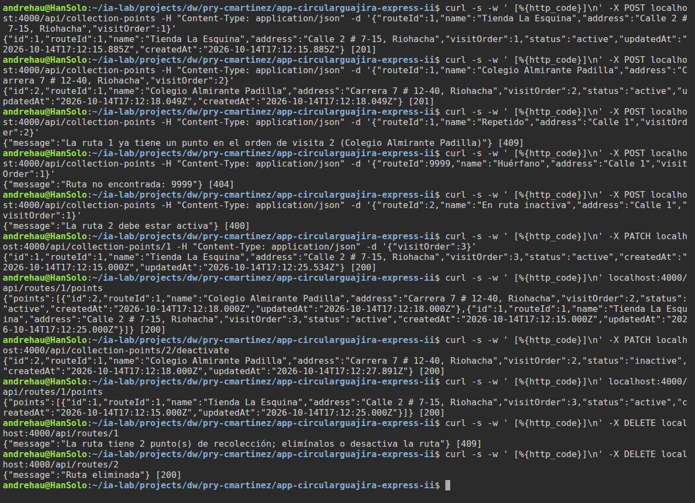

**Ev4 — Carpeta http:** cuatro archivos `.http` con los casos de lectura, alta, actualización y borrado.

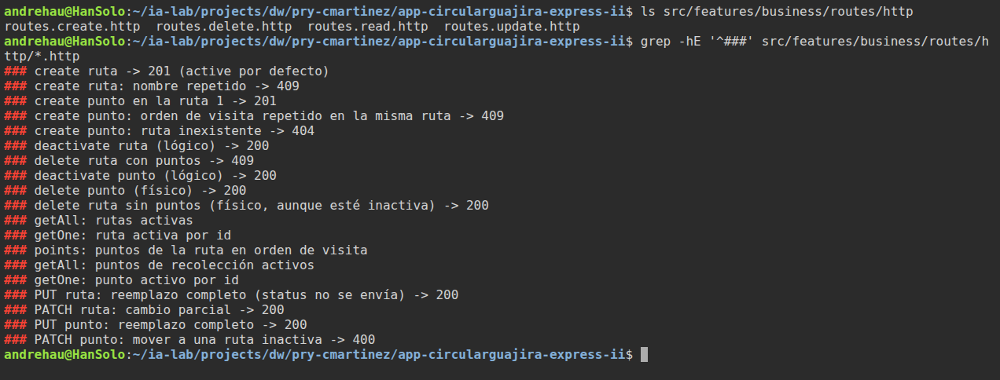

**Ev5 — Cableado:** `routes/index.ts` con `routesRoutes`; config, swagger y seeders importan asociaciones, docs y seeders de `business/routes`; `counts.ts` con `routes: 6` y `collectionPoints: 4`.

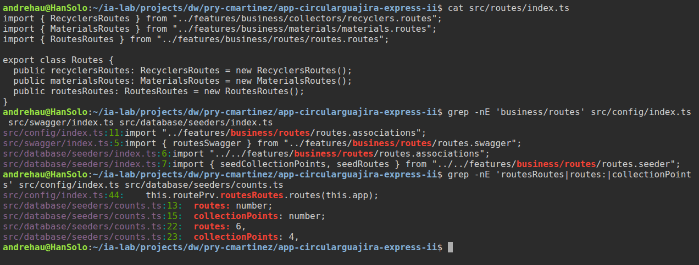

**Ev6 — Seeders:** `npm run db:seed` inserta 5 rutas (total 6) y 20 puntos (4 por ruta; Riohacha Centro se omite por tener puntos); MySQL muestra cada ruta con sus órdenes de visita 1..4.

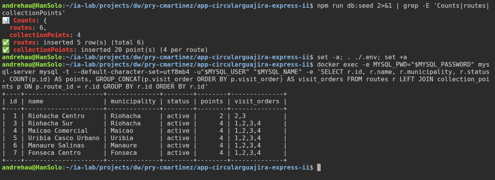

**Ev7 — Swagger:** `/api/docs` muestra los tags Rutas y Puntos de recolección (SIN AUTH) con sus endpoints y los schemas `Route*` y `CollectionPoint*`.

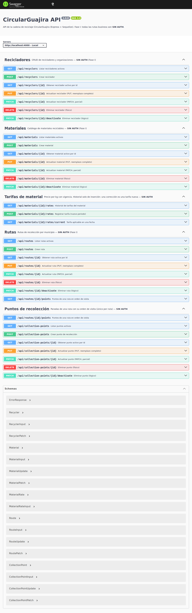

**Ev8 — Type-check:** `npx tsc --noEmit` termina sin errores.


### Commit

```bash
git add src/shared/http/validation.ts src/features/business/routes \
  src/routes/index.ts src/config/index.ts src/swagger/index.ts \
  src/database/seeders/counts.ts src/database/seeders/index.ts \
  docs/PROCESO.md docs/images/Ev1-ISS-07.png docs/images/Ev2-ISS-07.png \
  docs/images/Ev3-ISS-07.png docs/images/Ev4-ISS-07.png docs/images/Ev5-ISS-07.png \
  docs/images/Ev6-ISS-07.png docs/images/Ev7-ISS-07.png docs/images/Ev8-ISS-07.png
git commit -m "ISS-07: Feature routes (rutas y puntos de recolección)"
git push origin main
```

Commit: [`aa48f2d`](https://github.com/DW-2026-IISem/dw-2026-Andreushin/commit/aa48f2d2576cf00c7a0cd3b8dd27af4b2c905ee2)

### ISS-08 — Features `weighing` / `settlements` (recolección, pesaje y liquidación)

Implementar el flujo central: registrar la recolección, pesar por material, descontar la tara para obtener el peso neto, aplicar la tarifa vigente y generar una liquidación verificable. Guardar los valores y referencias usados en el cálculo para mantener trazabilidad; ejecutar escrituras relacionadas en una transacción.

**Verificación:** pruebas de peso neto, importe, tarifa aplicable, entradas inválidas y consistencia ante fallos.

Equivalencia con StoreLab: la venta (cabecera) es la **recolección** (reciclador + ruta + fecha) y el detalle de venta es el **pesaje** (material, bruto, tara). La **liquidación** es nueva. Reglas:

- neto = bruto − tara (bruto > tara); importe = neto × tarifa vigente en la fecha de la recolección (404 si ninguna tarifa cubre la fecha). La fórmula vive en `weighing.calculator.ts` y la usan services, verificación y seeders.
- Cada pesaje guarda la tarifa aplicada (`rateId`) y su precio (`pricePerKg`); los totales de la recolección se derivan de sus pesajes activos. Cambiar la fecha re-tarifica los pesajes.
- Liquidar confirma la tarifa vigente de cada pesaje, congela totales y número de líneas y bloquea la recolección (409 a cualquier cambio) hasta anular la liquidación (`/void`). `GET /api/settlements/:id/verify` recalcula todo y lo compara con lo guardado.
- Escrituras relacionadas en una transacción, con bloqueos en orden canónico recolección → pesajes → liquidación.

Criterios de aceptación (ISS-08)

- [x] Modelos `Collection`, `Weighing` y `Settlement` con FK RESTRICT (reciclador, ruta, material, tarifa, recolección) y sus asociaciones
- [x] Recolección con pesajes creada en una transacción: neto, importe y tarifa vigente; entradas inválidas rechazadas y rollback completo ante fallo
- [x] Pesajes: alta en recolección abierta, cambio de pesos con recálculo de totales, re-tarifado al cambiar la fecha, baja lógica
- [x] Liquidación verificable: emite y congela, bloquea la recolección, verificación consistente, anulación que reabre y reliquidación
- [x] Carpetas `http/` de recolecciones, pesajes y liquidaciones
- [x] Cableado en routes, config, swagger y seeders; `handleError` responde 409 ante violaciones de FK/unicidad
- [x] Seeders de recolecciones con pesajes y de liquidaciones, con totales consistentes
- [x] Swagger de recolecciones, pesajes y liquidaciones registrado
- [x] npx tsc --noEmit sin errores al cerrar el ISS

### Pasos

```bash
mkdir -p src/features/business/{weighing,settlements}/{dto,http}

# src/shared/database/decimal.ts: columna DECIMAL expuesta como number
# src/shared/http/validation.ts: nonNegativeAmount (tara); handleError: FK/unique -> 409
# weighing/weighing.calculator.ts: round2, calculateLine, sumLines (fórmula única)
# weighing/collection.model.ts, weighing.model.ts, weighing.associations.ts
# settlements/settlement.model.ts, settlements.associations.ts
# dto/: weighing.dto.ts + validation (fecha no futura, bruto > tara, 1..50 pesajes), settlement.dto.ts + validation
# repositories con variantes transaction/lock (FOR UPDATE)
# weighing-pricing.service.ts: material activo + tarifa aplicable (MaterialRatesService.findApplicableOrFail)
# collections.service.ts: create transaccional, PUT/PATCH con re-tarifado, lockOpenCollection, recalculateTotals
# weighings.service.ts: lockLine (recolección -> pesaje), cambios de peso, baja física y lógica
# settlements.service.ts: create (confirma tarifas, congela totales), notas, void, delete (solo anuladas), verify
# controllers + weighing.routes.ts (/api/collections, /api/weighings) y settlements.routes.ts (/api/settlements)
# weighing.seeder.ts y settlements.seeder.ts; counts.ts: collections, weighings, settlements
# weighing.swagger.ts y settlements.swagger.ts + registro en src/swagger/index.ts
```

### Verificación del ISS

```bash
curl -s -X POST localhost:4000/api/collections -H "Content-Type: application/json" \
  -d '{"recyclerId":1,"routeId":1,"collectedOn":"2026-10-10","weighings":[{"materialId":1,"grossKg":50.5,"tareKg":2}]}'
curl -s -X POST localhost:4000/api/settlements -H "Content-Type: application/json" -d '{"collectionId":1}'
curl -s localhost:4000/api/settlements/1/verify
npm run db:seed
npx tsc --noEmit
```

#### Evidencias

**Ev1 — Modelos y relaciones:** `grep` muestra las FK con `onDelete: "RESTRICT"`, `collectedOn` DATEONLY, columnas decimales (bruto, tara, neto, precio, importe, totales), el enum `issued`/`voided` y las asociaciones; `information_schema` lista las 7 FK RESTRICT de `collections`, `weighings` y `settlements`.

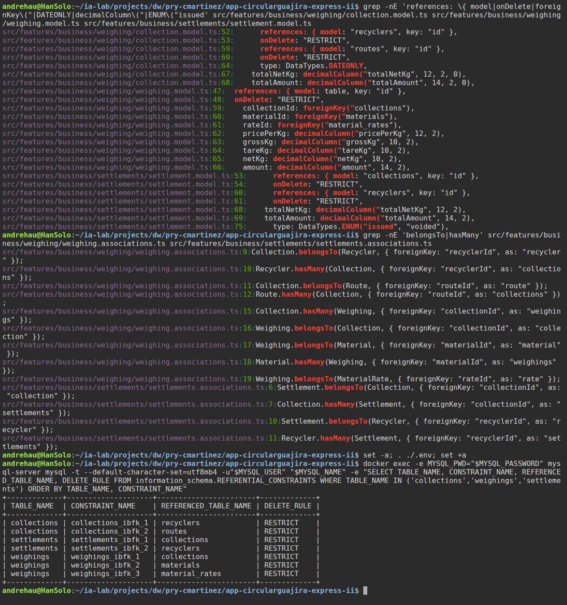

**Ev2 — Recolección transaccional:** con 0 recolecciones, el alta con PET (50,5 − 2 = 48,5 kg × 1200 = 58.200) y Cartón da 201 con total 71.310; el alta del 2026-08-15 falla en el segundo pesaje (404, sin tarifa) y el conteo sigue en 1 recolección y 2 pesajes (rollback); bruto <= tara, reciclador inactivo, fecha futura y lista vacía dan 400.

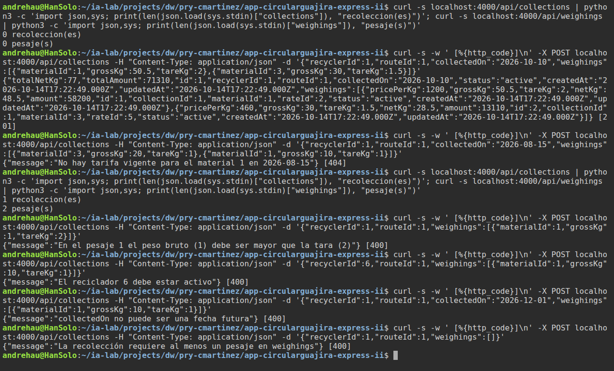

**Ev3 — Pesajes y re-tarifado:** pesaje de Chatarra agregado (201); PATCH de tara recalcula neto e importe (200); tara mayor que el bruto (400); cambiar la fecha al 2026-09-20 re-tarifa los 3 pesajes con tarifas de septiembre (PET 1200 → 1150) y el total pasa a 124.890; la baja lógica de un pesaje deja 76,5 kg / 68.310.

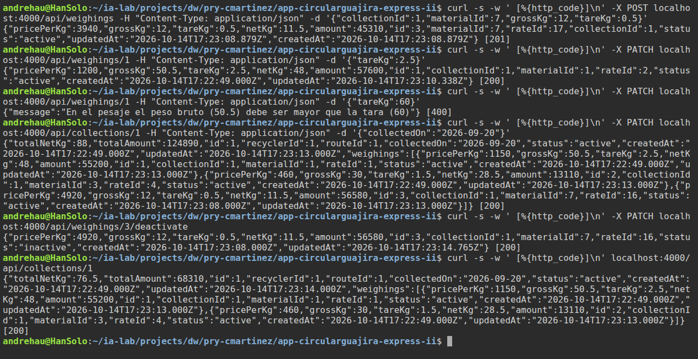

**Ev4 — Liquidación verificable:** se emite la liquidación 1 (201) con totales y pesajes; liquidar otra vez (409) y modificar un pesaje (409) se rechazan; `verify` responde `consistent: true` con la tarifa 2026-09-01 a 2026-09-30 en cada línea; borrar una emitida (409); `void` la anula (200), el pesaje ya se puede corregir (200) y se reliquida (liquidación 2: 77 kg / 68.885); la anulada se borra (200) y borrar un reciclador con recolecciones da 409.

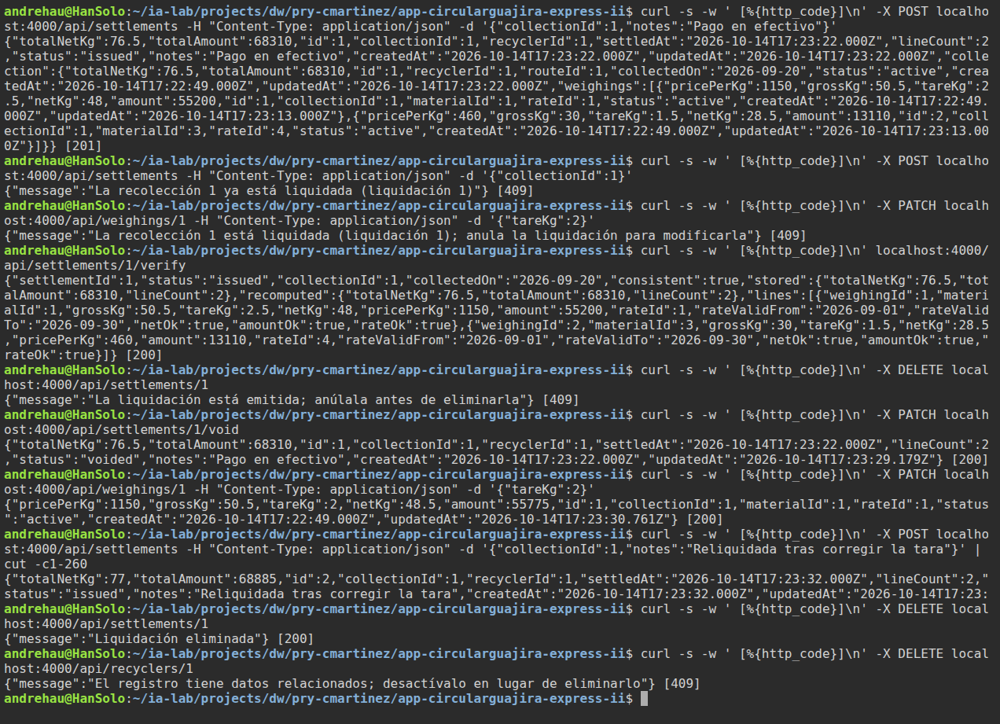

**Ev5 — Carpetas http:** `collections.http` (9 casos), `weighings.http` (7) y `settlements.http` (10).

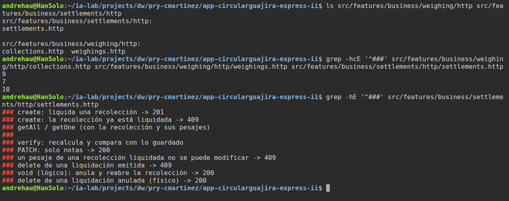

**Ev6 — Cableado:** `routes/index.ts` con `weighingRoutes` y `settlementsRoutes`; config, swagger y seeders importan asociaciones, docs y seeders; `counts.ts` con `collections: 8`, `weighings: 3`, `settlements: 4`; `handleError` atiende `ForeignKeyConstraintError` y `UniqueConstraintError`.

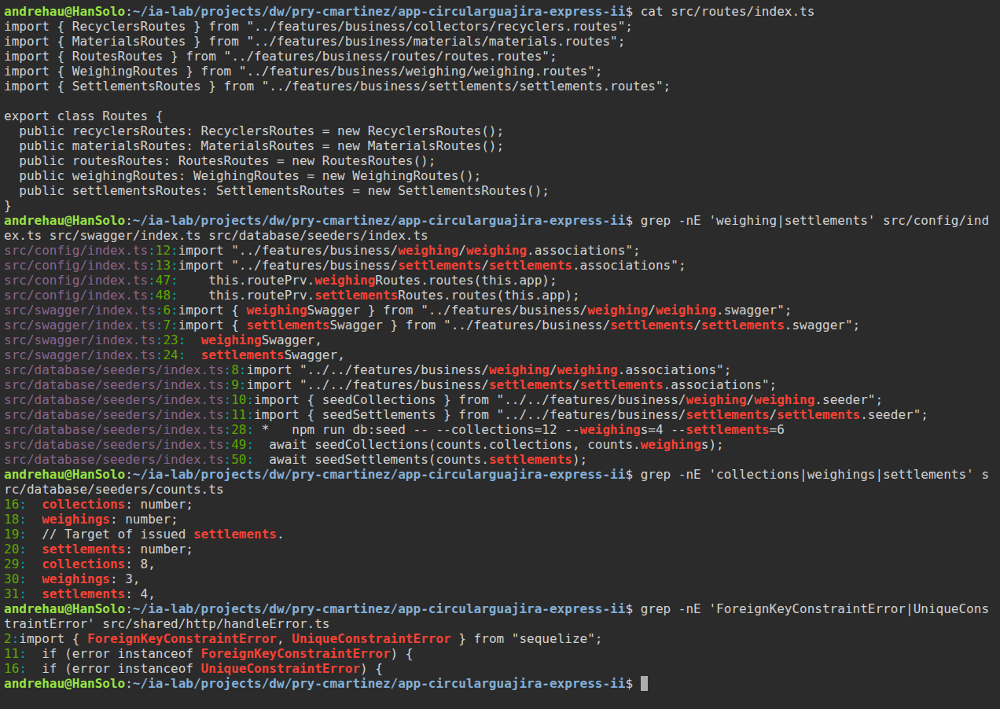

**Ev7 — Seeders consistentes:** `npm run db:seed` inserta 7 recolecciones con 21 pesajes y emite 3 liquidaciones (total 4); MySQL muestra que en las 8 recolecciones `total_net_kg` y `total_amount` son iguales a la suma de sus pesajes y al valor liquidado.

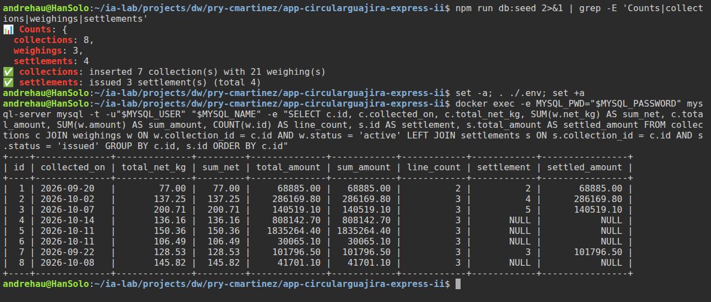

**Ev8 — Swagger:** `/api/docs` muestra los tags Recolecciones, Pesajes y Liquidaciones (SIN AUTH) junto a los de ISS-03 a ISS-07, con sus schemas.

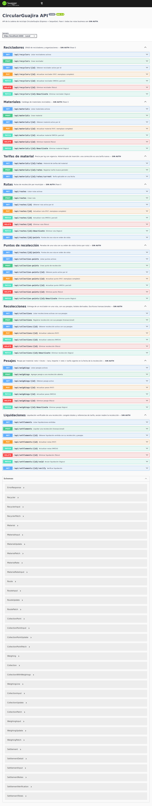

**Ev9 — Type-check:** `npx tsc --noEmit` termina sin errores.


### Commit

```bash
git add src/shared src/features/business/weighing src/features/business/settlements \
  src/features/business/materials/material-rates.repository.ts \
  src/routes/index.ts src/config/index.ts src/swagger/index.ts \
  src/database/seeders/counts.ts src/database/seeders/index.ts \
  docs/PROCESO.md docs/images/Ev1-ISS-08.png docs/images/Ev2-ISS-08.png \
  docs/images/Ev3-ISS-08.png docs/images/Ev4-ISS-08.png docs/images/Ev5-ISS-08.png \
  docs/images/Ev6-ISS-08.png docs/images/Ev7-ISS-08.png docs/images/Ev8-ISS-08.png \
  docs/images/Ev9-ISS-08.png
git commit -m "ISS-08: Features weighing / settlements (recolección, pesaje y liquidación)"
git push origin main
```

Commit: [`5887600`](https://github.com/DW-2026-IISem/dw-2026-Andreushin/commit/58876003fb8b4808748907a669f6b2685a9d0c92)

### Compuerta `CIERRE-BUSINESS`

La Fase I se cierra cuando las features están integradas, las migraciones y seeders funcionan, OpenAPI documenta la API y las pruebas cubren el flujo desde la recolección hasta la liquidación. El dominio debe poder probarse sin autenticación en desarrollo. Registrar pendientes antes de iniciar la Fase II.

Definition of Done de la Fase I (business SIN AUTH), equivalente al cierre del laboratorio StoreLab: 5 features, 8 tablas, API documentada, seeders, prueba automatizada del flujo y pendientes registrados.

Criterios de aceptación (CIERRE-BUSINESS)

- [x] 5 features en `src/features/business` (`collectors`, `materials`, `routes`, `weighing`, `settlements`), cada una con model, repository, service, controller, routes, `dto/`, seeder y swagger
- [x] 8 tablas snake_case con FK `<singular>_id` y RESTRICT: `recyclers`, `materials`, `material_rates`, `routes`, `collection_points`, `collections`, `weighings`, `settlements`
- [x] APIs `/api/recyclers`, `/api/materials` (+ `/rates`), `/api/routes`, `/api/collection-points`, `/api/collections`, `/api/weighings`, `/api/settlements` documentadas en `/api/docs`
- [x] SeedersRunner completo e idempotente (`npm run db:seed`)
- [x] Prueba automatizada del flujo recolección → liquidación (`npm run test:flow`)
- [x] Todas las rutas SIN AUTH; un JSON malformado responde 400 en JSON (sin stack trace)
- [x] npx tsc --noEmit sin errores al cerrar la fase

### Norma de nombres

- Carpeta de feature: kebab-case plural (`collectors`, `materials`); archivos de capa en plural (`recyclers.service.ts`); modelo en singular (`recycler.model.ts` → `Recycler`).
- Código en inglés y camelCase (`collectedOn`, `pricePerKg`); columnas snake_case vía `underscored: true` (`collected_on`, `price_per_kg`).
- Tablas snake_case plural (`material_rates`, `collection_points`); FK = singular de la tabla referenciada + `_id` (`recycler_id`, `rate_id`).
- DTO: `dto/<singular>.dto.ts` con los tipos de cada operación y `dto/<singular>.validation.ts` que valida el cuerpo en tiempo de ejecución (StoreLab usa un archivo por operación sin validación).
- Claves de `SeedCounts` en camelCase; variables de entorno en SNAKE_CASE (`materialRates` → `SEED_MATERIAL_RATES`).

### Cómo repetir el patrón (otra entidad)

```text
A  modelo + dto/ + esqueletos repository/service/controller/routes + cableado (routes/index, config)
B…E CRUD en orden: getAll, getOne, create, update PUT/PATCH, delete físico y lógico
    (cada paso toca repository -> service -> controller) + http/
F  seeder + counts.ts + SeedersRunner
G  swagger + registro en src/swagger
R  si hay FK: <feature>.associations.ts + import en config y seeders
Regla: routes -> controller -> service -> repository -> model; ninguna capa se salta.
```

### Pendientes para la Fase II

- ~~Migraciones: el esquema se crea con `sequelize.sync()`~~ Resuelto en CIERRE-BUSINESS-B: migraciones versionadas con Umzug.
- Datos de prueba: `npm run test:flow` usa la base de desarrollo (las credenciales son fijas) y deja sus filas `TEST-*` desactivadas.
- Protección: todas las rutas siguen SIN AUTH; ISS-13 las protege con authenticate + authorize por rol (`LOGISTICA`, `BASCULA`, `FINANZAS`...).
- Al cerrar se corrigió el seeder de tarifas, que también tomaba materiales inactivos.

### Pasos

```bash
# src/config/index.ts: errorHandling() -> JSON malformado = 400 en JSON
# src/tests/flow.test.ts: flujo completo con node:test + fetch contra la App en un puerto libre
# package.json -> "test:flow": "node --require ts-node/register --test src/tests/flow.test.ts"
# materials.seeder.ts: seedMaterialRates solo para materiales activos
git rm src/features/business/collectors/http/.gitkeep
npm run test:flow
```

### Verificación del ISS

```bash
npm run test:flow
npm run db:seed
curl -s localhost:4000/api/docs.json
npx tsc --noEmit
```

#### Evidencias

**Ev1 — Features y capas:** cada carpeta de `src/features/business` lista model, repository, service, controller, routes, seeder, swagger (y associations donde hay FK) y su `dto/` con tipos y validación.

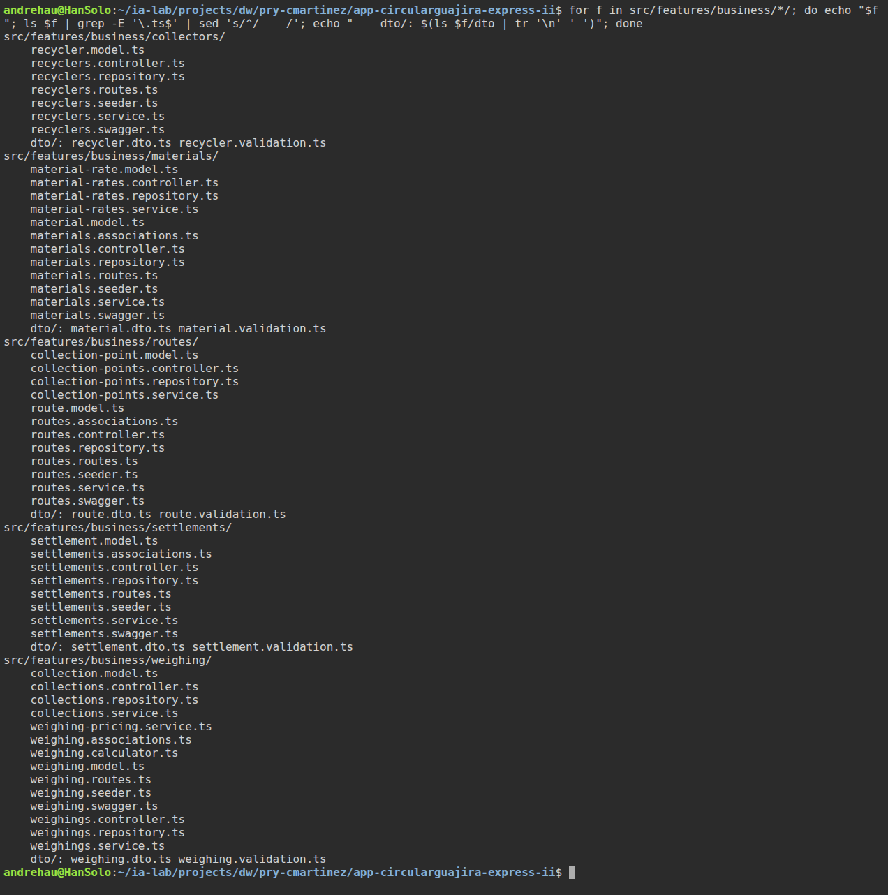

**Ev2 — Tablas y FK:** `information_schema` muestra las 9 FK snake_case (`route_id`, `recycler_id`, `material_id`, `collection_id`, `rate_id`) todas RESTRICT; `SHOW TABLES` lista las 8 tablas.

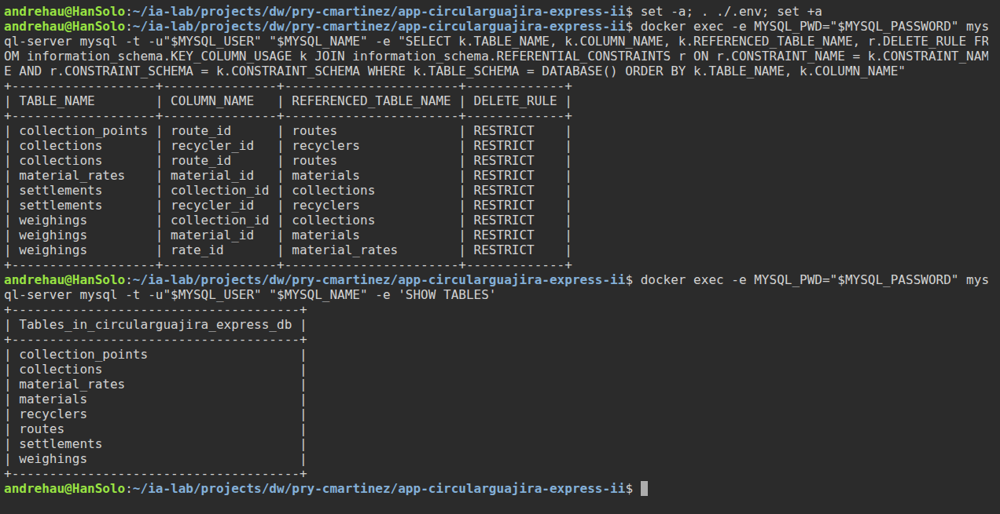

**Ev3 — API documentada:** `/api/docs.json` enumera todos los paths con sus métodos y cada listado responde 200.

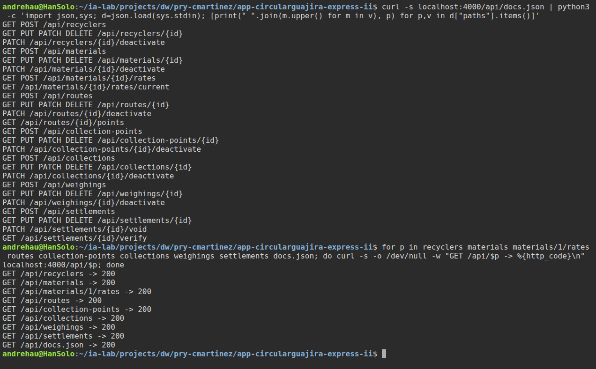

**Ev4 — Seeders idempotentes:** `npm run db:seed` sobre la base poblada omite todas las entidades; conteo por tabla.

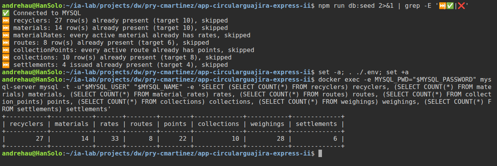

**Ev5 — Prueba del flujo:** `npm run test:flow` pasa 8 de 8: vigencia de tarifas, neto e importe, rollback, entradas inválidas, re-tarifado, liquidación con verificación, anulación y reliquidación, integridad.

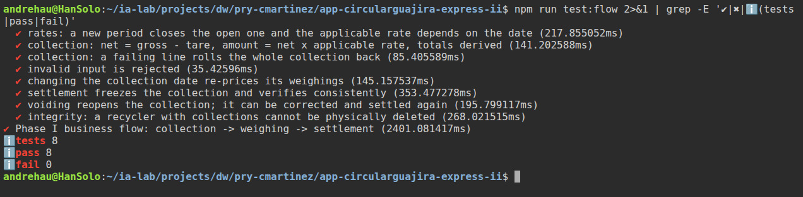

**Ev6 — SIN AUTH y errores:** la App solo usa morgan, cors, json, urlencoded y el manejador de cuerpo; ninguna ruta de negocio usa authenticate/authorize; un JSON malformado responde 400 en JSON.

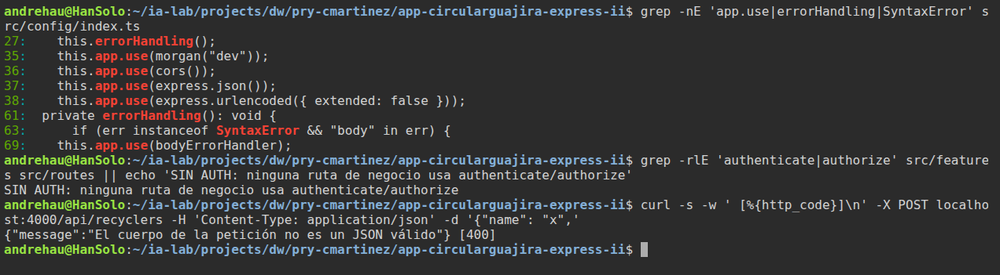

**Ev7 — Type-check:** `npx tsc --noEmit` termina sin errores.


### Commit

```bash
git add package.json src/config/index.ts src/tests/flow.test.ts \
  src/features/business/materials/materials.seeder.ts \
  docs/PROCESO.md docs/images/Ev1-CIERRE-BUSINESS.png docs/images/Ev2-CIERRE-BUSINESS.png \
  docs/images/Ev3-CIERRE-BUSINESS.png docs/images/Ev4-CIERRE-BUSINESS.png \
  docs/images/Ev5-CIERRE-BUSINESS.png docs/images/Ev6-CIERRE-BUSINESS.png \
  docs/images/Ev7-CIERRE-BUSINESS.png
git commit -m "CIERRE-BUSINESS: Compuerta de la Fase I"
git push origin main
```

Commit: [`da0c6c6`](https://github.com/DW-2026-IISem/dw-2026-Andreushin/commit/da0c6c694c7120a9d1e3a6712656d7992a9b9b1f)

### CIERRE-BUSINESS-B — Migraciones versionadas

Resuelve el pendiente de migraciones antes de la Fase II: el esquema deja de crearse con `sequelize.sync()` y sale de migraciones TypeScript versionadas (una por ISS) ejecutadas con Umzug; `SequelizeMeta` registra las aplicadas. Regla desde aquí: **todo ISS que crea o cambia un modelo agrega su migración**.

Criterios de aceptación (CIERRE-BUSINESS-B)

- [x] `src/database/migrator.ts` (Umzug + SequelizeStorage), CLI `migrate.ts` y scripts `db:migrate`, `db:migrate:undo`, `db:migrate:status`
- [x] Cuatro migraciones (ISS-03, 06, 07, 08) aplicadas desde una base vacía y registradas en `SequelizeMeta`
- [x] El esquema migrado es idéntico al que creaba `sync()` (columnas, índices, FK)
- [x] `db:migrate:undo` revierte la última; la App no arranca con migraciones pendientes y vuelve a arrancar al reaplicarla
- [x] Seeders y prueba del flujo funcionan sobre la base migrada; ningún `sync()` en el código
- [x] npx tsc --noEmit sin errores

### Pasos

```bash
npm install umzug@^3.8.2

# src/database/migrator.ts: Umzug (glob migrations/*.{ts,js}, nombre sin extensión), SequelizeStorage,
#   assertNoPendingMigrations()
# src/database/migrate.ts: runAsCLI (up, down, pending, executed)
# src/database/migrations/20261014-01-iss-03-recyclers.ts ... 20261014-04-iss-08-weighing-settlements.ts
# config/index.ts, database/seeders/index.ts, tests/flow.test.ts: sync() -> assertNoPendingMigrations()
# server.ts: un error de arranque termina el proceso con un mensaje claro
# package.json -> db:migrate, db:migrate:undo, db:migrate:status

# Una sola vez en desarrollo (datos de prueba): se guardó SHOW CREATE TABLE de las 8 tablas,
# se borraron y se recrearon con las migraciones
npm run db:migrate
npm run db:seed
```

### Verificación del ISS

```bash
npm run db:migrate && npm run db:migrate:status
npm run db:migrate:undo && npx ts-node src/server.ts   # falla: migración pendiente
npm run db:migrate && npm run db:seed && npm run test:flow
npx tsc --noEmit
```

#### Evidencias

**Ev1 — Migrator y migraciones:** `src/database` con `migrator.ts`, `migrate.ts` y las cuatro migraciones por ISS; el migrator usa `SequelizeStorage` y `assertNoPendingMigrations`; `package.json` tiene los tres scripts; la App, los seeders y la prueba llaman al guard y no queda ningún `sync()`.

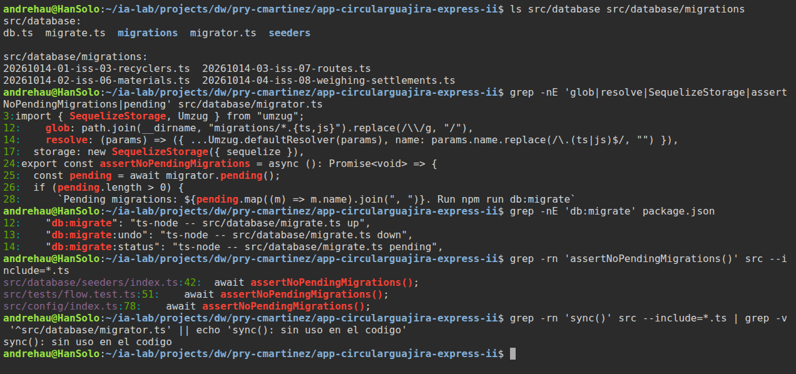

**Ev2 — Migración desde cero:** `npm run db:migrate` aplica las 4 migraciones; `db:migrate:status` no lista pendientes; `SequelizeMeta` registra las 4 y existen las 8 tablas.

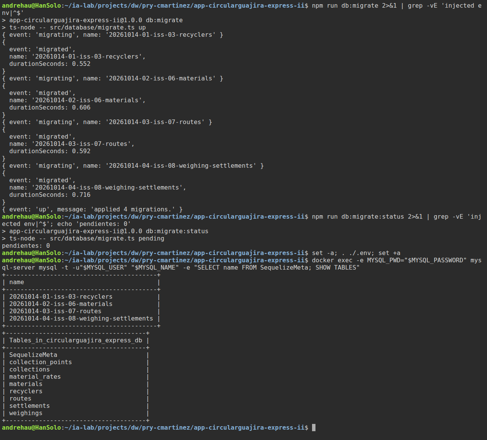

**Ev3 — Mismo esquema:** `diff` entre el `SHOW CREATE TABLE` del esquema de `sync()` y el de las migraciones: mismas 123 líneas y 9 FK, sin diferencias.

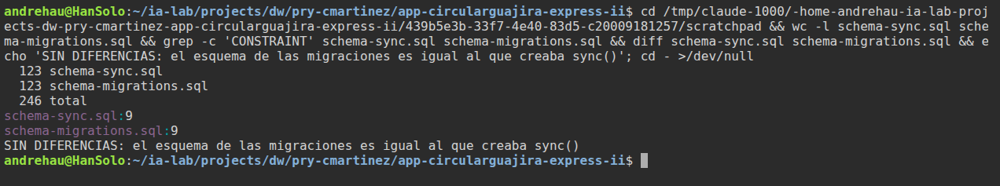

**Ev4 — Rollback y guard:** `db:migrate:undo` revierte la migración del ISS-08 y queda pendiente; la App termina con "Pending migrations: 20261014-04-iss-08-weighing-settlements. Run npm run db:migrate"; `db:migrate` la reaplica y la App arranca con "Database schema up to date".

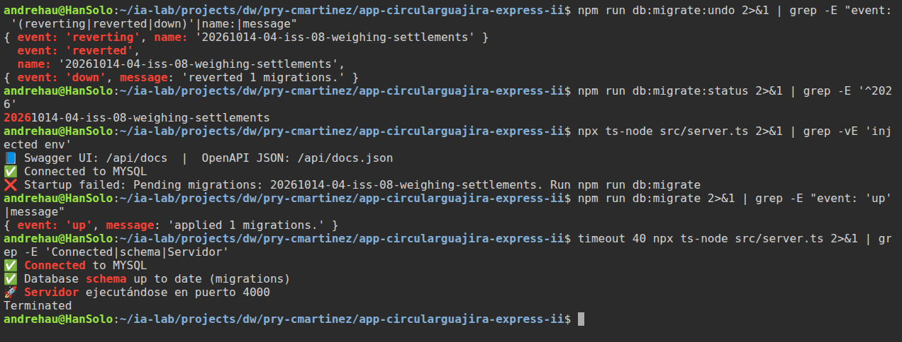

**Ev5 — Seeders y flujo sobre la base migrada:** `npm run db:seed` puebla las 8 tablas desde cero y `npm run test:flow` pasa 8 de 8.

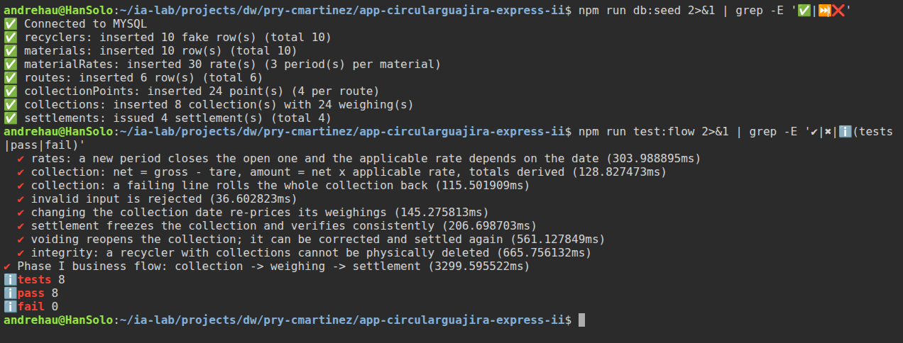

**Ev6 — Type-check:** `npx tsc --noEmit` termina sin errores.


### Commit

```bash
git add package.json package-lock.json src/server.ts src/config/index.ts \
  src/database/migrator.ts src/database/migrate.ts src/database/migrations \
  src/database/seeders/index.ts src/tests/flow.test.ts \
  docs/PROCESO.md docs/images/Ev1-CIERRE-BUSINESS-B.png docs/images/Ev2-CIERRE-BUSINESS-B.png \
  docs/images/Ev3-CIERRE-BUSINESS-B.png docs/images/Ev4-CIERRE-BUSINESS-B.png \
  docs/images/Ev5-CIERRE-BUSINESS-B.png docs/images/Ev6-CIERRE-BUSINESS-B.png
git commit -m "CIERRE-BUSINESS-B: Migraciones versionadas"
git push origin main
```

Commit: [`b248ab5`](https://github.com/DW-2026-IISem/dw-2026-Andreushin/commit/b248ab51a50af0420a226b60913a8a8a655ada06)

## Fase II · Auth con RBAC (planta y logística)

**Objetivo:** proteger la API y aplicar permisos por rol y recurso. Roles iniciales: `ADMIN`, `LOGISTICA`, `BASCULA`, `PLANTA` y `FINANZAS`.

### ISS-09 — Auth base (seguridad y modelos)

Definir la configuración de seguridad, el hashing de contraseñas y los modelos base de autenticación y autorización. Establecer validación de credenciales y respuestas seguras ante errores.

**Verificación:** secretos configurables por ambiente y contraseñas persistidas únicamente como hashes.

Base de seguridad compartida y modelos RBAC; todavía no expone endpoints (la API de la Fase I sigue SIN AUTH hasta ISS-13). Principios: no existe la entidad Permission (el permiso es la concesión Rol ↔ Recurso en `resource_roles`); tres modalidades por ruta (OPEN, JWT, JWT + RBAC); `status` active/inactive en las seis tablas; deny by default.

Criterios de aceptación (ISS-09)

- [x] `bcryptjs`, `jsonwebtoken` y `@types/jsonwebtoken` instalados; `.env` define `JWT_SECRET`, `JWT_ACCESS_TTL` y `JWT_REFRESH_TTL_DAYS`
- [x] Primitivas probadas: `password.ts` (bcrypt 12, `sha256Hex`, token opaco), `jwt.ts` (HS256 con iss, aud, exp, jti; rechaza tokens alterados, ajenos, sin firma, expirados o incompletos) y `resource-match.ts` (patrones `:param`, deny by default)
- [x] `auth-user.ts` (`Request.auth` + `requireAuthUser`), errores 401/403 en `httpError.ts` y en el mapeo único `handleError`; `swagger-security.ts` con `bearerAuth` registrado en OpenAPI
- [x] Seis modelos y su migración con claves únicas, índices y FK (`users`, `roles`, `resources`, `role_users`, `resource_roles`, `refresh_tokens`)
- [x] `rbac.associations.ts` con el grafo completo (User ↔ Role, Role ↔ Resource, User → RefreshToken)
- [x] Cableado en config y seeders; el servidor arranca y la API de la Fase I sigue funcionando SIN AUTH
- [x] npx tsc --noEmit sin errores al cerrar el ISS

### Pasos

```bash
npm install bcryptjs@^3.0.3 jsonwebtoken@^9.0.3
npm install -D @types/jsonwebtoken@^9.0.10
# .env (no versionado): JWT_SECRET aleatorio de 48 bytes, JWT_ACCESS_TTL=900, JWT_REFRESH_TTL_DAYS=7

# src/shared/auth/password.ts: hashPassword/verifyPassword (bcrypt 12), sha256Hex, generateOpaqueToken
# src/shared/auth/jwt.ts: signAccessToken/verifyAccessToken (HS256 fijo, iss, aud, exp, jti), extractBearerToken
# src/shared/auth/resource-match.ts: normalizePath, pathMatches, isOperationGranted
# src/shared/auth/auth-user.ts: AuthUser, Request.auth, requireAuthUser
# src/shared/errors/httpError.ts: UnauthorizedError (401), ForbiddenError (403)
# src/shared/http/handleError.ts: mapeo único también para ValidationError (400)
# src/shared/http/swagger-security.ts + securitySchemes en src/swagger/index.ts
# src/features/auth/{users,roles,resources,role-users,resource-roles,refresh-tokens}/*.model.ts
#   (password hasheado en hooks y nunca serializado; role en mayúsculas; resource normalizado)
# src/features/auth/rbac.associations.ts; import en config/index.ts y database/seeders/index.ts
# src/database/migrations/20261014-05-iss-09-auth.ts
# src/tests/auth.test.ts + "test:auth" en package.json
npm run db:migrate
```

### Verificación del ISS

```bash
npm run test:auth
npm run db:migrate:status
npm run test:flow
npx tsc --noEmit
```

**Decisiones respecto a la guía:** el mapeo error → HTTP ya era único (`handleError`), así que no se crea `sendError`/`BaseController`; los modelos usan atributos camelCase con `underscored` (columnas `user_id`, `token_hash`…); las tablas salen de una migración, no de `sync({ alter })`; `refresh_tokens.user_id` usa CASCADE (las sesiones mueren con el usuario) y la matriz de permisos usa RESTRICT (se desactiva, no se borra).

#### Evidencias

**Ev1 — Dependencias y entorno:** `npm ls` muestra bcryptjs 3.0.3, jsonwebtoken 9.0.3 y @types/jsonwebtoken 9.0.10; `.env` tiene las tres variables JWT (solo nombres) y git lo ignora.

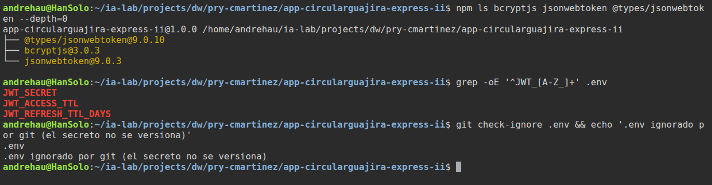

**Ev2 — Primitivas probadas:** `npm run test:auth` pasa 10 de 10: bcrypt de coste 12, SHA-256 y token opaco; JWT HS256 con sus claims y rechazo con 401 de tokens alterados, de otro secreto, `alg: none`, otra audiencia, expirados, sin `jti` o con `sub` no numérico; patrones de recurso y deny by default; hooks de User, Role y Resource contra la base migrada.

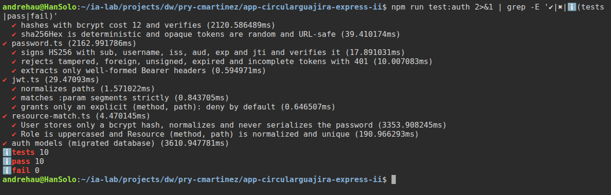

**Ev3 — Piezas compartidas:** `src/shared/auth` exporta `requireAuthUser`, las funciones de JWT, password y resource-match; `swagger-security.ts` exporta `bearerSecurityScheme`, `unauthorizedResponse` y `forbiddenResponse`; existen `UnauthorizedError` (401) y `ForbiddenError` (403) y OpenAPI registra `securitySchemes`.

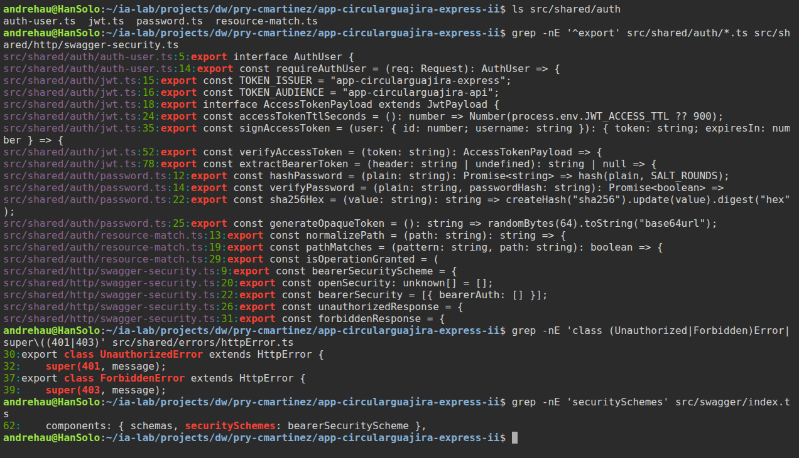

**Ev4 — Tablas, índices y FK:** `db:migrate` aplica `20261014-05-iss-09-auth`; `information_schema` lista `uq_users_username`, `uq_users_email`, `uq_roles_name`, `uq_resources_method_path`, `uq_role_users_user_role`, `uq_resource_roles_role_resource`, `uq_refresh_tokens_token_hash` y los índices `ix_*`; FK RESTRICT en la matriz y CASCADE en `refresh_tokens`.

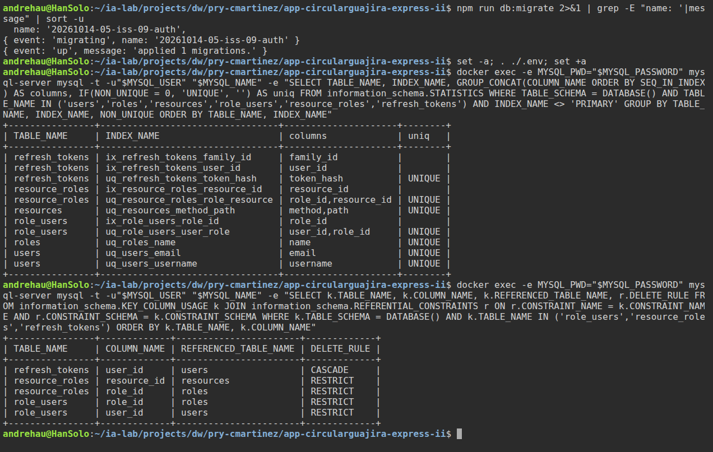

**Ev5 — Modelos y grafo:** los seis modelos en `src/features/auth` y `rbac.associations.ts` con los `belongsTo`/`hasMany` de User ↔ Role (RoleUser), Role ↔ Resource (ResourceRole) y User → RefreshToken.

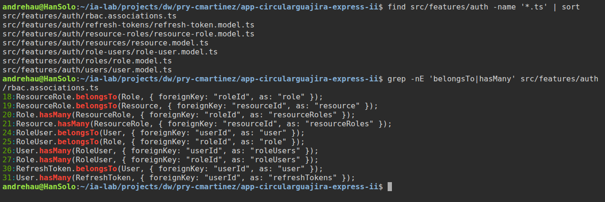

**Ev6 — Cableado y Fase I intacta:** config y seeders importan las asociaciones RBAC; el servidor arranca (puerto 4100, `/health` 200) con el esquema al día; los 7 seeders se omiten (idempotentes); `GET /api/collections` sin token sigue en 200 y `test:flow` pasa 8 de 8.

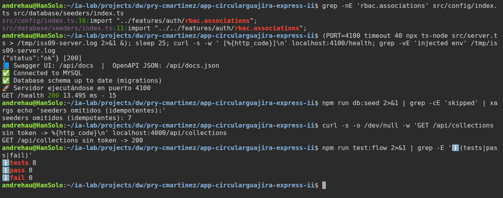

**Ev7 — Type-check:** `npx tsc --noEmit` termina sin errores.


### Commit

```bash
git add package.json package-lock.json src/shared src/features/auth \
  src/database/migrations/20261014-05-iss-09-auth.ts src/database/seeders/index.ts \
  src/config/index.ts src/swagger/index.ts src/tests/auth.test.ts \
  docs/PROCESO.md docs/images/Ev1-ISS-09.png docs/images/Ev2-ISS-09.png \
  docs/images/Ev3-ISS-09.png docs/images/Ev4-ISS-09.png docs/images/Ev5-ISS-09.png \
  docs/images/Ev6-ISS-09.png docs/images/Ev7-ISS-09.png
git commit -m "ISS-09: Auth base (seguridad y modelos)"
git push origin main
```

Commit: [`199fd55`](https://github.com/DW-2026-IISem/dw-2026-Andreushin/commit/199fd55b2b7532fe9690c811bf068024a5807b6b)

### ISS-10 — Feature `users` (identidad y contraseña)

Gestionar las identidades del personal de báscula, planta, logística y finanzas. Definir validaciones, unicidad y estados de usuario; no devolver ni registrar contraseñas en texto plano.

**Verificación:** altas y consultas cumplen las reglas de identidad y protegen credenciales.

CRUD de identidades con las mismas capas de la Fase I y dos diferencias: la contraseña nunca entra ni sale en claro, y el service expone los permisos efectivos recorriendo la cadena RBAC. Como el `authorize` (RBAC) llega en ISS-13, las 9 rutas quedan en modalidad **JWT** (`authenticate`): token válido de un usuario activo o 401. ISS-13 encadena `authorize` sin tocar el feature.

Criterios de aceptación (ISS-10)

- [x] `dto/user.dto.ts` (create, PUT, PATCH, cambio de contraseña) y `dto/user.validation.ts` (username, email, avatar, contraseña de 8 a 72 con letra y número; PATCH no admite password ni status)
- [x] `users.repository.ts`: lecturas sin el hash; solo `findByIdWithPassword` y `findByIdentifierWithPassword` (para el login) lo leen
- [x] Service y controller: unicidad de username/email (409), hash por los hooks del modelo, cambio de contraseña con la actual, permisos efectivos y ninguna respuesta con `password`
- [x] `users.routes.ts`: las 9 operaciones protegidas con `authenticate` (`features/auth/access`), que revalida en cada petición que el usuario siga activo
- [x] `users.seeder.ts`: un usuario canónico por rol (admin, logistica, bascula, planta, finanzas), idempotente
- [x] `users.swagger.ts`: 9 endpoints con `security: bearerAuth` y respuesta 401
- [x] Archivos `http/` de lectura y escritura
- [x] npx tsc --noEmit sin errores; las pruebas anteriores siguen en verde

### Pasos

```bash
mkdir -p src/features/auth/access src/features/auth/users/{dto,http}

# features/auth/access/effective-permissions.repository.ts: consulta de permisos por la cadena activa
#   role_users -> roles -> resource_roles -> resources (la reutiliza authorize en ISS-13)
# features/auth/access/access.service.ts + authenticate.ts: Bearer JWT + usuario activo -> req.auth, o 401
# users/dto/user.dto.ts + user.validation.ts
# users/users.repository.ts, users.service.ts, users.controller.ts, users.routes.ts (/api/users...)
# users/users.seeder.ts + counts.ts (users: 8) + SeedersRunner
# users/users.swagger.ts + registro en src/swagger; routes/index.ts y config (usersRoutes)
# src/tests/users.test.ts + "test:users" en package.json
npm run db:seed
```

### Verificación del ISS

```bash
npm run test:users
curl -s -o /dev/null -w '%{http_code}' localhost:4000/api/users   # 401 sin token
npx tsc --noEmit
```

**Decisiones respecto a la guía:** rutas en inglés (`/api/users`, `/:id/permissions`) y cuerpos camelCase (`currentPassword`, `newPassword`); la consulta de permisos vive en `access/` (no en `resource-roles`, que llega en ISS-12) para que el endpoint y `authorize` usen la misma; usuarios canónicos por rol del dominio en lugar de admin/seller. Las contraseñas del seeder son solo de laboratorio.

#### Evidencias

**Ev1 — DTO y validación:** `users/dto` exporta `UserCreateDto`, `UserUpdateDto`, `UserPatchDto`, `ChangePasswordDto` y los parsers `parseUserCreate`, `parseUserUpdate`, `parseUserPatch`, `parseChangePassword`.

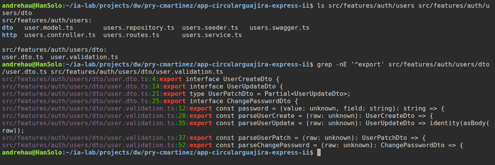

**Ev2 — Repository sin hash:** las lecturas usan `WITHOUT_PASSWORD`; solo `findByIdWithPassword` y `findByIdentifierWithPassword` (usuario o correo con `Op.or`) leen la credencial.

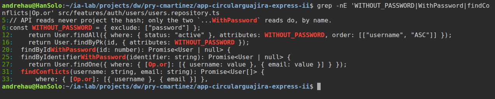

**Ev3 — Reglas por la API:** `npm run test:users` pasa 7 de 7: 401 sin token, con token inválido o de un usuario inexistente; alta con hash bcrypt y sin `password` en ninguna respuesta; 409 por username o email repetidos y 400 por contraseña débil o password en PATCH; PUT y PATCH; cambio de contraseña solo con la actual; permisos efectivos que desaparecen al desactivar la concesión o la asignación; desactivación con efecto inmediato (el token del usuario pasa a 401) y borrado físico.

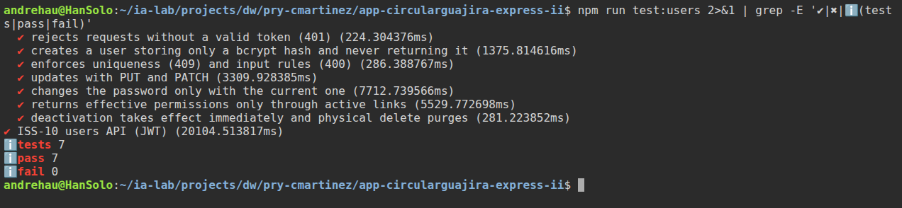

**Ev4 — Rutas protegidas:** `features/auth/access` con `authenticate`; las 9 rutas lo usan y todas responden 401 sin token.

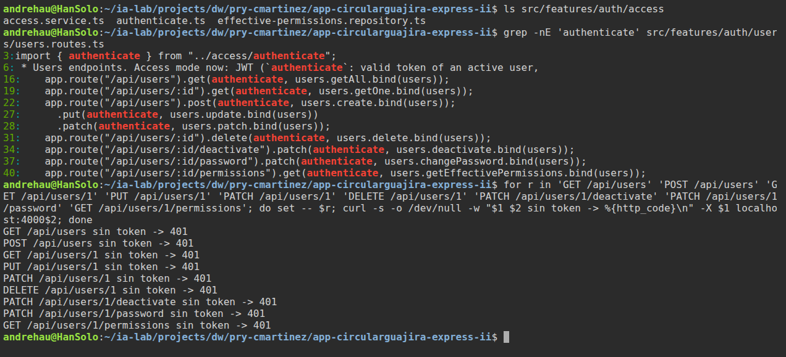

**Ev5 — Seeder idempotente:** el primer `db:seed` inserta 8 usuarios (5 canónicos y 3 aleatorios) y el segundo los omite; MySQL guarda solo hashes `$2b$12$` de 60 caracteres.

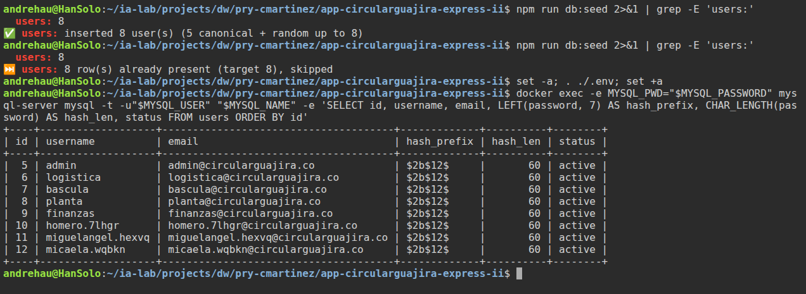

**Ev6 — Swagger:** `/api/docs.json` documenta los 9 endpoints de `/api/users` con `security: bearerAuth` y sus respuestas (200/201, 400, 401, 404, 409); `securitySchemes` incluye `bearerAuth`.

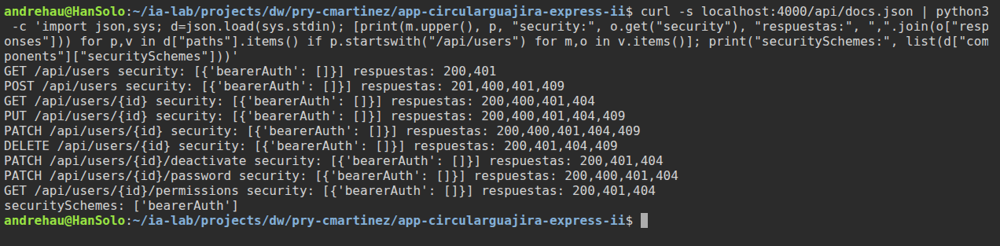

**Ev7 — Archivos http:** `users.read.http` y `users.write.http` con los casos de lectura, alta, cambios, contraseña y bajas.


**Ev8 — Type-check y regresión:** `npx tsc --noEmit` sin errores; `test:auth` 10 de 10 y `test:flow` 8 de 8.


### Commit

```bash
git add package.json src/features/auth/access src/features/auth/users \
  src/routes/index.ts src/config/index.ts src/swagger/index.ts \
  src/database/seeders/counts.ts src/database/seeders/index.ts src/tests/users.test.ts \
  docs/PROCESO.md docs/images/Ev1-ISS-10.png docs/images/Ev2-ISS-10.png \
  docs/images/Ev3-ISS-10.png docs/images/Ev4-ISS-10.png docs/images/Ev5-ISS-10.png \
  docs/images/Ev6-ISS-10.png docs/images/Ev7-ISS-10.png docs/images/Ev8-ISS-10.png
git commit -m "ISS-10: Feature users (identidad y contraseña)"
git push origin main
```

Commit: [`a12cb79`](https://github.com/DW-2026-IISem/dw-2026-Andreushin/commit/a12cb796361427c4f887e597d48468eb2ce5d1ee)

### ISS-11 — Features `roles` y `resources`

Registrar los roles iniciales y los recursos/acciones protegidos. Incluir, entre otros, `POST /recolecciones`, `POST /pesajes`, `POST /lotes-material` y `POST /liquidaciones`. Definir la matriz de acceso según las responsabilidades del negocio.

**Verificación:** roles y recursos se inicializan de forma repetible y la matriz queda documentada.

Los dos extremos del permiso: el **rol** (a quién se concede) y el **recurso** (qué se concede, el par `(method, path)` con la ruta en patrón). Las concesiones que los unen son ISS-12. Igual que en ISS-10, las rutas quedan en modalidad JWT hasta que ISS-13 encadene `authorize`.

Matriz de mínimo privilegio declarada en `resource-catalog.ts` (ADMIN recibe todo): LOGISTICA gestiona rutas, puntos, recicladores y recepción de recolecciones; BASCULA registra pesajes (y recolecciones, que se crean con sus pesajes); PLANTA gestiona el catálogo de materiales y consulta recolecciones y pesajes; FINANZAS gestiona tarifas y liquidaciones. El borrado físico y la administración de auth son solo de ADMIN.

Criterios de aceptación (ISS-11)

- [x] `roles/dto/role.dto.ts` y `role.validation.ts` (nombre único en mayúsculas, sin `status` en PUT/PATCH)
- [x] Roles: repository, service, controller y rutas `/api/roles` (7 operaciones, JWT)
- [x] `roles.seeder.ts` (ADMIN, LOGISTICA, BASCULA, PLANTA, FINANZAS, idempotente) y `roles.swagger.ts`
- [x] `resources/dto/` y `resource-catalog.ts` con los 87 recursos de la API (54 de negocio y 33 de administración) y los roles que reciben cada uno
- [x] Resources: repository, service, controller y rutas `/api/resources` (7 operaciones, JWT); `(method, path)` normalizado y único (409)
- [x] `resources.seeder.ts` (carga el catálogo, idempotente) y `resources.swagger.ts`
- [x] Archivos `http/` de ambos features
- [x] npx tsc --noEmit sin errores; `test:rbac` verifica el CRUD y que toda operación documentada está en el catálogo

### Pasos

```bash
mkdir -p src/features/auth/{roles,resources}/{dto,http}

# resources/resource-catalog.ts: ROLE_NAMES, RESOURCE_CATALOG (helper crud() para las 7 operaciones
#   de cada feature; el DELETE físico solo ADMIN) y resourcesForRole()
# roles/: dto (role.dto + role.validation), repository, service, controller, routes, seeder, swagger, http
# resources/: dto (resource.dto + resource.validation: método permitido y patrón /api/...),
#   repository, service, controller, routes, seeder, swagger, http
# routes/index.ts, config/index.ts, src/swagger/index.ts y SeedersRunner (seedRoles, seedResources)
# src/tests/rbac-catalog.test.ts + "test:rbac" en package.json
npm run db:seed
```

### Verificación del ISS

```bash
npm run test:rbac
npm run db:seed   # dos veces: la segunda no crea nada
npx tsc --noEmit
```

**Decisiones respecto a la guía:** roles del dominio en lugar de ADMIN/SELLER; catálogo propio (87 recursos en vez de 58) con los roles de cada recurso en el mismo archivo, del que ISS-12 derivará las concesiones; rutas `/api/roles` y `/api/resources`; las rutas de ISS-12 quedan catalogadas como `/api/role-users` y `/api/resource-roles`.

#### Evidencias

**Ev1 — DTO de roles:** `roles/dto` exporta `RoleCreateDto`, `RoleUpdateDto`, `RolePatchDto` y los parsers de validación.


**Ev2 — Rutas de roles:** las 7 operaciones de `/api/roles` usan `authenticate`, responden 401 sin token y OpenAPI las documenta con `bearerAuth`.


**Ev3 — Seeder de roles:** el primer `db:seed` crea 5 roles y 87 recursos; el segundo no crea nada; MySQL lista ADMIN, LOGISTICA, BASCULA, PLANTA y FINANZAS activos con su descripción.


**Ev4 — Catálogo:** `resource-catalog.ts` exporta `ROLE_NAMES`, `RESOURCE_CATALOG` (helper `crud`) y `resourcesForRole`; 87 recursos únicos; ADMIN 87, LOGISTICA 30, BASCULA 21, PLANTA 13, FINANZAS 18.


**Ev5 — Rutas de recursos:** las 7 operaciones de `/api/resources` usan `authenticate`, responden 401 sin token y están documentadas con `bearerAuth`.


**Ev6 — Recursos sembrados:** MySQL agrupa los 87 recursos activos por feature (recyclers 7, materials 10, routes 8, settlements 8, users 9, role-users 5, resource-roles 5...) y el seeder reconcilia con `findOrCreate` y reactivación.


**Ev7 — Archivos http:** `roles.http` y `resources.http` con lectura, alta, 409, 400, cambios y bajas.


**Ev8 — Pruebas y type-check:** `test:rbac` pasa 4 de 4 (cobertura del catálogo, 401, CRUD de roles y de recursos con 409 por FK y por duplicados); `tsc` sin errores; `test:users` 7 de 7.


### Commit

```bash
git add package.json src/features/auth/roles src/features/auth/resources \
  src/routes/index.ts src/config/index.ts src/swagger/index.ts \
  src/database/seeders/index.ts src/tests/rbac-catalog.test.ts \
  docs/PROCESO.md docs/images/Ev1-ISS-11.png docs/images/Ev2-ISS-11.png \
  docs/images/Ev3-ISS-11.png docs/images/Ev4-ISS-11.png docs/images/Ev5-ISS-11.png \
  docs/images/Ev6-ISS-11.png docs/images/Ev7-ISS-11.png docs/images/Ev8-ISS-11.png
git commit -m "ISS-11: Features roles y resources"
git push origin main
```

Commit: [`28dc1b7`](https://github.com/DW-2026-IISem/dw-2026-Andreushin/commit/28dc1b7ec1b8b56c66cae5545a769480e2d68feb)

### ISS-12 — Features `roleUsers` y `resourceRoles`

Implementar la asignación de roles a usuarios y de recursos/acciones a roles, respetando integridad y mínimo privilegio.

**Verificación:** asignaciones persistidas y permisos efectivos derivados correctamente.

Las dos tablas pivote que convierten el modelo en autorización real: **asignaciones** (usuario → rol, `role_users`) y **concesiones** (rol → recurso, `resource_roles`; la fila es el permiso). Ambas son idempotentes y sin borrado físico: asignar o conceder crea el par o reactiva el inactivo (409 si ya está activo), y retirar es lógico y reversible para conservar la auditoría. El efecto es inmediato porque la cadena se consulta en cada petición. Las rutas siguen en modalidad JWT hasta ISS-13.

Criterios de aceptación (ISS-12)

- [x] DTO y validación de ambos features (`userId`/`roleId`, `roleId`/`resourceId` y filtros de listado)
- [x] RoleUsers: repository, service, controller y rutas `/api/role-users` (listar, ver, asignar, retirar, reactivar); usuario y rol deben estar activos
- [x] ResourceRoles: repository, service, controller y rutas `/api/resource-roles` con filtros `?roleId=` y `?resourceId=`
- [x] `reconcileRole(roleId, resourceIds)` en una transacción: concede lo que falta, reactiva lo inactivo y retira lo que sobra; repetirlo no cambia nada
- [x] Seeders: cada usuario canónico con su rol y la matriz desde `resource-catalog.ts` (ADMIN 87, LOGISTICA 30, BASCULA 21, PLANTA 13, FINANZAS 18 = 169 concesiones)
- [x] Swagger de ambos features
- [x] Archivos `http/` de ambos features
- [x] npx tsc --noEmit sin errores; `test:rbac` ahora exige que todo el catálogo exista en la API

### Pasos

```bash
mkdir -p src/features/auth/{role-users,resource-roles}/{dto,http}

# role-users/: dto (role-user.dto + validation), repository (resumen de usuario sin password y de rol),
#   service (assign create-or-reactivate, deactivate, reactivate), controller (201 nuevo / 200 reactivado), routes
# resource-roles/: dto (+ filtros), repository (findAllByRole con lock), service (grant, deactivate,
#   reactivate, reconcileRole con withTransaction), controller, routes
# role-users.seeder.ts y resource-roles.seeder.ts (matriz por reconcileRole) en el SeedersRunner
# swagger de ambos + registro; routes/index.ts y config
# src/tests/rbac-catalog.test.ts: sin excepción para estas rutas
# src/tests/permissions.test.ts + "test:permissions" en package.json
npm run db:seed
```

### Verificación del ISS

```bash
npm run test:permissions
npm run db:seed   # dos veces: la segunda reconcilia sin cambios
npx tsc --noEmit
```

**Decisiones respecto a la guía:** rutas `/api/role-users` y `/api/resource-roles` con cuerpos camelCase; la consulta de permisos efectivos no se duplica en `resource-roles` (ya vive en `access/` desde ISS-10); reactivar por POST responde 200 y crear 201; la matriz de los cinco roles sale del catálogo propio (169 concesiones en lugar de 65).

#### Evidencias

**Ev1 — DTO:** `role-users/dto` y `resource-roles/dto` exportan `RoleUserCreateDto`, `ResourceRoleCreateDto`, `ResourceRoleFilters` y sus parsers.


**Ev2 — Asignaciones:** las 5 rutas de `/api/role-users` con `authenticate` (401 sin token); el service responde 409 si el par ya está activo y reactiva el inactivo.


**Ev3 — Concesiones:** las 5 rutas de `/api/resource-roles` con `authenticate` (401 sin token) y los filtros `roleId`/`resourceId` validados.


**Ev4 — Reglas y reconciliación:** `test:permissions` pasa 4 de 4: asignación idempotente (201, 409, retirar, reasignar = reactivar con 200, 409 al reactivar una activa); 404 por usuario o rol inactivo y 400 por ids inválidos; concesión con filtros y efecto inmediato en los permisos efectivos al retirarla y reactivarla; `reconcileRole` deja exactamente el conjunto pedido (+2/−1, luego 0/0, luego +1/0). `reconcileRole` corre en `withTransaction`.


**Ev5 — Matriz sembrada:** el primer `db:seed` crea 5 asignaciones y 169 concesiones; el segundo reconcilia sin cambios (+0/−0); MySQL muestra cada usuario canónico con su rol y ADMIN 87, LOGISTICA 30, BASCULA 21, PLANTA 13 y FINANZAS 18 concesiones activas.


**Ev6 — Swagger:** `/api/docs.json` documenta las 10 operaciones con `bearerAuth` y sus respuestas (201 nuevo, 200 reactivado, 404, 409).


**Ev7 — Archivos http:** `role-users.http` y `resource-roles.http` con asignar, conceder, filtros, retirar y reactivar.


**Ev8 — Type-check y cobertura:** `tsc` sin errores; `test:rbac` 4 de 4 con la cobertura del catálogo ya sin excepciones; `test:users` 7 de 7.


### Commit

```bash
git add package.json src/features/auth/role-users src/features/auth/resource-roles \
  src/routes/index.ts src/config/index.ts src/swagger/index.ts src/database/seeders/index.ts \
  src/tests/rbac-catalog.test.ts src/tests/permissions.test.ts \
  docs/PROCESO.md docs/images/Ev1-ISS-12.png docs/images/Ev2-ISS-12.png \
  docs/images/Ev3-ISS-12.png docs/images/Ev4-ISS-12.png docs/images/Ev5-ISS-12.png \
  docs/images/Ev6-ISS-12.png docs/images/Ev7-ISS-12.png docs/images/Ev8-ISS-12.png
git commit -m "ISS-12: Features roleUsers y resourceRoles"
git push origin main
```

Commit: [`d18fbd6`](https://github.com/DW-2026-IISem/dw-2026-Andreushin/commit/d18fbd62a14d256da8d82d11c13966448e2e4fb5)

### ISS-13 — Middlewares de acceso

Incorporar middlewares de autenticación y autorización en las rutas. Aplicar la matriz de acceso; por ejemplo, limitar el registro de pesajes a `BASCULA` y la aprobación de liquidaciones a `FINANZAS`.

Dos middlewares componibles materializan las tres modalidades: OPEN (sin middleware), JWT (`authenticate`, 401) y JWT + RBAC (`authenticate, authorize`, 401 sin identidad válida y 403 sin concesión). Se insertan entre la ruta y el controller; controllers, services y repositories de negocio no cambian. Los permisos no viajan en el token: la cadena se consulta en cada petición, así que revocar una concesión o desactivar un usuario tiene efecto inmediato.

Criterios de aceptación (ISS-13)

- [x] `authenticate` valida el Bearer token (algoritmo, `iss`, `aud`, `exp`), exige usuario activo en BD y deja la identidad en `req.auth`; cualquier fallo es 401
- [x] `authorize` resuelve `(method, path)` de la petición contra las concesiones activas del usuario; deny by default → 403
- [x] `access/index.ts` reexporta ambos middlewares
- [x] Las 5 features de negocio (recyclers, materials, routes, weighing, settlements) y las 5 de administración aplican `authenticate, authorize` (87 operaciones)
- [x] Modalidades documentadas: OpenAPI declara `bearerAuth`, 401 y 403 en cada operación del catálogo
- [x] Sin token → 401; con token sin concesión → 403 y la operación no se ejecuta; con concesión → 200/201
- [x] npx tsc --noEmit sin errores; las suites anteriores siguen pasando con identidades por rol

### Pasos

```bash
# access/: access.service.ts (resolveIdentity + assertGranted), authorize.ts, index.ts (barrel)
# rutas de negocio y de administración: authenticate, authorize desde el barrel
# src/swagger/index.ts: bearerAuth + 401 + 403 derivados de resource-catalog.ts
# archivos http/ de negocio con Authorization: Bearer {{token}}
# src/tests/support/identity.ts: usuario de prueba con roles sembrados y token firmado
# src/tests/access.test.ts + "test:access" en package.json; flow/users/rbac/permissions con caller ADMIN
npm run db:seed
```

### Verificación del ISS

```bash
npm run test:access
npm run test:flow && npm run test:users && npm run test:rbac && npm run test:permissions
npx tsc --noEmit
npm run dev   # curl sin token, con token manipulado y con tokens por rol
```

**Verificación:** pruebas de acceso permitido y denegado por endpoint; las solicitudes no autorizadas no ejecutan la operación.

**Decisiones respecto a la guía:** archivos `authenticate.ts`/`authorize.ts` y la decisión en `AccessService` (middleware → service → repository), reutilizando la consulta de permisos efectivos de ISS-10; errores con `UnauthorizedError`/`ForbiddenError` y `handleError`; también se protegen las rutas de administración (users, roles, resources, role-users, resource-roles), que estaban en modalidad JWT; la seguridad de OpenAPI se aplica una sola vez desde el catálogo. Sin login hasta ISS-15, los tokens se firman con `signAccessToken`.

#### Evidencias

**Ev1 — authenticate:** `AccessService.resolveIdentity` extrae y verifica el Bearer y exige `status = active`; `authenticate` deja la identidad en `req.auth`. Curl sin token y con `no.es.un.jwt` → 401.


**Ev2 — authorize:** `assertGranted` normaliza la ruta y la compara con los permisos efectivos; `POST /api/weighings` con LOGISTICA y `POST /api/settlements` con BASCULA → 403; `GET /api/recyclers` con LOGISTICA → 200.


**Ev3 — Barrel:** `access/index.ts` reexporta `authenticate` y `authorize`.


**Ev4 — Rutas protegidas:** 87 handlers con `(authenticate, authorize, ...)` en los 10 `*.routes.ts`, todos importando del barrel.


**Ev5 — OpenAPI:** `/api/docs.json` con 87 operaciones, las 87 con `bearerAuth`, 401 y 403.


**Ev6 — Acceso por endpoint:** `test:access` 6 de 6: 401 en las 87 operaciones sin identidad válida, 403 para un usuario sin roles, la matriz de los 5 roles endpoint por endpoint, la operación denegada no cambia los conteos, revocación inmediata y `/health` OPEN.


**Ev7 — Type-check y regresión:** `tsc` sin errores; `test:flow` 8, `test:users` 7, `test:rbac` 4 y `test:permissions` 4 pasan.


### Commit

```bash
git add package.json docs/PROCESO.md src/features/auth src/features/business \
  src/shared/auth/auth-user.ts src/shared/http/handleError.ts src/swagger/index.ts \
  src/tests/access.test.ts src/tests/support src/tests/flow.test.ts src/tests/users.test.ts \
  src/tests/rbac-catalog.test.ts src/tests/permissions.test.ts \
  docs/images/Ev1-ISS-13.png docs/images/Ev2-ISS-13.png docs/images/Ev3-ISS-13.png \
  docs/images/Ev4-ISS-13.png docs/images/Ev5-ISS-13.png docs/images/Ev6-ISS-13.png \
  docs/images/Ev7-ISS-13.png
git commit -m "ISS-13: Middlewares de acceso"
git push origin main
```


### ISS-14 — Feature `refreshTokens` (sesiones)

Gestionar sesiones y tokens de renovación, con expiración, rotación y revocación. Proteger su almacenamiento y evitar renovar sesiones invalidadas.

**Verificación:** renovación, expiración y revocación probadas.

### ISS-15 — Feature `session` (login y perfil)

Implementar inicio de sesión, renovación de sesión y consulta del perfil autenticado con roles y permisos efectivos. Excluir credenciales e información sensible de las respuestas.

**Verificación:** pruebas de login válido e inválido, perfil protegido y permisos devueltos.

### Compuerta `CIERRE-AUTH`

El backend se cierra cuando las features de negocio continúan funcionando protegidas por RBAC, los flujos de sesión están integrados, cada rol tiene permisos explícitos y existen pruebas de autenticación, autorización y negocio. Actualizar OpenAPI con los requisitos de autenticación y documentar la configuración necesaria para ejecutar el proyecto.

## Secuencia y entregables

1. Completar los bloques en orden, incorporando pruebas y migraciones con cada feature.
2. Integrar y verificar el dominio antes de habilitar seguridad: `CIERRE-BUSINESS`.
3. Incorporar usuarios, roles, permisos y sesiones; proteger las rutas y repetir las pruebas de negocio: `CIERRE-AUTH`.
4. Entregar en cada bloque código integrado, pruebas y documentación o configuración pertinente; registrar decisiones y pendientes del alcance.
