# Proceso de creación del frontend de CircularGuajira

## Propósito y alcance

Este documento organiza en bloques ISS la construcción del frontend Angular de **CircularGuajira**, que consume la API de `app-circularguajira-express-ii` en `http://localhost:4000/api`. La **Fase I** entrega las pantallas de negocio (recicladores, materiales y tarifas, rutas, pesajes y liquidaciones); la **Fase II** incorpora la sesión JWT y la navegación según los permisos del rol (`ADMIN`, `LOGISTICA`, `BASCULA`, `PLANTA`, `FINANZAS`).

## Criterios técnicos

- Tecnologías: Node.js, Angular 22 (standalone, signals) y TypeScript.
- Código en inglés y camelCase; textos de la interfaz en español.
- Organizar el código por *features* del dominio, con servicios HTTP separados de los componentes.
- Los permisos no se fijan en el frontend: salen de `GET /api/session/permissions`.
- La URL de la API se configura por ambiente; no se guardan secretos en el repositorio.

## Fase I · Business (dominio CircularGuajira)

### ISS-00 — Requisitos previos

Dejar el equipo listo para construir el frontend: Node, npm, Angular CLI, navegador, backend Express corriendo y base de datos sembrada. Al terminar este ISS no se ha escrito código de Angular; solo se comprueba el entorno.

El backend ya está en su estado final (Fase II): las rutas de negocio exigen JWT + RBAC. Login, refresh y logout son OPEN; `GET /api/session/profile` y `GET /api/session/permissions` son JWT. El login devuelve solo el par de tokens; el perfil y los permisos se piden aparte. Usuarios del seeder: `admin`, `logistica`, `bascula`, `planta` y `finanzas` (contraseña `<Rol>2026!`), con 87, 30, 21, 13 y 18 permisos.

WSL ejecuta Node, Angular CLI, el backend y MySQL (Docker); el navegador de Windows abre `http://localhost:<puerto>` porque WSL2 reenvía localhost.

Criterios de aceptación (ISS-00)

- [x] `node -v` cumple los `engines` de `@angular/cli` y `npm -v` responde
- [x] `ng version` identifica Angular CLI 22.x y `command -v ng` apunta a la instalación npm
- [x] `npm run db:seed` termina sin error y `npm run dev` deja el puerto 4000 escuchando
- [x] `POST /api/session/login` con `admin` / `Admin2026!` devuelve `accessToken` y `refreshToken`
- [x] `GET /api/session/permissions` con ese token devuelve `permissions` (87 para admin)
- [x] `logistica`, `bascula`, `planta` y `finanzas` inician sesión y reciben 30, 21, 13 y 18 permisos
- [x] DevTools con Console y Network disponibles para revisar cada petición
- [x] La carpeta del frontend existe y está vacía de código: sin `src/` ni `package.json`; solo `docs/`
- [x] `curl -i http://localhost:4000/api/recyclers` responde 401 (backend final)
- [x] `GET /api/session/profile` (JWT) devuelve el usuario con sus `roles`
- [x] Un usuario sin rol se autentica pero recibe 403 en recursos RBAC
- [x] En Network la petición lleva `Authorization: Bearer ...`

### Pasos

```bash
node --version && npm --version
npm view @angular/cli version engines --json
npm install -g @angular/cli
command -v ng && ng version
cd ~/ia-lab/projects/dw/pry-cmartinez/app-circularguajira-express-ii
npm run db:migrate && npm run db:seed && npm run dev
mkdir -p ~/ia-lab/projects/dw/pry-cmartinez/front-circularguajira-express-ii
```

### Verificación del ISS

```bash
# 1. Versiones
node -v && npm -v && ng version

# 2. Backend vivo (401 = protegido)
curl -s -o /dev/null -w "HTTP %{http_code}\n" http://localhost:4000/api/recyclers

# 3. Login + permisos de admin
TOKEN=$(curl -s -X POST http://localhost:4000/api/session/login \
  -H "Content-Type: application/json" \
  -d '{"identifier":"admin","password":"Admin2026!"}' \
  | grep -o '"accessToken":"[^"]*' | cut -d'"' -f4)

curl -s http://localhost:4000/api/session/permissions \
  -H "Authorization: Bearer $TOKEN" | head -c 300

# 4. Perfil (JWT)
curl -s http://localhost:4000/api/session/profile -H "Authorization: Bearer $TOKEN"

# 5. Permisos de los demás roles
for u in logistica bascula planta finanzas; do
  B='{"identifier":"'$u'","password":"'${u^}'2026!"}'
  T=$(curl -s -X POST http://localhost:4000/api/session/login \
    -H "Content-Type: application/json" -d "$B" \
    | grep -o '"accessToken":"[^"]*' | cut -d'"' -f4)
  curl -s http://localhost:4000/api/session/permissions \
    -H "Authorization: Bearer $T" | grep -o '"resourceId"' | wc -l
done
```

**Verificación:** versiones correctas, backend protegido en el puerto 4000 (401 sin token), login, perfil y permisos efectivos de los cinco roles; un usuario sin rol recibe 403.

#### Evidencias

**Ev1 — Node y npm:** `node -v && npm -v` devuelve v24.20.0 y 11.19.0; `npm view @angular/cli` pide `node ^22.22.3 || ^24.15.0 || >=26.0.0` y `npm >=8.0.0`.

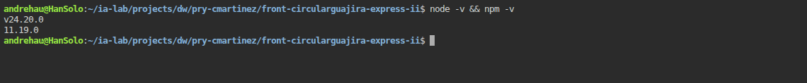

**Ev2 — Angular CLI:** `command -v ng` apunta a `~/.nvm/.../bin/ng`, enlace a `@angular/cli/bin/ng.js`; `ng version` reporta Angular CLI 22.2.3.

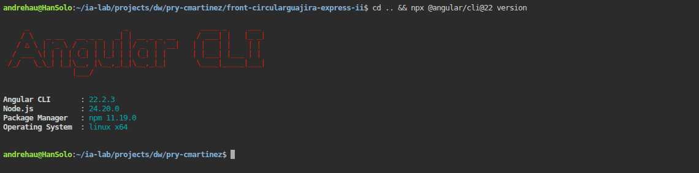

**Ev3 — Backend:** `npm run db:migrate && npm run db:seed` concilia 5 roles y 87 recursos; `npm run dev` levanta en el puerto 4000, `/health` responde 200 y el puerto está en LISTEN.

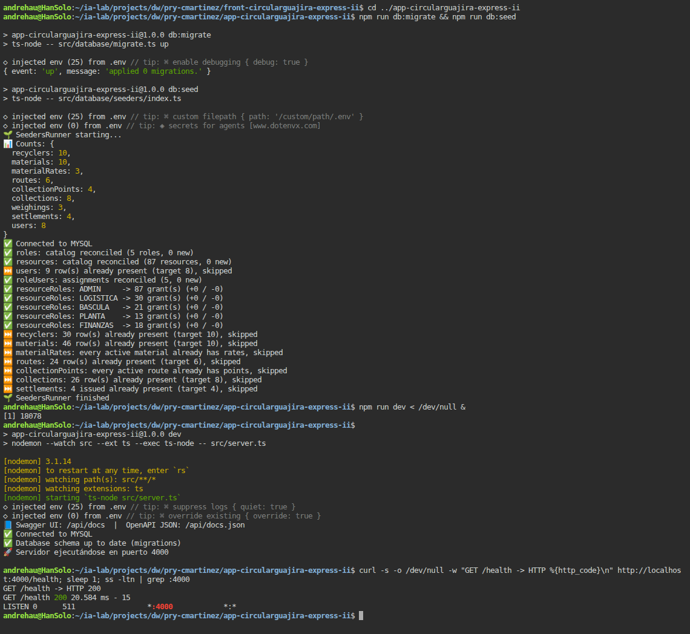

**Ev4 — Login:** `POST /api/session/login` con `admin` devuelve `accessToken`, `tokenType: Bearer`, `expiresIn: 900`, `refreshToken` y `refreshExpiresIn`.

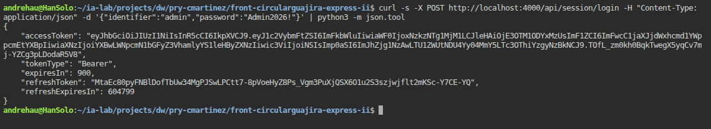

**Ev5 — Permisos admin:** con ese token, `GET /api/session/permissions` devuelve filas `{ resourceId, method, path }`, 87 en total.

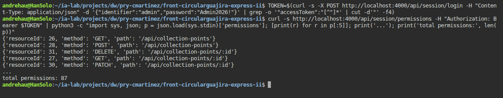

**Ev6 — Demás roles:** el ciclo de login + permisos da logistica 30, bascula 21, planta 13 y finanzas 18.

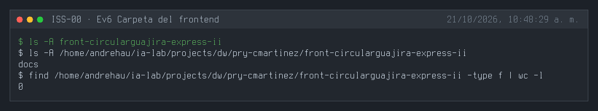

**Ev7 — DevTools:** Network muestra `login` y `permissions` con 200 y Console imprime `GET /api/session/permissions -> 200, 87 permisos`.

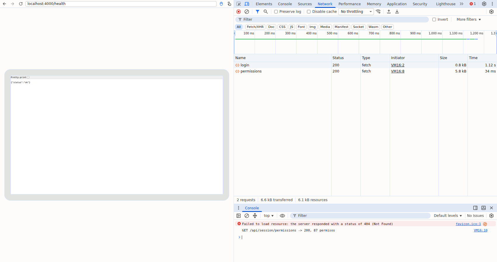

**Ev8 — Carpeta del frontend:** en el commit `820bc53` de este ISS, `git ls-tree` muestra solo `docs` y ningún `src/` ni `package.json`.

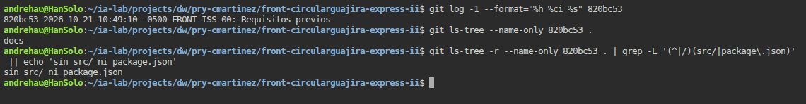

**Ev9 — Backend protegido:** `curl -i http://localhost:4000/api/recyclers` responde `401 Unauthorized` con "Falta el token de acceso".

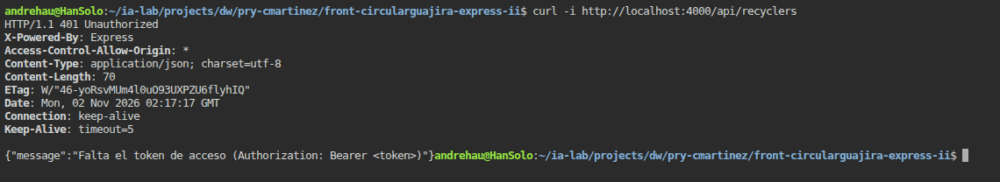

**Ev10 — Perfil:** con el token del admin, `GET /api/session/profile` devuelve `id`, `username`, `email`, `status` y `roles: ["ADMIN"]`.

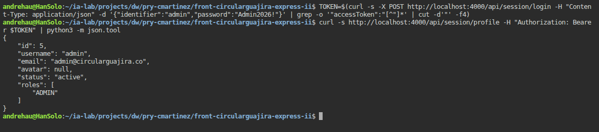

**Ev11 — Usuario sin rol:** `homero.7lhgr` (usuario aleatorio del seeder, `Usuario2026!`) inicia sesión, pero tiene `roles: []`, `permissions: []` y `GET /api/recyclers` responde 403.

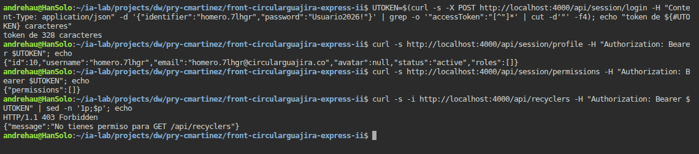

**Ev12 — Authorization en Network:** la petición `permissions` (200) muestra en Request Headers `Authorization: Bearer eyJ...`.

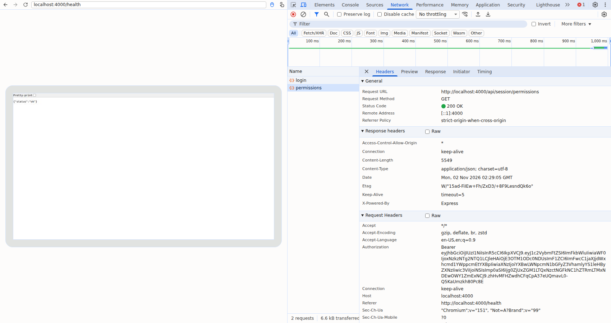

### Commit

```bash
git add docs/PROCESO.md docs/images/Ev1-ISS-00.png docs/images/Ev2-ISS-00.png docs/images/Ev3-ISS-00.png \
  docs/images/Ev4-ISS-00.png docs/images/Ev5-ISS-00.png docs/images/Ev6-ISS-00.png
git commit -m "FRONT-ISS-00: Requisitos previos"
git push origin main
```

Commit: [`820bc53`](https://github.com/DW-2026-IISem/dw-2026-Andreushin/commit/820bc535796b844270434257844df1f83bbb63ad)

Capturas reales de evidencias: [`2b8fc5b`](https://github.com/DW-2026-IISem/dw-2026-Andreushin/commit/2b8fc5b964c31496944f6bbd8cd001e5b4afebe3)

Criterios consolidados de la guía:

```bash
git add docs/PROCESO.md docs/images/Ev1-ISS-00.png docs/images/Ev2-ISS-00.png docs/images/Ev3-ISS-00.png \
  docs/images/Ev4-ISS-00.png docs/images/Ev5-ISS-00.png docs/images/Ev6-ISS-00.png docs/images/Ev7-ISS-00.png \
  docs/images/Ev8-ISS-00.png docs/images/Ev9-ISS-00.png
git commit -m "FRONT-ISS-00: Criterios consolidados de requisitos previos"
git push origin main
```

Commit: [`2adf274`](https://github.com/DW-2026-IISem/dw-2026-Andreushin/commit/2adf274138e969c8b2b23f868176a7527bd22b02)

Sub-ítems de perfil, usuario sin rol y Authorization:

```bash
git add docs/PROCESO.md docs/images/Ev10-ISS-00.png docs/images/Ev11-ISS-00.png docs/images/Ev12-ISS-00.png
git commit -m "FRONT-ISS-00: Perfil, usuario sin rol y Authorization en Network"
git push origin main
```

Commit: [`89ba2b1`](https://github.com/DW-2026-IISem/dw-2026-Andreushin/commit/89ba2b18db06c2b6670b148daf5e473f8746c5e7)

### ISS-01 — Bootstrap Angular 22 con CLI

Crear el proyecto con el Angular CLI actual sin carpeta adicional, integrar Tailwind y PrimeNG compatibles y dejar el tema Aura funcionando. Al final `ng serve` muestra la pantalla inicial sin errores. App compone un único componente de aprendizaje, `demo/example`: un objeto `Material` en un `signal`, dos `computed` y un `effect` (equivalente al producto con IVA de la guía: aquí el valor liquidado es tarifa × peso neto).

El tema Aura de PrimeNG pinta los controles (variables CSS generadas en runtime); las utilidades Tailwind resuelven espacio, tipografía y color en el HTML. El orden de capas `theme, base, primeng, utilities` hace que Tailwind gane sin `!important`.

Criterios de aceptación (ISS-01)

- [x] Existen `angular.json`, `package.json`, `src/main.ts` y `src/app/app.config.ts` directamente en la carpeta del proyecto (sin subcarpeta)
- [x] `src/app/app.routes.ts` existe con `export const routes` y `provideRouter` está en `app.config.ts`
- [x] `npm ls primeng @primeuix/themes primeicons @angular/cdk --depth=0` muestra versiones compatibles con Angular 22; `package-lock.json` se conserva
- [x] `src/styles.css` declara el orden de capas e importa `tailwindcss` y `primeicons/primeicons.css`
- [x] `providePrimeNG` usa el preset Aura y `darkModeSelector: '.app-dark'`
- [x] `providePrimeNG` lee `environment.primeUiLicense` y se entiende el aviso Invalid PrimeUI License
- [x] `app.ts` importa `Example` y `app.html` contiene `<app-example />`; `app.css` queda vacío; `app.routes.ts` sigue vacío
- [x] Existe el componente `src/app/demo/example/` (`.ts`, `.html`, `.css`, `.spec.ts`) con un objeto en un `signal`
- [x] `index.html` tiene `<title>CircularGuajira Express II · Angular 22</title>`, `lang="es"` y `<body class="m-0 bg-slate-100 font-sans text-slate-900">`
- [x] El presupuesto `initial` de producción es 750kB / 1MB
- [x] `ng serve` compila sin errores y `http://localhost:4200` responde 200
- [x] En pantalla se ve la tarjeta del material; +100 cambia la tarifa y el valor liquidado sin recargar
- [x] Explica el arranque `index.html` → `main.ts` → `app.config.ts` → App → `<app-example />` → `demo/example` y la función de los cuatro archivos de un componente
- [x] Explica cómo el selector del componente se convierte en la etiqueta que se escribe en `app.html`
- [x] Distingue `signal`, `computed` y `effect` sobre el código real de `demo/example/example.ts`
- [x] Explica el aislamiento de estilos con la clase `.example-scope` de `example.css` y el atributo `_ngcontent-…`
- [x] La consola del navegador no muestra errores de código; `[PrimeUI] PrimeUI license is not configured` está identificado como aviso de licencia
- [x] La consola del navegador no muestra errores de dependencias ni de tema
- [x] `ng build` termina con código 0

### Pasos

```bash
cd ~/ia-lab/projects/dw/pry-cmartinez/front-circularguajira-express-ii
ng new front-circularguajira-express-ii --directory . --style=tailwind --routing \
  --ssr=false --skip-git --package-manager=npm --defaults
npm install
npm view primeng version peerDependencies --json
npm install primeng @primeuix/themes primeicons @angular/cdk
ng generate environments
ng generate component demo/example
# styles.css, app.config.ts, environment*.ts, app.ts/html/css/spec, app.routes.ts,
# index.html, README.md y presupuesto initial en angular.json
npm start
```

### Verificación del ISS

```bash
ng build
grep -R "providePrimeNG\|@import 'tailwindcss'" src | head
npm ls primeng @primeuix/themes primeicons @angular/cdk --depth=0
node -e "const a=require('./angular.json');const p=a.projects[Object.keys(a.projects)[0]];console.log(p.architect.build.configurations.production.budgets[0])"
cat src/styles.css
grep -n "imports: \[Example\]" src/app/app.ts
grep -n "app-example" src/app/app.html
grep -n "signal<\|computed(\|effect(" src/app/demo/example/example.ts
npm test -- --watch=false
```

**Verificación:** `ng serve` muestra la tarjeta del material con Tailwind y Aura activos; +100 cambia la tarifa y el valor liquidado sin recargar, el estado alterna el mensaje y el presupuesto está ajustado.

#### Evidencias

**Ev1 — Proyecto en la carpeta:** los cinco archivos clave están en la raíz del proyecto, sin subcarpeta.

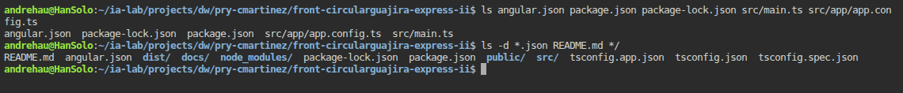

**Ev2 — Rutas:** `app.routes.ts` exporta `routes: Routes = []` y `app.config.ts` usa `provideRouter`.

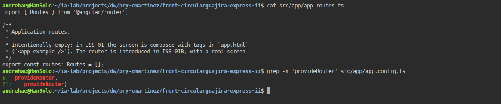

**Ev3 — PrimeNG:** `primeng@22.1.4`, `@primeuix/themes@3.1.0`, `primeicons@8.0.2`, `@angular/cdk@22.2.5`; los peers de PrimeNG piden `@angular/* ^22.1.0` y existe `package-lock.json`.

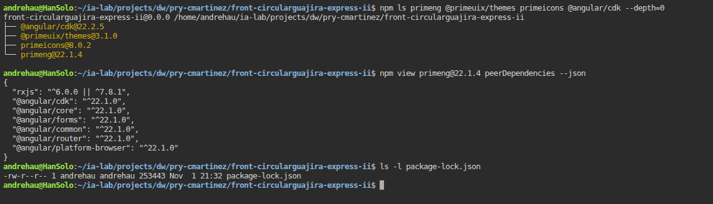

**Ev4 — Estilos globales:** `styles.css` declara `@layer theme, base, primeng, utilities;` e importa `tailwindcss` y `primeicons`.

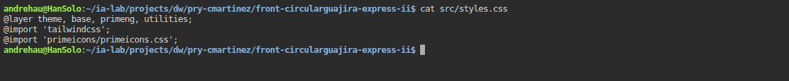

**Ev5 — Tema:** `providePrimeNG` con `preset: Aura`, `darkModeSelector: '.app-dark'` y `cssLayer` `primeng`.

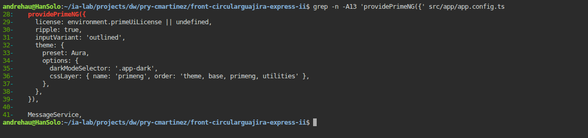

**Ev6 — Licencia:** `license: environment.primeUiLicense || undefined`; `primeUiLicense: ''` en ambos environments y `fileReplacements` para desarrollo. Sin clave aparece la banda Invalid PrimeUI License (Ev12).

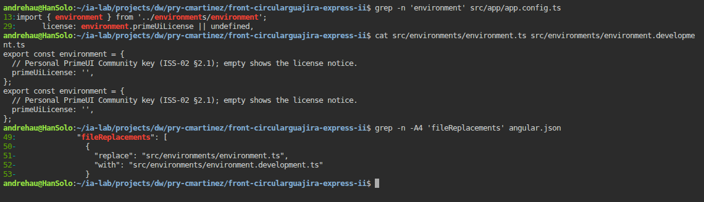

**Ev7 — Composición:** `app.ts` importa `Example`, `app.html` contiene `<app-example />`, `app.css` solo tiene un comentario y `routes` sigue vacío.

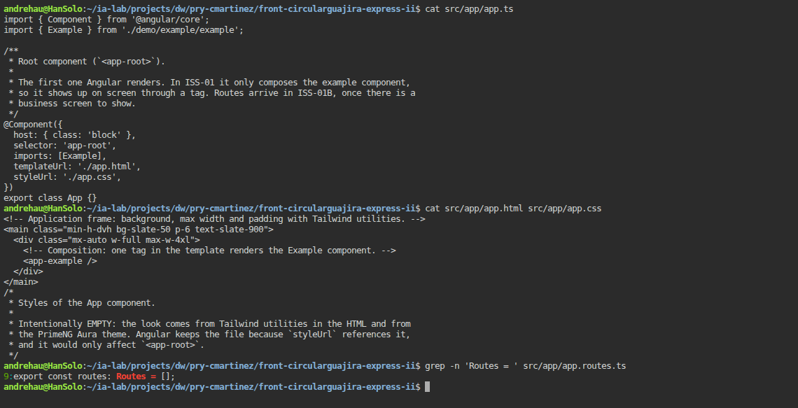

**Ev8 — Componente de ejemplo:** `demo/example` tiene sus cuatro archivos y `material = signal<Material>(createInitialMaterial())`.

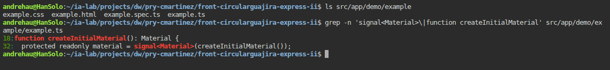

**Ev9 — index.html:** `lang="es"`, título, meta description y `<body class="m-0 bg-slate-100 font-sans text-slate-900">`.

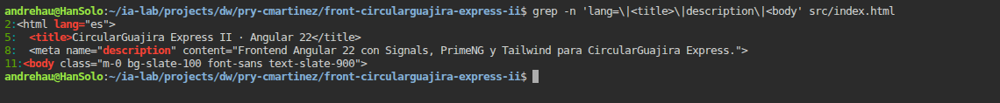

**Ev10 — Presupuesto:** `initial` con `maximumWarning: "750kB"` y `maximumError: "1MB"`.

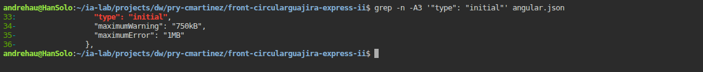

**Ev11 — ng serve:** `npm start` compila y `GET http://localhost:4200` responde 200 con el título del proyecto.

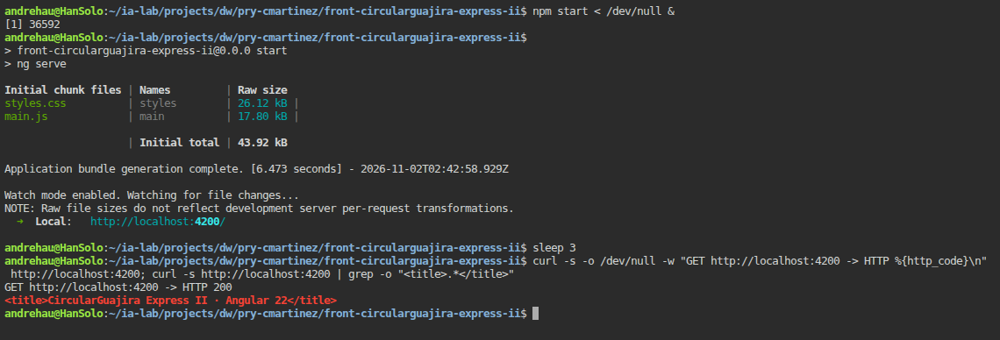

**Ev12 — Pantalla tras +100:** tarjeta «Objeto material» con tarifa 1900 y valor liquidado 19000, etiqueta Activo, las tarjetas Signals y Estilos y la banda de licencia.

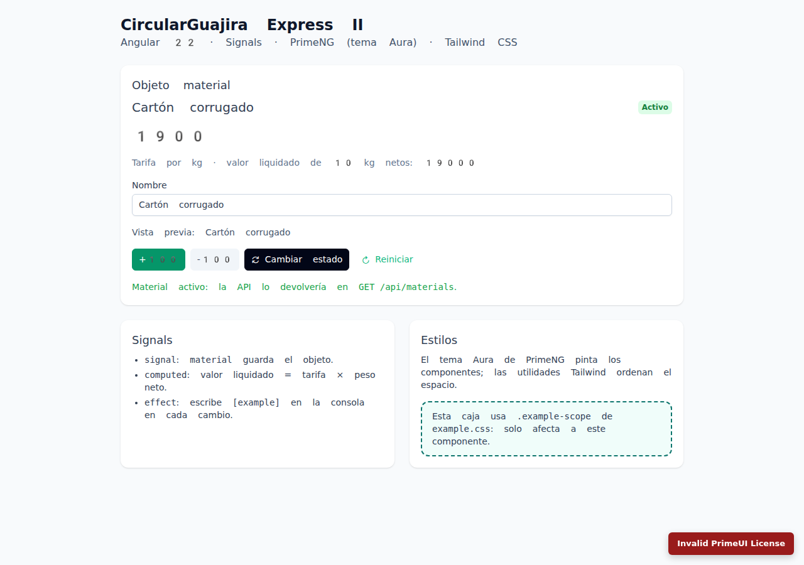

**Ev13 — Arranque:** `index.html` (`<app-root>`) → `main.ts` (`bootstrapApplication`) → `app.config.ts` (providers) → `app.ts` (`imports: [Example]`) → `app.html` (`<app-example />`) → `demo/example` (`.ts` clase, `.html` vista, `.css` estilos privados, `.spec.ts` prueba).

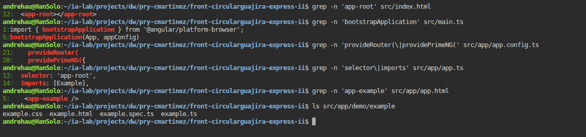

**Ev14 — Selector a etiqueta:** `selector: 'app-example'` en `example.ts` más `imports: [Example]` en `app.ts` hacen que `<app-example />` de `app.html` pinte el componente; `host: { class: 'block' }` da la clase al anfitrión.

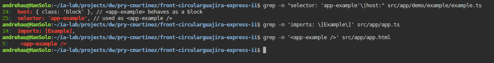

**Ev15 — signal, computed y effect:** `material` es el estado (`signal`), `settlementValue` y `statusLabel` se derivan (`computed`), `logger` registra en consola (`effect`); los métodos usan `update` con `{ ...current }` o `set`, sin mutar el objeto. Sin Zone.js: el signal avisa a la vista.

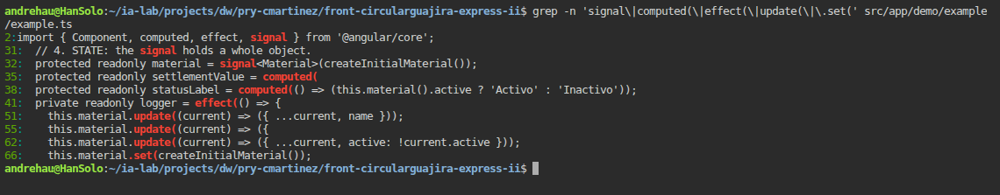

**Ev16 — Encapsulamiento:** `example.css` define `.example-scope` y el build la emite como `.example-scope[_ngcontent-%COMP%]`, que solo afecta a `<app-example>`.

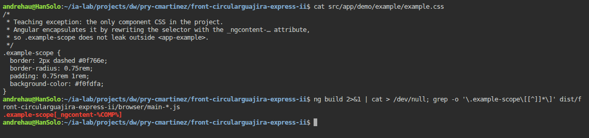

**Ev17 — Consola:** Chromium carga la app y registra 0 errores, el aviso `[PrimeUI] PrimeUI license is not configured` y los logs del `effect` 1800 → 1900 tras +100.

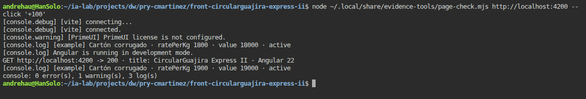

**Ev18 — Tema cargado:** `--p-primary-color` vale `light-dark(#10b981,#34d399)` en runtime (Aura) y la consola no tiene errores de dependencias ni de tema.

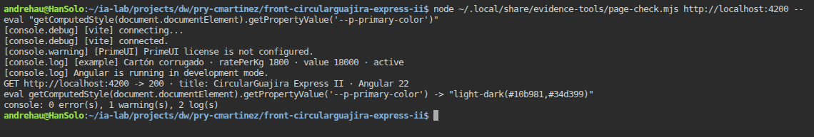

**Ev19 — Build y pruebas:** `ng build` termina con código 0 (Initial total 602.96 kB, sin warning) y `ng test` aprueba 7 pruebas (3 de App + 4 del ejemplo).

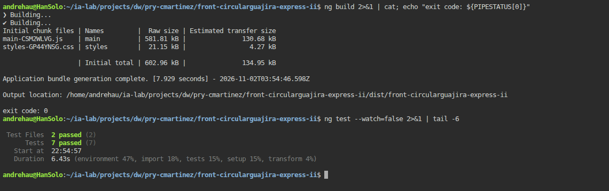

### Commit

```bash
git add .editorconfig .gitignore .postcssrc.json .prettierrc .vscode README.md angular.json \
  package.json package-lock.json tsconfig.json tsconfig.app.json tsconfig.spec.json public src \
  docs/PROCESO.md docs/images/Ev*-ISS-01.png
git commit -m "FRONT-ISS-01: Bootstrap Angular 22 con CLI"
git push origin main
```

Commit: [`64b8292`](https://github.com/DW-2026-IISem/dw-2026-Andreushin/commit/64b829293197dfa27324ea478fe6fe38318a5632)

### ISS-01A — Esqueleto Header / Aside / contenido / Footer

Construir primero la pantalla: Header arriba, Aside a la izquierda del contenido y Footer abajo a todo el ancho, con datos fijos y sin llamadas a la API. Los tres componentes de `layout/` son de presentación: no inyectan servicios ni conocen permisos. `demo/example` deja de componerse y queda solo como material de consulta del ISS-01.

Un componente generado no se ve hasta que el padre lo declara en `imports` (paso 1) y escribe su selector como etiqueta en su plantilla (paso 2).

Criterios de aceptación (ISS-01A)

- [x] Explica por qué un componente generado no aparece hasta que el padre lo declara en `imports` y usa su selector
- [x] Existen `src/app/layout/header/`, `src/app/layout/aside/` y `src/app/layout/footer/`, cada una con `.ts`, `.html` y `.css`
- [x] `header.ts` declara `title` y `header.html` lo muestra con `{{ title }}`
- [x] Los tres `.css` de `layout/` no contienen reglas: solo un comentario que explica por qué están vacíos
- [x] `app.ts` importa `Header`, `Aside` y `Footer` y los declara en `imports`
- [x] `app.html` compone las cuatro regiones: `<app-header />`, `<aside>` con `<app-aside />`, `<main>` con el contenido y `<app-footer />`
- [x] `app.html` ya no contiene `<app-example />`: `demo/example` no forma parte de la aplicación
- [x] Se ven las cuatro regiones, el Footer queda abajo y no hay desplazamiento horizontal
- [x] En Network no aparece ninguna petición `/api`
- [x] `ng build` termina con código 0 y las pruebas pasan

### Pasos

```bash
ng generate component layout/header --skip-tests --defaults
ng generate component layout/aside --skip-tests --defaults
ng generate component layout/footer --skip-tests --defaults
# header.ts/html, aside.ts/html, footer.ts/html, los tres .css con comentario,
# app.ts (imports: [Header, Aside, Footer]), app.html (cuatro regiones) y app.spec.ts
npm start
```

### Verificación del ISS

```bash
ng build
ls src/app/layout/header src/app/layout/aside src/app/layout/footer
grep -n "imports: \[Header, Aside, Footer\]" src/app/app.ts
grep -n "app-header\|app-aside\|app-footer" src/app/app.html
grep -c "app-example" src/app/app.html || echo "no aparece: correcto"
grep -v "^\s*$" src/app/layout/*/*.css | grep -v "^\S*: \*\|/\*\|^\S*:  \*" || echo "sin reglas: correcto"
npm test -- --watch=false
```

**Verificación:** la pantalla tiene las cuatro regiones, el Footer se mantiene abajo, no hay scroll horizontal y la aplicación no depende de la API.

#### Evidencias

**Ev1 — imports + selector:** `app.ts` declara `imports: [Header, Aside, Footer]`, cada componente tiene su `selector` (`app-header`, `app-aside`, `app-footer`) y `app.html` escribe esas etiquetas; sin uno de los dos pasos el componente no se pinta.

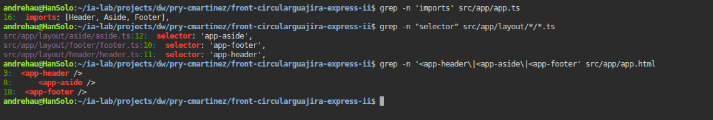

**Ev2 — layout/:** `header/`, `aside/` y `footer/` tienen `.ts`, `.html` y `.css` (generados con `--skip-tests`).

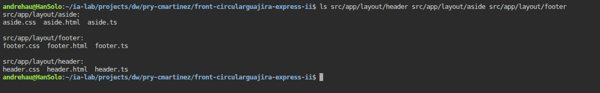

**Ev3 — Header:** `readonly title = 'CircularGuajira Express II'` y `header.html` lo muestra con `{{ title }}`.

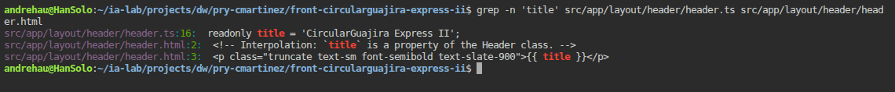

**Ev4 — CSS vacíos:** los tres `.css` solo tienen un comentario; el filtro de la verificación responde «sin reglas: correcto».

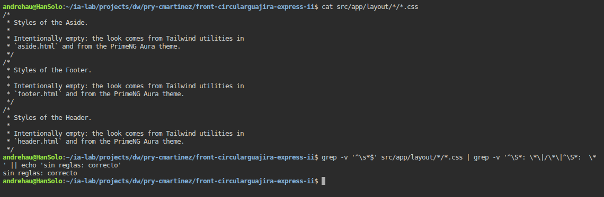

**Ev5 — Imports de App:** `app.ts` importa `Aside`, `Footer` y `Header` y los declara en `imports`.

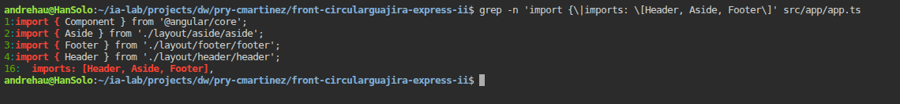

**Ev6 — Composición:** `app.html` con `<app-header />`, `<aside class="w-64 shrink-0">` con `<app-aside />`, `<main id="content" class="min-w-0 flex-1 p-6 wrap-break-word">` y `<app-footer />`.

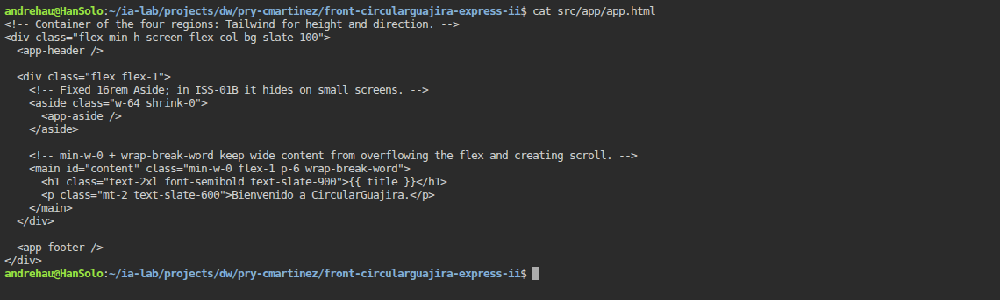

**Ev7 — Sin demo:** `grep -c 'app-example' src/app/app.html` da 0.

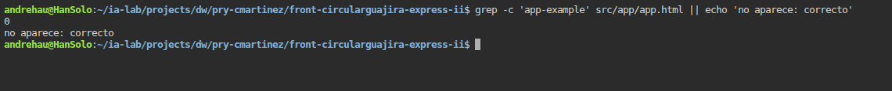

**Ev8 — Pantalla:** Header blanco con CircularGuajira Express II, Aside oscuro con Menú de CircularGuajira, contenido Inicio / Bienvenido a CircularGuajira. y Footer abajo a todo el ancho.

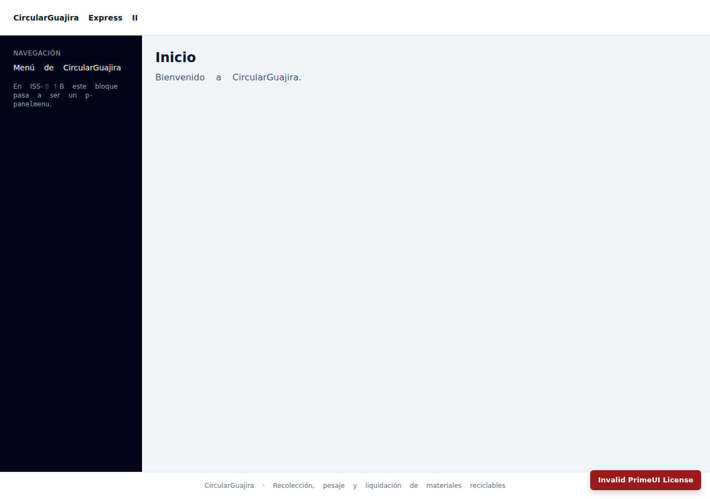

**Ev9 — Medidas y Network:** sobre el build servido en `localhost:4300`, Header 64 px, Aside 256 px, `main` desde x = 256, Footer termina en 900 = alto de la ventana y `scrollWidth = clientWidth` a 1280 y a 390 px; ninguna respuesta `/api` y 0 errores de consola.

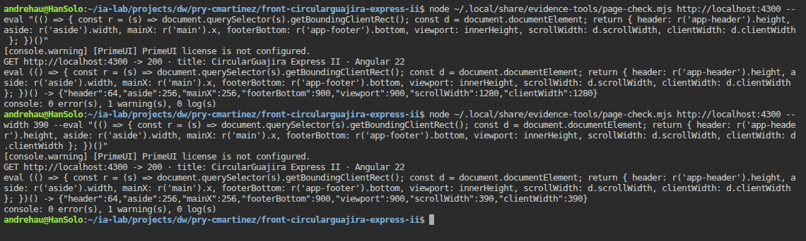

**Ev10 — Build y pruebas:** `ng build` termina con código 0 (Initial total 415.81 kB) y `ng test` aprueba 8 pruebas (4 de App + 4 del ejemplo).

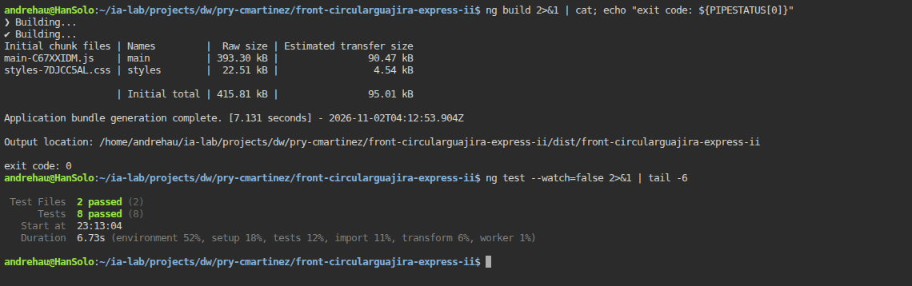

### Commit

```bash
git add src/app/app.ts src/app/app.html src/app/app.spec.ts src/app/layout \
  docs/PROCESO.md docs/images/Ev*-ISS-01A.png
git commit -m "FRONT-ISS-01A: Esqueleto Header / Aside / contenido / Footer"
git push origin main
```

Commit: [`48a2c32`](https://github.com/DW-2026-IISem/dw-2026-Andreushin/commit/48a2c326281f845c42fce9bf0c118d638c82b080)

### ISS-01B — Menú PrimeNG y primera interacción

Pasar de una maqueta a una pantalla que responde: PanelMenu en el Aside, botón de menú en el Header, Drawer en pantalla pequeña y selección que cambia el contenido local. Sin rutas de negocio y sin API. La pantalla es `features/prototype` (equivale a `construir` de la guía) y las cinco opciones son las del dominio: Inicio, Recicladores, Materiales y tarifas, Rutas de recolección y Pesajes y liquidaciones.

`input()` es el dato que el padre entrega al hijo (`items`, `appName`); `output()` es el aviso que el hijo devuelve al padre (`menuRequested`, `navigated`); `signal()` es el estado propio de la pantalla (`title`, `mobileOpen`, `sidebarCollapsed`). `[(visible)]` en el Drawer es ida y vuelta en un solo atributo.

Criterios de aceptación (ISS-01B)

- [x] Explica la diferencia entre `input()` (dato del padre al hijo), `output()` (aviso del hijo al padre) y `signal()` (estado propio)
- [x] `aside.ts` declara `items = input<MenuItem[]>([])` y `aside.html` lo pinta con `<p-panelmenu [model]="items()" [multiple]="true" />`
- [x] `aside.css` sigue sin reglas: la apariencia es de Aura y Tailwind
- [x] El Header emite `menuRequested` y su botón está siempre visible: por debajo de `lg` abre el Drawer, desde `lg` alterna el Aside fijo
- [x] Existe `src/app/features/prototype/` con `prototype.ts`, `prototype.html`, `prototype.css` y `prototype.spec.ts`
- [x] `mobileOpen`, `sidebarCollapsed` y `title` son `signal`; elegir una opción cambia el título y cierra el Drawer
- [x] El layout se compone una sola vez en `prototype.html` y se reutiliza en el Drawer
- [x] `app.ts` importa `RouterOutlet` y `app.html` contiene solo `<router-outlet />`
- [x] `app.routes.ts` declara `prototype` con `loadComponent` y redirige `''` y `**` a `prototype`
- [x] A 1280 px se ve el Aside con las cinco opciones; a 390 px se oculta y el botón abre el Drawer
- [x] A 1280 px el botón de menú se ve y oculta/muestra el Aside sin abrir el Drawer
- [x] La URL no cambia al elegir una opción y Network no registra llamadas `/api`
- [x] `ng build` termina con código 0, `prototype` se empaqueta como chunk diferido y las pruebas pasan

### Pasos

```bash
ng generate component features/prototype --skip-tests --defaults
# core/utils/media-query.ts (watchMediaQuery), aside.ts/html (input/output + p-panelmenu),
# header.ts/html (menuRequested), prototype.ts/html/css/spec (estado y Drawer),
# app.ts/html (RouterOutlet), app.routes.ts (loadComponent) y public/brand/circularguajira-mark.svg
npm start
```

### Verificación del ISS

```bash
ng build
grep -n "input<MenuItem\[\]>" src/app/layout/aside/aside.ts
grep -n "menuRequested" src/app/layout/header/header.ts
grep -rn "lg:hidden" src/app/layout/header/header.html || echo "sin lg:hidden: correcto"
grep -n "signal(" src/app/features/prototype/prototype.ts
grep -n "app-header\|app-aside\|app-footer\|p-drawer" src/app/features/prototype/prototype.html
grep -n "RouterOutlet" src/app/app.ts
grep -n "loadComponent" src/app/app.routes.ts
for f in src/app/layout/*/*.css src/app/features/prototype/*.css; do
  grep -q '[{}]' "$f" && echo "REGLAS EN $f"
done
npm test -- --watch=false
```

**Verificación:** el Aside pinta el menú que recibe, el Header avisa sin conocer el estado ajeno, el Drawer funciona en móvil y App quedó como punto de entrada con `router-outlet`. No hay llamadas a la API y los CSS de `layout/` y `prototype/` siguen vacíos.

#### Evidencias

**Ev1 — input, output y signal:** Aside y Header solo declaran `input()` y `output<void>()`; `prototype.ts` tiene los tres `signal`; en `prototype.html` viajan `[items]` hacia abajo y vuelven `(menuRequested)` y `(navigated)`, más `[(visible)]` en el Drawer.

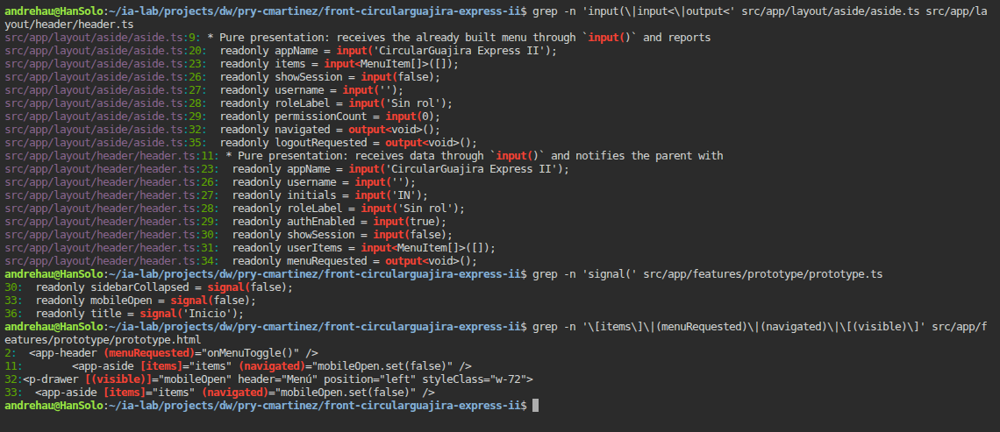

**Ev2 — Aside:** `items = input<MenuItem[]>([])` y `<p-panelmenu [model]="items()" [multiple]="true" />`.

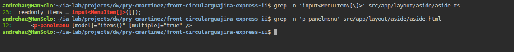

**Ev3 — CSS sin reglas:** el ciclo sobre los `.css` de `layout/` y `prototype/` no imprime ningún «REGLAS EN».

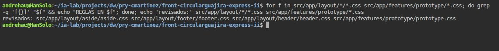

**Ev4 — Botón de menú:** `menuRequested = output<void>()` y el botón lo emite; no hay `lg:hidden`; `onMenuToggle` alterna `sidebarCollapsed` en escritorio y abre `mobileOpen` en móvil.

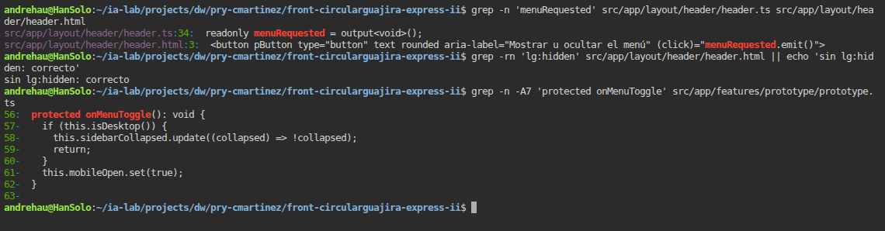

**Ev5 — features/prototype:** `prototype.ts`, `prototype.html`, `prototype.css` y `prototype.spec.ts`.

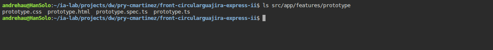

**Ev6 — Estado:** `sidebarCollapsed`, `mobileOpen` y `title` son `signal`; los cinco `command` llaman a `select`, que hace `title.set(title)` y `mobileOpen.set(false)`.

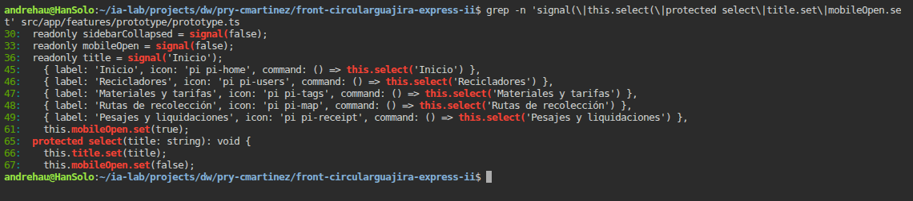

**Ev7 — Layout una vez:** `prototype.html` compone `app-header`, `app-aside` y `app-footer`, y el `p-drawer` reutiliza el mismo `<app-aside [items]="items">`.

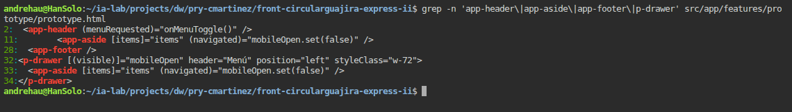

**Ev8 — Punto de entrada:** `app.ts` importa `RouterOutlet` y `app.html` solo contiene `<router-outlet />`.

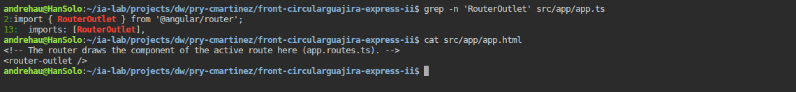

**Ev9 — Rutas:** `prototype` con `loadComponent`, `''` con `pathMatch: 'full'` y `**` redirigen a `prototype`.

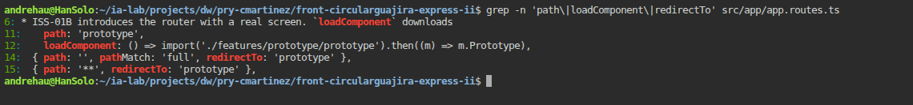

**Ev10 — Escritorio y móvil:** a 1280 px el Aside fijo muestra logo y las cinco opciones; a 390 px el Aside no se ve y el botón abre el Drawer con las mismas cinco opciones.


**Ev11 — Botón en escritorio:** a 1280 px el Aside mide 288 px; el primer clic lo quita del DOM (`sin aside`) sin abrir Drawer y el segundo lo devuelve.


**Ev12 — Móvil, URL y Network:** a 390 px el Aside no se ve, el botón abre el Drawer, «Recicladores» cambia el `<h1>` y cierra el Drawer; la URL sigue en `/prototype` y no hay respuestas `/api`.


**Ev13 — Build y pruebas:** `ng build` termina con código 0, `main` 117.15 kB y `prototype` como chunk diferido de 226.62 kB; `ng test` aprueba 13 pruebas en 3 archivos.


### Commit

```bash
git add src/app/app.ts src/app/app.html src/app/app.routes.ts src/app/app.spec.ts \
  src/app/layout/aside src/app/layout/header src/app/features/prototype src/app/core \
  public/brand docs/PROCESO.md docs/images/Ev*-ISS-01B.png
git commit -m "FRONT-ISS-01B: Menú PrimeNG y primera interacción"
git push origin main
```

Commit: [`1bcce95`](https://github.com/DW-2026-IISem/dw-2026-Andreushin/commit/1bcce9522bb2bd9160264aa18351217bebb981f6)

### ISS-02 — Núcleo: environment, modelos, servicios y layout

Dejar lista la capa de infraestructura antes de las pantallas de negocio: `environment` con la URL del backend, interfaces que reflejan el contrato real de Express, servicios HTTP que devuelven `Observable<T>` ya desenvuelto, utilidades transversales, componentes de UI reutilizables y el layout `Shell`. Todavía no hay ninguna petición HTTP real.

El contrato se tomó del backend, no de la guía de StoreLab: campos en camelCase, listas envueltas en plural (`{ recyclers }`, `{ points }`, `{ rates }`, `{ assignments }`, `{ grants }`), un solo elemento sin envoltura y errores `{ message }`. Cadena: plantilla → componente → `RecyclerApi` → `GET /api/recyclers` → Express responde `{ recyclers: [...] }` → `pipe(map)` del servicio devuelve `Recycler[]` → el componente lo guarda en un `signal`. La respuesta se desenvuelve en el servicio.

Criterios de aceptación (ISS-02)

- [x] `environment.apiUrl === 'http://localhost:4000/api'`, sin slash final
- [x] `environment.ts` y `environment.development.ts` existen y `angular.json` aplica `fileReplacements`
- [x] Los 15 modelos compilan y coinciden campo a campo con los modelos del backend
- [x] `Money` acepta `number | string` y `toNumber()` normaliza DECIMAL
- [x] `status` no viaja en los payload de edición: solo el backend lo cambia con `/deactivate`
- [x] Cada servicio usa `this.base` construido desde `environment.apiUrl`
- [x] `list()` desenvuelve la colección (`{ recyclers }` → `Recycler[]`) y `get()`/`create()` devuelven la entidad tal como llega
- [x] Las envolturas pivote son `{ assignments }` y `{ grants }`, no `{ role_users }`
- [x] `toApiMessage` distingue `status === 0` (backend caído) de un 403
- [x] `NotificationService` traduce a `MessageService` con duraciones por severidad
- [x] `PageHeader`, `EmptyState` y `StatusTag` compilan como standalone y no añaden CSS
- [x] `StatusTag` se repinta al cambiar el input gracias a `computed`
- [x] `Shell` compone Header/aside/router-outlet/Footer una sola vez; el botón del Header alterna el Aside en escritorio y abre el Drawer en móvil
- [x] `app.routes.ts` carga `Shell` con `loadComponent` y conserva el prototipo
- [x] `provideHttpClient()` está registrado y no hay interceptores de sesión
- [x] `ng build` termina con código 0 y `shell` aparece como chunk diferido
- [x] Las pruebas pasan: 10 archivos, 33 casos

### Pasos

```bash
ng generate component shared/ui/page-header --skip-tests --defaults
ng generate component shared/ui/empty-state --skip-tests --defaults
ng generate component shared/ui/status-tag --skip-tests --defaults
ng generate component layout/shell --skip-tests --defaults
# environment*.ts (production, appName, apiUrl, requireAuth, primeUiLicense)
# core/models/*.model.ts (15), features/*/*-api.ts (12), core/utils/api-error.ts,
# core/services/notification.ts, shared/ui, layout/shell, app.routes.ts y provideHttpClient()
# vitest-base.config.ts (maxWorkers: 2) enlazado en angular.json → test → runnerConfig
```

### Verificación del ISS

```bash
ng build
grep -n "apiUrl" src/environments/environment.ts src/environments/environment.development.ts
ls src/app/core/models/*.model.ts
grep -rn "\.pipe(map" src/app/features src/app/core | wc -l
grep -n "provideHttpClient" src/app/app.config.ts
grep -rn "withInterceptors" src/app/app.config.ts || echo "sin interceptores: correcto"
grep -n "assignments\|grants" src/app/features/admin/*/*-api.ts
for f in src/app/shared/ui/*/*.css src/app/layout/shell/shell.css; do
  grep -q '[{}]' "$f" && echo "REGLAS EN $f"
done
npm test -- --watch=false
```

**Verificación:** una URL de backend, 15 modelos que reflejan las tablas, 12 servicios que desenvuelven la respuesta de Express, dos utilidades transversales, tres componentes de UI y un `Shell` que conserva el layout al navegar; sin llamadas `/api` todavía.

#### Evidencias

**Ev1 — apiUrl:** ambos environments declaran `apiUrl: 'http://localhost:4000/api'`, sin slash final.


**Ev2 — Environments:** existen `environment.ts` y `environment.development.ts`; `fileReplacements` los intercambia en desarrollo.


**Ev3 — Modelos:** 15 archivos en `core/models`, `tsc --noEmit` los compila y los campos de `Recycler` coinciden uno a uno con el modelo del backend (los `readonly` finales son las marcas de tiempo de Sequelize).


**Ev4 — Money:** `Money = number | string` y `toNumber()` normaliza; 11 campos numéricos usan `Money`.


**Ev5 — Payload de edición:** los `*UpdatePayload` son `Omit<..., 'status'>` o interfaces sin `status`; `UserUpdatePayload` no lo tiene.


**Ev6 — base:** los 12 servicios construyen `base` desde `environment.apiUrl`.


**Ev7 — Desenvolver:** `list()` hace `pipe(map((response) => response.recyclers))` y los demás métodos devuelven `Observable<Recycler>`; las 4 pruebas de `RecyclerApi` con `HttpTestingController` pasan.


**Ev8 — Pivotes:** `RoleUserApi` desenvuelve `{ assignments }` y `ResourceRoleApi` `{ grants }` con los filtros `roleId`/`resourceId`; sus 2 pruebas pasan.


**Ev9 — toApiMessage:** rama `status === 0` y lectura de `body.message`; las 4 pruebas (backend caído, 403, texto plano y error genérico) pasan.


**Ev10 — Notificaciones:** `success` 3000 ms, `info` 3500, `warn` 4500 y `error` 6000; la prueba lo comprueba sobre `MessageService`.


**Ev11 — UI compartida:** `app-page-header`, `app-empty-state` y `app-status-tag` con `input()`/`input.required()`; ningún CSS tiene reglas.


**Ev12 — StatusTag:** `label` y `severity` son `computed`; al pasar el input a `inactive` cambian a Inactivo/danger.


**Ev13 — Shell:** `shell.html` monta header, aside, `router-outlet`, footer, Drawer, `p-toast` y `p-confirmdialog` una vez; las 5 pruebas cubren composición, hosts, enlaces reales, Drawer en móvil y Aside oculto en escritorio.


**Ev14 — Rutas:** `prototype` y `Shell` con `loadComponent`; la hija de `Shell` redirige a `/prototype`. En el build servido, `/` termina en `/prototype` sin errores ni respuestas `/api`.


**Ev15 — HttpClient:** `provideHttpClient()` registrado y sin `withInterceptors`.


**Ev16 — Build:** código 0, Initial total 517.99 kB; `shell` (96.69 kB) y `prototype` (7.77 kB) como chunks diferidos.


**Ev17 — Pruebas:** 10 archivos y 33 pruebas aprobadas.


### Commit

```bash
git add angular.json vitest-base.config.ts src/environments src/app/app.config.ts src/app/app.routes.ts \
  src/app/core src/app/features/recyclers src/app/features/materials src/app/features/routes \
  src/app/features/collections src/app/features/settlements src/app/features/admin \
  src/app/shared src/app/layout/shell docs/PROCESO.md docs/images/Ev*-ISS-02.png
git commit -m "FRONT-ISS-02: Núcleo: environment, modelos, servicios y layout"
git push origin main
```

Commit: [`722a9ec`](https://github.com/DW-2026-IISem/dw-2026-Andreushin/commit/722a9ec543b8b8b1cbc6d27ef7a39201e67ba69d)

### ISS-03 — CRUD de recicladores con Signals

Primer CRUD completo contra `/api/recyclers` (equivale a «clientes» de la guía): listar, crear, editar, baja lógica y baja física. `RecyclerForm` recibe `recycler` y `resetKey` con `input()` y devuelve el resultado con `output()` (`saved`, `cancelled`); no llama a la API. `RecyclerList` guarda todo el estado en signals, filtra con `computed` y decide entre `POST` y `PATCH`. El formulario replica las reglas del backend: documento `^\d{5,15}(-\d)?$`, teléfono `^\+?\d{7,15}$`, tipo `independent`/`organization`.

Fase I: el backend ya exige JWT (no tiene `AUTH_ENABLED`), así que la carga contra él muestra el 401 real en `p-message`. El flujo de escritura se comprobó contra un stub temporal del contrato de `/api/recyclers` en el puerto 4000 (fuera del repositorio), sembrado con los 10 recicladores activos del backend; el `environment` no se tocó.

Criterios de aceptación (ISS-03)

- [x] `recycler-list` y `recycler-form` existen y son standalone (`imports: [...]`, sin `NgModule`)
- [x] `filterRows` es una función pura y probada
- [x] El formulario no llama a la API: entra por `input()` y sale por `output<RecyclerPayload>()` / `output<void>()`
- [x] La lista usa `computed`, no tiene filtrado imperativo y la tabla usa `#caption/#header/#body/#emptymessage` de PrimeNG 22 (sin `pTemplate`)
- [x] La ruta `recyclers` es hija de `Shell`, `/` redirige a ella, el menú apunta a `/recyclers` y los CSS no tienen reglas
- [x] `GET /api/recyclers` pinta la tabla con los recicladores activos del seeder
- [x] «Nuevo reciclador» abre el diálogo, valida y crea (`POST`)
- [x] Editar abre el mismo formulario con los datos cargados y hace `PATCH` sin `status`
- [x] El buscador filtra sin recargar y sin llamar al backend
- [x] La baja lógica y la física desaparecen de la tabla
- [x] Un fallo de carga (`GET`) se muestra en `p-message` con la tabla vacía
- [x] Un fallo de operación (guardar) se muestra en un toast y el diálogo sigue abierto
- [x] La consola no muestra errores de código
- [x] `ng build` termina con código 0 y las pruebas pasan

### Pasos

```bash
ng generate component features/recyclers/recycler-list --skip-tests --defaults
ng generate component features/recyclers/recycler-form --skip-tests --defaults
# core/utils/filter-rows.ts (+ spec), recycler-form.ts/html/spec, recycler-list.ts/html/spec,
# ruta `recyclers` hija de Shell y redirección '' → 'recyclers'
# vitest-base.config.mts: 1 worker y testTimeout 60 s (la máquina de 4 GB pagina con 2 workers)
npm start
```

### Verificación del ISS

```bash
grep -n "export function filterRows" src/app/core/utils/filter-rows.ts
grep -n "output<RecyclerPayload>\|output<void>" src/app/features/recyclers/recycler-form/recycler-form.ts
grep -n "computed(" src/app/features/recyclers/recycler-list/recycler-list.ts
grep -n "applyFilter" src/app/features/recyclers/recycler-list/recycler-list.ts || echo "sin applyFilter: correcto"
grep -n "#caption\|#header\|#body\|#emptymessage" src/app/features/recyclers/recycler-list/recycler-list.html
grep -n "pTemplate=" src/app/features/recyclers/recycler-list/recycler-list.html || echo "sin pTemplate: correcto"
grep -n "recyclers" src/app/app.routes.ts src/app/layout/shell/shell.ts
curl -s -i http://localhost:4000/api/recyclers | sed -n '1p;$p'
npm test -- --watch=false
ng build
```

**Verificación:** la tabla lista los activos, el diálogo crea y edita con el mismo formulario, el buscador filtra en memoria, las bajas recargan la tabla y cada fallo tiene su canal (`p-message` para la carga, toast para la operación).

#### Evidencias

**Ev1 — Componentes:** `recycler-list` y `recycler-form` con sus cuatro archivos; ambos declaran `imports: [...]` y no hay `NgModule`.


**Ev2 — filterRows:** función pura exportada; sus 5 pruebas (copia sin término, mayúsculas, números, `null`, sin coincidencias) pasan.


**Ev3 — Formulario:** `recycler`, `resetKey` y `saving` son `input()`; `saved` y `cancelled` son `output()`; no usa `RecyclerApi` ni `HttpClient`; sus 7 pruebas pasan.


**Ev4 — Lista y tabla:** `visibleRows` y `title` son `computed`, no hay `applyFilter`, y la tabla usa `#caption`, `#header`, `#body` y `#emptymessage` sin `pTemplate`.


**Ev5 — Ruta y menú:** `'' → recyclers`, ruta `recyclers` con `loadComponent` y menú `/recyclers`; los CSS de `recyclers/` no tienen reglas.


**Ev6 — Tabla:** `/recyclers` con los 10 recicladores activos del seeder, tipo, contacto, dirección, estado Activo, los tres iconos de acción y el contador «10 activos» (captura rehecha en el ISS-04 tras corregir los iconos).


**Ev7 — Crear:** «Guardar» vacío muestra los tres mensajes de validación sin petición; con datos válidos hace `POST /api/recyclers` con `status: "active"`, responde 201, cierra el diálogo y el contador pasa a «11 activos».


**Ev8 — Editar:** el formulario abre con los datos de Teodoro Valadez y el estado deshabilitado (`aria-disabled="true"`); «Guardar» hace `PATCH /api/recyclers/4` sin `status` y la fila muestra el teléfono nuevo.


**Ev9 — Buscador:** «maicao» deja «2 de 11 coinciden» y al borrarlo vuelven las filas; ninguna petición nueva.


**Ev10 — Bajas:** «Desactivar» hace `PATCH /api/recyclers/10/deactivate` (11 → 10 activos) y «Eliminar» hace `DELETE /api/recyclers/6` (10 → 9).


**Ev11 — Error de carga:** contra el backend real, `GET /api/recyclers` responde 401 y la pantalla muestra «Falta el token de acceso (Authorization: Bearer <token>)» en `p-message`, tabla vacía y «Sin recicladores activos».


**Ev12 — Error de operación:** un documento repetido responde 409; el toast muestra «No se pudo guardar · Ya existe un registro con esos datos únicos» y el diálogo sigue abierto.


**Ev13 — Consola:** abrir y cancelar los diálogos de alta y edición y buscar termina con 0 errores (solo el aviso de licencia de PrimeUI).


**Ev14 — Build y pruebas:** `ng build` código 0 (Initial total 549.79 kB; `recycler-list` 570.34 kB diferido); las 10 pruebas de la lista pasan y la suite queda en 13 archivos y 55 pruebas.


### Commit

```bash
git add angular.json vitest-base.config.ts vitest-base.config.mts src/app/app.routes.ts \
  src/app/core/utils/filter-rows.ts src/app/core/utils/filter-rows.spec.ts \
  src/app/features/recyclers/recycler-list src/app/features/recyclers/recycler-form \
  docs/PROCESO.md docs/images/Ev*-ISS-03.png
git commit -m "FRONT-ISS-03: CRUD de recicladores con Signals"
git push origin main
```

Commit: [`f69f34e`](https://github.com/DW-2026-IISem/dw-2026-Andreushin/commit/f69f34e0d94668953f43d8a6239506aeb2444fcc)

### ISS-04 — CRUD de materiales

Repetir el patrón del ISS-03 con una entidad más simple: `/api/materials` (equivale a «tipos de producto» de la guía). Se reutiliza todo: servicio de ISS-02, signals de estado, `filterRows`, `computed`, `resetKey`, diálogo, confirmaciones y canales de error. Cambian el modelo (`name`, `description`, `status`), los campos buscables y los límites, que salen del backend: nombre obligatorio de máximo 60 caracteres y único (409), descripción hasta 255. La pantalla vive dentro de `Shell`, así que por URL directa conserva Header, Aside y Footer.

Al revisar la tabla se encontró que los botones de acción no mostraban icono: en PrimeNG 22 el atributo `icon` del directivo `pButton` ya no pinta nada. Se corrigió con `<i pButtonIcon>` en recicladores y materiales, con una prueba de regresión en cada lista.

Criterios de aceptación (ISS-04)

- [x] `material-list` y `material-form` existen, son standalone y repiten la estructura de recicladores (solo cambian modelo, campos y textos)
- [x] La tabla lista los materiales activos del backend con sus acciones visibles
- [x] Crear valida nombre obligatorio y máximo 60 caracteres antes de enviar
- [x] Editar carga el material y hace `PATCH` sin `status`
- [x] La baja lógica oculta el material del listado
- [x] El buscador filtra por nombre y descripción usando `filterRows`, sin peticiones
- [x] La ruta `/materials` funciona por URL directa con Header, Aside y Footer
- [x] Un fallo de carga se muestra en `p-message`
- [x] Un fallo de operación (nombre repetido, 409) se muestra en un toast con el diálogo abierto
- [x] La consola no muestra errores de código
- [x] `ng build` termina con código 0 y las pruebas pasan

### Pasos

```bash
ng generate component features/materials/material-list --skip-tests --defaults
ng generate component features/materials/material-form --skip-tests --defaults
# material-form.ts/html/spec, material-list.ts/html/spec, material-api.spec.ts,
# ruta `materials` hija de Shell y entrada «Materiales» en el menú;
# botones de acción con <i pButtonIcon> en recycler-list.html y material-list.html
npm start
```

### Verificación del ISS

```bash
curl -s -i http://localhost:4000/api/materials | sed -n '1p;$p'
grep -n "materials" src/app/app.routes.ts src/app/layout/shell/shell.ts
grep -n "filterRows(this.rows()" src/app/features/materials/material-list/material-list.ts
grep -rn 'icon="pi' src/app/features --include=*-list.html | grep -v app-empty-state || echo "acciones con pButtonIcon: correcto"
npm test -- --watch=false
ng build
```

**Verificación:** misma pantalla que recicladores con otra entidad; la tabla lista, crea, edita, da de baja y filtra en memoria, y la URL directa monta el Shell completo.

#### Evidencias

**Ev1 — Qué se reutiliza:** `materials/` tiene servicio, prueba, lista y formulario; el `diff` de miembros entre `RecyclerList` y `MaterialList` solo muestra `typeLabel`, y el filtro usa `filterRows` con `name` y `description`.


**Ev2 — Tabla:** los 10 materiales activos del seeder (Aluminio … Vidrio) con descripción, estado, los tres iconos de acción y «10 activos».


**Ev3 — Crear y validar:** «Guardar» vacío y con 61 caracteres muestra «El nombre es obligatorio (máximo 60 caracteres).» sin petición; «Bolsa de leche» hace `POST /api/materials` (201) y el contador pasa a 11.


**Ev4 — Editar:** el formulario carga «Tetra Pak» con el estado bloqueado y su nota; «Guardar» hace `PATCH /api/materials/10` sin `status` y la fila muestra «Tetra Pak (envases)».


**Ev5 — Buscador:** «botellas» encuentra por descripción PET y Vidrio (2 de 10), «chatarra» por nombre (1 de 10) y un término sin resultados muestra «Sin coincidencias»; ninguna petición nueva.


**Ev6 — Baja lógica:** «Desactivar» en Vidrio hace `PATCH /api/materials/5/deactivate`; la recarga deja 9 activos y Vidrio ya no aparece.


**Ev7 — URL directa:** `GET /materials` sirve la app (200) y la pantalla abre en `/materials` con título «Materiales · CircularGuajira», Header, Aside y Footer presentes.


**Ev8 — Error de operación:** crear «Cartón» otra vez responde 409; el toast muestra «No se pudo guardar · Ya existe un registro con esos datos únicos» y el diálogo sigue abierto.


**Ev9 — Consola:** abrir y cancelar los diálogos y buscar termina con 0 errores (solo el aviso de licencia).


**Ev10 — Build y pruebas:** `ng build` código 0 (Initial total 550.03 kB; `material-list` 11.93 kB diferido); 24 pruebas de materiales y la suite completa en 16 archivos y 80 pruebas.


**Ev11 — Error de carga:** contra el backend real, `/materials` por URL directa recibe 401 y muestra «Falta el token de acceso…» en `p-message`, «Sin materiales activos» y el layout completo.


### Commit

```bash
git add src/app/app.routes.ts src/app/layout/shell/shell.ts src/app/layout/shell/shell.spec.ts \
  src/app/features/materials src/app/features/recyclers/recycler-list \
  docs/PROCESO.md docs/images/Ev6-ISS-03.png docs/images/Ev*-ISS-04.png
git commit -m "FRONT-ISS-04: CRUD de materiales"
git push origin main
```

Commit: [`9b80bc3`](https://github.com/DW-2026-IISem/dw-2026-Andreushin/commit/9b80bc3f52a48a0a811e64ccdf1022f2cf4169ce)

### ISS-05 — CRUD de rutas, puntos de recolección y su relación

Primera relación muchos-a-uno: cada punto de recolección pertenece a una ruta (`routeId`), igual que el producto de la guía pertenece a un tipo. Para tener rutas que elegir, este ISS incluye su CRUD (nombre único de 80, municipio de 60, descripción de 255), como el ISS-07 del backend («rutas y puntos de recolección»).

`CollectionPointList` carga puntos y rutas activas en paralelo con `forkJoin`; la tabla solo trae `routeId`, así que `routeName()` construye un `Map` una vez en un `computed` y resuelve cada fila. `routesWithoutPoints()` (equivalente a `lowStockCount()`) cuenta las rutas activas sin puntos, y un punto cuya ruta ya no está activa se marca en rojo («Ruta #5 (inactiva)»). El `p-select` del formulario usa `optionValue="id"`: guarda el número de la ruta, que es lo que espera `routeId`, no el objeto completo. El backend valida que la ruta esté activa (400), que el orden de visita sea único dentro de la ruta (409) y que una ruta con puntos no se elimine (409). No hay precio en este dominio, así que el formato de moneda llega con los pesajes.

Además, el combobox de `p-select` es un `span` que `<label for>` no etiqueta: los `p-select` de todos los formularios reciben `ariaLabelledBy` con el `id` de su etiqueta.

Criterios de aceptación (ISS-05)

- [x] Existen los servicios y las pantallas de rutas y puntos; la lista de puntos usa `forkJoin`, un `Map` en `computed` y `routesWithoutPoints`
- [x] El CRUD de rutas valida nombre y municipio y crea con `POST`
- [x] El listado de puntos muestra la ruta como texto, el orden de visita, el nombre, la dirección y el estado
- [x] El formulario solo recibe las rutas activas y su `p-select` usa `optionValue="id"` con etiqueta accesible
- [x] Crear un punto bloquea el envío sin ruta y envía `routeId` numérico; el contador de rutas sin puntos se actualiza
- [x] Crear un punto en una ruta que se desactivó falla (400) y el error se muestra al usuario
- [x] Un orden de visita repetido en la misma ruta se rechaza (409) en un toast
- [x] Editar conserva la ruta seleccionada (`routeId` numérico) y hace `PATCH` sin `status`
- [x] Tras desactivar una ruta, sus puntos la muestran como inactiva y el formulario ya no la ofrece
- [x] La ruta inactiva se ve en rojo en el listado
- [x] Una ruta con puntos no se puede eliminar (409) y el motivo se muestra
- [x] El buscador de puntos encuentra por nombre de ruta, nombre y dirección
- [x] Un fallo de carga se muestra en `p-message`
- [x] Las rutas `/routes` y `/collection-points` están en `Shell` y el menú, y los CSS no tienen reglas
- [x] `ng build` termina con código 0 y las pruebas pasan

### Pasos

```bash
ng generate component features/routes/route-list --skip-tests --defaults
ng generate component features/routes/route-form --skip-tests --defaults
ng generate component features/routes/collection-point-list --skip-tests --defaults
ng generate component features/routes/collection-point-form --skip-tests --defaults
# route-form/list, collection-point-form/list con sus pruebas, route-apis.spec.ts,
# rutas `routes` y `collection-points` hijas de Shell, menú «Rutas» y «Puntos de recolección»,
# ariaLabelledBy en los p-select de todos los formularios
npm start
```

### Verificación del ISS

```bash
curl -s -i http://localhost:4000/api/collection-points | sed -n '1p;$p'
grep -n "forkJoin\|new Map\|routesWithoutPoints = computed" src/app/features/routes/collection-point-list/collection-point-list.ts
grep -n 'optionValue="id"\|ariaLabelledBy="point-route' src/app/features/routes/collection-point-form/collection-point-form.html
grep -n "routes'\|collection-points'" src/app/app.routes.ts src/app/layout/shell/shell.ts
npm test -- --watch=false
ng build
```

**Verificación:** el punto se guarda con el id numérico de una ruta activa, la tabla muestra el nombre de la ruta resuelto con el `Map` y cada regla de la relación que rechaza el backend (ruta inactiva, orden repetido, ruta con puntos) llega al usuario.

#### Evidencias

**Ev1 — Estructura:** `features/routes/` tiene los dos servicios, su prueba y las cuatro pantallas; la lista de puntos usa `forkJoin`, `routeName = computed(...)` con `new Map(...)` y `routesWithoutPoints = computed(...)`.


**Ev2 — CRUD de rutas:** «Guardar» vacío muestra los mensajes de nombre y municipio; «Riohacha Norte» hace `POST /api/routes` (201) y pasan a «7 activas».


**Ev3 — Listado de puntos:** los 24 puntos del seeder con la ruta como texto (Riohacha Centro, Riohacha Sur, Maicao Comercial…), orden, nombre, dirección, estado y acciones; «0 rutas sin puntos».


**Ev4 — Select de rutas:** `[options]="routes()"`, `optionLabel="name"`, `optionValue="id"` y `ariaLabelledBy`; el control nace como `number | null` y se emite `routeId: value.routeId`; la tabla usa `routeName()` y `routeIsActive()`.


**Ev5 — Crear punto:** con la ruta nueva aparece «1 rutas sin puntos»; «Guardar» sin datos muestra «Elige una ruta activa»; al elegir «Riohacha Norte» se envía `"routeId":7` (número), responde 201 y el contador pasa a «0 rutas sin puntos».


**Ev6 — Ruta inactiva al guardar:** con el formulario abierto en «Manaure Salinas» se desactiva la ruta en el backend; «Guardar» recibe 400 y el toast muestra «No se pudo guardar · La ruta 5 debe estar activa» con el diálogo abierto.


**Ev7 — Orden repetido:** otro punto en «Riohacha Centro» con orden 1 responde 409: «La ruta 1 ya tiene un punto en el orden de visita 1 (Supermercado Razo Quintero)».


**Ev8 — Editar:** el formulario abre con «Maicao Comercial», orden 1 y estado bloqueado; «Guardar» hace `PATCH /api/collection-points/9` con `"routeId":3` y sin `status`.


**Ev9 — Tras desactivar la ruta:** los 4 puntos de Manaure muestran «Ruta #5 (inactiva)» y el `p-select` solo ofrece las 6 rutas activas (sin Manaure Salinas).


**Ev10 — Ruta inactiva en rojo:** la etiqueta de ruta de esos puntos cambia a `danger`.


**Ev11 — Ruta con puntos:** eliminar «Riohacha Centro» responde 409 y el toast dice «La ruta tiene 4 punto(s) de recolección; elimínalos o desactiva la ruta».


**Ev12 — Buscador:** «maicao comercial» encuentra por nombre de ruta los 4 puntos de esa ruta y «supermercado» encuentra por nombre 3 puntos; sin peticiones nuevas.


**Ev13 — Error de carga:** contra el backend real `/collection-points` recibe 401, `forkJoin` cancela la petición de rutas y la pantalla muestra «Falta el token de acceso…» y «Sin puntos activos».


**Ev14 — Rutas y menú:** `routes` y `collection-points` en `app.routes.ts` y en el menú del Shell; los CSS de `routes/` no tienen reglas.


**Ev15 — Build y pruebas:** `ng build` código 0 (Initial total 550.37 kB; `collection-point-list` 14.49 kB y `route-list` 12.11 kB diferidos); 24 pruebas de rutas y puntos y la suite en 21 archivos y 104 pruebas.


### Commit

```bash
git add src/app/app.routes.ts src/app/layout/shell/shell.ts src/app/layout/shell/shell.spec.ts \
  src/app/features/routes src/app/features/recyclers/recycler-form/recycler-form.html \
  src/app/features/materials/material-form/material-form.html \
  docs/PROCESO.md docs/images/Ev*-ISS-05.png
git commit -m "FRONT-ISS-05: CRUD de rutas, puntos de recolección y su relación"
git push origin main
```

Commit: [`deb594a`](https://github.com/DW-2026-IISem/dw-2026-Andreushin/commit/deb594a1dc68248b816fad3f425ec2e2b856b20f)

### ISS-06 — Recolecciones transaccionales con sus pesajes

Equivale a «ventas con detalle» de la guía: una recolección (cabecera: reciclador, ruta y fecha) con sus pesajes (material, peso bruto y tara) se registra en **una sola petición** `POST /api/collections`. Express, dentro de una transacción, valida reciclador, ruta y materiales activos, comprueba bruto > tara, busca la tarifa vigente en `collectedOn` para cada material, calcula neto, importe y totales, guarda cabecera y pesajes, y si una línea falla no guarda nada. La UI no envía precios ni totales.

`CollectionForm` arma el borrador con signals (sin `FormGroup`): las líneas son un arreglo dinámico y los totales son `computed`. Agregar un pesaje solo lee la tarifa vigente (`GET /api/materials/:id/rates/current?date=`) para estimar el importe con la misma fórmula del backend (`core/utils/weighing-math.ts`); el servidor no cambia hasta confirmar. La tarifa vigente cumple el papel del stock de la guía: se valida en el cliente para dar aviso inmediato y el backend la vuelve a validar en la transacción. Cada pesaje es una lectura de báscula, así que el mismo material puede repetirse (no se agrupan como las líneas de producto). Una recolección liquidada no se cancela ni se elimina (409).

Criterios de aceptación (ISS-06)

- [x] `CollectionForm` y `CollectionList` existen; el borrador usa signals, `previews`/`totals` son `computed` y los catálogos se cargan con `forkJoin`
- [x] El formulario carga recicladores, rutas y materiales activos y muestra el borrador con neto, tarifa vigente e importe estimado
- [x] No se agregan pesajes sin material, con bruto ≤ tara o sin tarifa vigente en la fecha
- [x] Agregar pesajes no escribe en el servidor; al confirmar se envía un único `POST` sin precios ni totales y la app navega a `/collections`
- [x] Los totales se actualizan al agregar o quitar pesajes y al cambiar la fecha (tarifa de esa fecha)
- [x] La recolección nueva aparece con los totales calculados por el backend, iguales al estimado
- [x] Si la transacción falla, se muestra el error, el borrador se conserva y no se crea ningún registro
- [x] Cancelar (baja lógica) funciona y una recolección liquidada no se cancela ni se elimina (409)
- [x] Un fallo de carga se muestra en `p-message`
- [x] Las rutas `/collections` y `/collections/new` están en `Shell` y el menú, y los CSS no tienen reglas
- [x] `ng build` termina con código 0 y las pruebas pasan

### Pasos

```bash
ng generate component features/collections/collection-list --skip-tests --defaults
ng generate component features/collections/collection-form --skip-tests --defaults
# core/utils/weighing-math.ts (+ spec), collection-form.ts/html/spec, collection-list.ts/html/spec,
# rutas `collections` y `collections/new` hijas de Shell y entrada «Recolecciones» en el menú
npm start
```

### Verificación del ISS

```bash
curl -s -i http://localhost:4000/api/collections | sed -n '1p;$p'
grep -n "previews = computed\|totals = computed\|forkJoin({" src/app/features/collections/collection-form/collection-form.ts
grep -n -A3 "No prices or totals" src/app/features/collections/collection-form/collection-form.ts
grep -n "collections'\|collections/new'" src/app/app.routes.ts src/app/layout/shell/shell.ts
npm test -- --watch=false
ng build
```

**Verificación:** el borrador vive en memoria hasta confirmar, la recolección se registra en una sola transacción con los importes del backend y cualquier fallo de una línea deja la base sin cambios.

#### Evidencias

**Ev1 — Estructura:** `collections/` con servicios, formulario y lista; el borrador declara `lines` y `rates` como signals, `previews` y `totals` como `computed` y carga catálogos con `forkJoin`; `weighing-math.ts` replica `round2`, la fórmula de línea y la fecha de Colombia.


**Ev2 — Borrador:** reciclador, ruta y fecha; dos pesajes (PET 10.5/0.5 kg y Archivo 25/1.2 kg) con neto, tarifa vigente ($1,190 y $650 por kg) e importe estimado; resumen con 33.80 kg y $27,370.00.


**Ev3 — Validaciones:** sin material «Selecciona un material.»; bruto 5 y tara 5 «El peso bruto (5) debe ser mayor que la tara (5).»; con fecha 2026-07-15 el backend responde 404 «No hay tarifa vigente para el material 3 en 2026-07-15» y el borrador sigue vacío.


**Ev4 — Borrador sin escritura y POST único:** agregar los pesajes solo hace `GET .../rates/current`; el servidor sigue con 8 recolecciones; «Registrar recolección» envía un único `POST /api/collections` con `recyclerId`, `routeId`, `collectedOn` y `weighings` (bruto/tara, sin precios), responde 201, navega a `/collections` y el servidor pasa a 9.


**Ev5 — Totales y fecha:** con un pesaje de PET el total es $11,900.00 (tarifa $1,190); al cambiar la fecha a 2026-09-15 se vuelve a leer la tarifa de esa fecha ($1,290) y el total pasa a $12,900.00.


**Ev6 — Recolección registrada:** la #9 aparece primera (orden por fecha) con 33.80 kg, 2 pesajes y $27,370.00, el mismo valor que estimó el borrador; 9 activas.


**Ev7 — Rollback:** con el borrador listo se desactiva PET en el backend; el `POST` responde 400 «El material PET debe estar activo», el `p-message` y el toast lo muestran, la página no navega, el borrador conserva sus 2 pesajes y el servidor sigue con 9 recolecciones.


**Ev8 — Cancelar y eliminar:** la #7 se cancela con `PATCH /deactivate` (8 → 7 activas); cancelar la #3 y eliminar la #2, que están liquidadas, responden 409 y el toast explica el motivo.


**Ev9 — Error de carga:** contra el backend real `/collections` recibe 401, `forkJoin` cancela las demás peticiones y la pantalla muestra «Falta el token de acceso…» y «Sin recolecciones activas».


**Ev10 — Payload, rutas y menú:** el `POST` solo lleva `recyclerId`, `routeId`, `collectedOn` y `weighings`; la tarifa se lee con `currentRate(materialId, collectedOn)`; rutas `collections` y `collections/new` en `app.routes.ts` y el menú; CSS sin reglas.


**Ev11 — Build y pruebas:** `ng build` código 0 (Initial total 571.18 kB; `collection-form` 11.86 kB y `collection-list` 7.76 kB diferidos); las 8 pruebas del formulario pasan y la suite queda en 24 archivos y 120 pruebas.


### Commit

```bash
git add src/app/app.routes.ts src/app/layout/shell/shell.ts src/app/layout/shell/shell.spec.ts \
  src/app/core/utils/weighing-math.ts src/app/core/utils/weighing-math.spec.ts \
  src/app/features/collections/collection-list src/app/features/collections/collection-form \
  docs/PROCESO.md docs/images/Ev*-ISS-06.png
git commit -m "FRONT-ISS-06: Recolecciones transaccionales con sus pesajes"
git push origin main
```

Commit: [`ffdfebf`](https://github.com/DW-2026-IISem/dw-2026-Andreushin/commit/ffdfebf2f13c6ee37370411a9809b7ffc18926df)

### ISS-07 — Pesajes, detalle de recolección, panel y cierre de la Fase I

Cierra la Fase I con tres piezas, traducidas de la guía: **pesajes** (`/api/weighings`, el «detalle de ventas») como CRUD independiente de líneas, **`CollectionDetail`** (el `SaleDetail`) como componente presentacional dentro de un diálogo, y el **panel de operación** (dashboard). El flujo normal sigue siendo registrar la recolección completa (ISS-06); `/weighings` existe para corregir líneas: cada escritura bloquea la recolección (409 si está liquidada) y Express recalcula neto, importe y totales en la misma transacción. En edición solo cambian bruto y tara.

El panel consulta la API **una vez** (cuatro peticiones en paralelo: recicladores, materiales, recolecciones y liquidaciones) y todo lo demás lo calcula con `computed`: valor y kilos recolectados, recolecciones **sin liquidar** (el equivalente al «stock bajo»: activas sin liquidación emitida) y las 5 últimas. `toNumber` normaliza los DECIMAL antes de sumar. Desde este ISS la ruta vacía abre el panel.

Criterios de aceptación (ISS-07)

- [x] `/weighings` lista los pesajes con la recolección y el material resueltos
- [x] Crear un pesaje actualiza los totales de la recolección
- [x] Editar un pesaje solo permite bruto y tara; recolección y material quedan bloqueados
- [x] La baja lógica de un pesaje recalcula los totales de la recolección
- [x] Un pesaje de una recolección liquidada no se modifica (409) y el motivo se muestra
- [x] El diálogo de detalle muestra cabecera, pesajes y total de la recolección
- [x] El panel carga sin errores y sus KPIs coinciden con los listados de la API
- [x] El panel muestra las recolecciones sin liquidar y las últimas recolecciones
- [x] Los indicadores se recalculan al recargar los datos
- [x] `CollectionDetail` es presentacional (`input.required`), el panel deriva todo con `computed` y el menú tiene todas las entradas de negocio
- [x] Cierre de Fase I: contra el backend real todos los endpoints de negocio responden 401 y ninguna petición lleva `Authorization`
- [x] No hay interceptor, guard, `SessionStore` ni directiva de permisos; `/` redirige al panel
- [x] `ng build` termina con código 0
- [x] Las pruebas pasan

### Pasos

```bash
ng generate component features/collections/weighing-list --skip-tests --defaults
ng generate component features/collections/weighing-form --skip-tests --defaults
ng generate component features/collections/collection-detail --skip-tests --defaults
ng generate component features/dashboard --skip-tests --defaults
# weighing-form/list, collection-detail (diálogo en collection-list), dashboard con sus pruebas,
# rutas `weighings` y `dashboard`, redirección '' → 'dashboard' y menú «Panel» y «Pesajes»
npm start
```

### Verificación del ISS

```bash
ng build
for path in recyclers materials routes collection-points collections weighings settlements; do
  printf '%-18s ' $path; curl -s -o /dev/null -w '%{http_code}\n' http://localhost:4000/api/$path
done
grep -rnE 'HttpInterceptor|withInterceptors|canActivate|SessionStore|appHasPermission|Authorization' src/app \
  --include=*.ts --include=*.html | grep -v '\.spec\.ts' | grep -vE ':[0-9]+:\s*(\*|//)' || echo "sin piezas de Fase II"
npm test -- --watch=false
```

**Verificación:** la aplicación cubre el negocio de la Fase I (recicladores, materiales, rutas, puntos, recolecciones, pesajes y panel) contra `/api/*`, sin ninguna pieza de autenticación. El backend real ya está en Fase II y responde 401: es la señal para abrir el ISS-08.

#### Evidencias

**Ev1 — Pesajes:** 24 pesajes con recolección (`#1 · 2026-10-05`), material, bruto/tara, neto, importe con su tarifa y acciones.


**Ev2 — Crear pesaje:** la #7 tenía 204.17 kg, 363,249.7 COP y 3 pesajes; «Nuevo pesaje» (PET 12/0.4 kg) hace `POST /api/weighings` y la recolección queda en 215.77 kg, 377,053.7 COP y 4 pesajes.


**Ev3 — Editar pesaje:** recolección y material bloqueados (`aria-disabled="true"`), bruto cargado y nota; «Guardar» hace `PATCH /api/weighings/19` con `{"grossKg":85,"tareKg":0.96}` y la #7 pasa a 220.98 kg y 380,440.2 COP.


**Ev4 — Baja lógica:** desactivar el pesaje #21 hace `PATCH /deactivate` y la #7 vuelve a 3 pesajes con 167.94 kg y 349,677 COP.


**Ev5 — Recolección liquidada:** corregir el pesaje #5 de la #2 responde 409 «La recolección 2 está liquidada (liquidación 4); anula la liquidación para modificarla» y el diálogo sigue abierto.


**Ev6 — Detalle:** el diálogo de la recolección #7 muestra reciclador, ruta, fecha, estado, sus 3 pesajes con tarifa e importe y el total $363,249.70, el mismo de la lista.


**Ev7 — KPIs = listados:** el panel muestra 10 recicladores, 10 materiales, 8 recolecciones y $4,843,863; la API devuelve 10, 10, 8 y 4,843,863.3. Las cuatro peticiones salen sin `Authorization`.


**Ev8 — Panel:** KPIs, 1,066.91 kg netos, $1,573,608 sin liquidar, la tabla de 4 recolecciones pendientes y las 5 últimas recolecciones.


**Ev9 — Recarga:** con 8 recolecciones y 4 pendientes se registra una nueva en el backend; «Recargar» deja 9 recolecciones, el monto sube 22,560 (4,830,291 → 4,852,851) y 5 pendientes.


**Ev10 — Código:** `collection = input.required<Collection>()` y `materialName = computed(...)`; la edición envía solo `grossKg` y `tareKg`; el panel usa `forkJoin` y `collectedAmount`, `unsettled` y `latestCollections` como `computed`; el menú tiene Panel y las siete pantallas de negocio.


**Ev11 — Cierre de Fase I:** contra el backend real los 7 endpoints de negocio responden 401 y el panel muestra «Falta el token de acceso…»; sus 4 peticiones salen sin `Authorization`.


**Ev12 — Sin piezas de Fase II:** no hay interceptor, guard, `SessionStore`, directiva de permisos ni `Authorization` en el código; `''` redirige a `dashboard`; los CSS no tienen reglas.


**Ev13 — Build:** `ng build` código 0 (Initial total 571.98 kB; `weighing-list` 14.79 kB, `collection-list` 12.51 kB y `dashboard` 10.64 kB diferidos).


**Ev14 — Pruebas:** 25 pruebas de panel y recolecciones; la suite queda en 28 archivos y 134 pruebas.


### Commit

```bash
git add src/app/app.routes.ts src/app/layout/shell/shell.ts src/app/layout/shell/shell.spec.ts \
  src/app/features/collections src/app/features/dashboard \
  docs/PROCESO.md docs/images/Ev*-ISS-07.png
git commit -m "FRONT-ISS-07: Pesajes, detalle de recolección, panel y cierre de la Fase I"
git push origin main
```

Commit: [`fb522ea`](https://github.com/DW-2026-IISem/dw-2026-Andreushin/commit/fb522ea45c06b503a80191e67bdd8390cb96a1b4)

### ISS-07B — Liquidaciones

La guía de StoreLab no tiene equivalente (allí la venta ya es el cierre contable), pero en CircularGuajira la **liquidación** es el paso central del negocio: lo que se le paga al reciclador por una recolección. Este ISS completa la Fase I con `/settlements` antes de abrir la sesión.

Reglas del backend que respeta la pantalla: liquidar (`POST`) solo envía `collectionId` y `notes`; exige una recolección activa, sin liquidación emitida (409) y con pesajes activos (400); en la transacción Express confirma la tarifa vigente de cada pesaje en la fecha de la recolección y **congela** los totales. Una liquidación emitida bloquea su recolección (los pesajes responden 409). Las notas son lo único editable (`PATCH { notes }`). Anular (`PATCH /void`) la deja como histórico y **reabre** la recolección; como el listado solo trae las emitidas, la pantalla no ofrece el borrado físico (que el backend solo permite sobre anuladas). La verificación (`GET /:id/verify`) recalcula cada línea y compara lo guardado con lo recalculado.

`SettlementList` carga liquidaciones, recolecciones, recicladores y materiales en paralelo; `pending` (`computed`) son las recolecciones sin liquidación emitida, que alimentan el `p-select` del formulario y el contador «por liquidar». `SettlementVerification` es presentacional (`input.required`). El panel enlaza a esta pantalla desde «Recolecciones sin liquidar».

Al probar el flujo se encontró un error real: el método se llamaba `void`, y en una plantilla `(click)="void(settlement)"` es el **operador** `void` de JavaScript, no una llamada; el botón no hacía nada. Se renombró a `voidSettlement` y se añadió una prueba que pulsa el botón de la fila.

Criterios de aceptación (ISS-07B)

- [x] `/settlements` lista las liquidaciones emitidas con recolección, reciclador, neto, total y notas
- [x] El formulario solo ofrece recolecciones sin liquidar y muestra qué se va a liquidar
- [x] Liquidar envía solo `collectionId` y `notes`, emite la liquidación y bloquea la recolección (sus pesajes responden 409)
- [x] Editar una liquidación solo cambia las notas
- [x] La verificación compara lo guardado con el recálculo línea por línea
- [x] Liquidar una recolección ya liquidada responde 409 y se muestra
- [x] Liquidar una recolección sin pesajes activos responde 400 y se muestra
- [x] Anular deja la recolección pendiente y desbloquea sus pesajes
- [x] Un fallo de carga se muestra en `p-message`
- [x] La pantalla está en las rutas, el menú y el panel; `pending` y la verificación usan `computed`
- [x] Las pruebas pasan
- [x] `ng build` termina con código 0

### Pasos

```bash
ng generate component features/settlements/settlement-list --skip-tests --defaults
ng generate component features/settlements/settlement-form --skip-tests --defaults
ng generate component features/settlements/settlement-verification --skip-tests --defaults
# settlement-list/form/verification con sus pruebas, ruta `settlements`, menú «Liquidaciones»
# y enlace «Liquidar» en el panel
npm start
```

### Verificación del ISS

```bash
curl -s -i http://localhost:4000/api/settlements | sed -n '1p;$p'
grep -n "pending = computed\|updateNotes(current.id, { notes: value.notes })\|voidSettlement" \
  src/app/features/settlements/settlement-list/settlement-list.ts
npm test -- --watch=false
ng build
```

**Verificación:** se liquida una recolección pendiente, la liquidación congela sus valores y la bloquea, la verificación confirma la consistencia, y anularla la reabre; cada regla del backend llega al usuario.

#### Evidencias

**Ev1 — Listado:** 4 liquidaciones emitidas del seeder con recolección, reciclador, neto, pesajes, total y notas; «4 emitidas», «4 por liquidar» y total liquidado.


**Ev2 — Formulario:** «Liquidar recolección» ofrece la #7 (pendiente) y muestra 3 pesajes, 204.17 kg y $363,249.70 antes de emitir.


**Ev3 — Liquidar:** `POST /api/settlements` con `{"collectionId":7,"notes":"…"}` responde 201, «Liquidación #5 emitida» y los contadores pasan a 5 emitidas y 3 por liquidar; corregir un pesaje de la #7 responde 409.


**Ev4 — Notas:** el formulario bloquea la recolección; «Guardar notas» hace `PATCH /api/settlements/5` con solo `{"notes":…}` y la fila muestra la nota nueva.


**Ev5 — Verificación:** la liquidación #1 es consistente: guardado y recalculado coinciden (135.64 kg · $1,349,673.80) y sus 3 pesajes dan OK en neto, importe y tarifa.


**Ev6 — Doble liquidación:** con el formulario abierto en la #1, otra sesión la liquida; «Emitir liquidación» responde 409 «La recolección 1 ya está liquidada (liquidación 6)» y el diálogo sigue abierto.


**Ev7 — Sin pesajes:** se desactivan los 3 pesajes de la #4; liquidarla responde 400 «La recolección 4 no tiene pesajes activos para liquidar».


**Ev8 — Anular:** antes, el pesaje 19 de la #7 responde 409; «Confirmar anulación» hace `PATCH /api/settlements/5/void`, «La recolección #7 quedó pendiente» (5 emitidas, 3 por liquidar) y el mismo pesaje ya responde 200.


**Ev9 — Error de carga:** contra el backend real `/settlements` recibe 401 (sin `Authorization`), `forkJoin` cancela el resto y se muestra «Falta el token de acceso…» y «Sin liquidaciones emitidas».


**Ev10 — Código:** `settlements/` con servicio y tres componentes; `pending = computed(...)`, `forkJoin`, edición con solo `notes`, `voidSettlement`; la verificación usa `input.required` y `failedLines = computed(...)`; ruta y menú «Liquidaciones».


**Ev11 — Pruebas:** las 13 pruebas de liquidaciones pasan (incluida la del botón «Anular liquidación») y la suite queda en 31 archivos y 147 pruebas.


**Ev12 — Build:** `ng build` código 0 (Initial total 572.36 kB; `settlement-list` 18.22 kB diferido).


### Commit

```bash
git add src/app/app.routes.ts src/app/layout/shell/shell.ts src/app/layout/shell/shell.spec.ts \
  src/app/features/settlements src/app/features/dashboard/dashboard.html \
  docs/PROCESO.md docs/images/Ev*-ISS-07B.png
git commit -m "FRONT-ISS-07B: Liquidaciones"
git push origin main
```

Commit: [`52b7200`](https://github.com/DW-2026-IISem/dw-2026-Andreushin/commit/52b720039087fa192910846883be4093925d3bc8)

### ISS-08 — Autenticación JWT, perfil y permisos efectivos

Fase II · bloque 1 de 3 (sesión). Se activa el login contra el contrato real de `app-circularguajira-express-ii`: `POST /api/session/login` devuelve **solo tokens** (`accessToken` de 900 s y `refreshToken` opaco de 7 días); el perfil (`GET /api/session/profile`, con sus `roles`) y los permisos efectivos (`GET /api/session/permissions` → `{ permissions: { resourceId, method, path }[] }`) se cargan después con `forkJoin`. Si esa carga falla, la sesión se limpia. Refresh y logout llevan `{ refreshToken }` en el cuerpo. El backend de CircularGuajira siempre exige JWT (no tiene `AUTH_ENABLED`), así que `environment.requireAuth` queda en `true`.

`SessionStore` guarda tokens, perfil y permisos en signals y en `localStorage` (`circularguajira.session.v1`, observable en DevTools; en producción irían en cookies HttpOnly). `authInterceptor` añade el Bearer solo a la API y, ante un 401, comparte **un único refresh en vuelo** (`refreshInFlight ??=` + `shareReplay`) y reintenta. Dos refresh en paralelo presentarían el mismo token dos veces y el backend revocaría la familia. Si el refresh falla, limpia la sesión y redirige a `/login?returnUrl=…`. `errorInterceptor` muestra un toast para 403, 5xx y backend caído. `authGuard` protege el Shell y `guestGuard` el login; los guards por permiso y el menú filtrado son del ISS-09. El Shell pasa usuario, iniciales, rol y permisos a Header y Aside, que siguen siendo presentacionales. `/prototype` sigue siendo público y no llama a la sesión.

Criterios de aceptación (ISS-08)

- [x] `/dashboard` sin sesión redirige a `/login?returnUrl=/dashboard`; `/prototype` abre sin sesión y sin llamadas de sesión
- [x] El login guarda los tokens, carga perfil y permisos, y abre la `returnUrl`
- [x] Local Storage contiene `circularguajira.session.v1` con `accessToken`, `refreshToken`, `user` y `permissions`
- [x] Cada petición protegida lleva `Authorization: Bearer <access>`
- [x] Con el access vencido, los 401 disparan un solo refresh y se reintentan
- [x] Logout borra el storage, vuelve al login y el refresh deja de servir
- [x] El refresh rota y reutilizar uno viejo revoca la familia
- [x] El perfil muestra usuario, roles y permisos efectivos; Header y Aside muestran la sesión
- [x] Credenciales inválidas muestran el mensaje del backend sin crear sesión
- [x] Las pruebas pasan (store, servicio, interceptor single-flight, guards, login, perfil, shell)
- [x] `ng build` termina con código 0

### Pasos

```bash
ng generate interceptor core/interceptors/auth --functional --skip-tests --defaults
ng generate interceptor core/interceptors/error --functional --skip-tests --defaults
ng generate guard core/guards/auth --functional --implements CanActivate --skip-tests --defaults
ng generate guard core/guards/guest --functional --implements CanActivate --skip-tests --defaults
ng generate component features/auth/login --skip-tests --defaults
ng generate component features/auth/profile --skip-tests --defaults
ng generate component features/auth/forbidden --skip-tests --defaults
# auth.model, SessionStore, AuthService, interceptores en app.config, rutas login/profile/forbidden
# con authGuard en el Shell, y sesión conectada a Header y Aside
cd ../app-circularguajira-express-ii && npm run db:migrate && npm run db:seed && npm run dev
```

### Verificación del ISS

```bash
curl -s -w ' -> HTTP %{http_code}\n' http://localhost:4000/api/collections
grep -n "let refreshInFlight\|refreshInFlight ??=\|shareReplay(" src/app/core/interceptors/auth-interceptor.ts
npm test -- --watch=false
ng build
```

**Verificación:** con el backend real, el login abre la sesión, cada petición lleva el Bearer, un access vencido se renueva con un solo refresh y el logout deja inservible el refresh.

#### Evidencias

**Ev1 — Sin sesión:** `/dashboard` termina en `/login?returnUrl=%2Fdashboard`; `/prototype` abre con `sesion: null` y sin ninguna petición `/api`.


**Ev2 — Login:** `POST /api/session/login` (contraseña enmascarada) sin Authorization; luego `profile` y `permissions` con Authorization, y se abre `/settlements` (la `returnUrl`).


**Ev3 — Local Storage:** `circularguajira.session.v1` con los campos `accessToken` (JWT `eyJhbGci…`), `refreshToken`, `user` (`admin ["ADMIN"]`) y `permissions` (87).


**Ev4 — Bearer:** sin token, `curl` a `/api/collections` responde 401 «Falta el token de acceso»; desde la app, las peticiones de `/collections` salen con Authorization y responden 200.


**Ev5 — Refresh:** con un access inválido, el panel recibe 4 respuestas 401, hace **un** `POST /api/session/refresh` y reintenta las 4 con 200; el access nuevo vuelve a ser un JWT.


**Ev6 — Logout:** «Cerrar sesión» hace `POST /api/session/logout`, vuelve a `/login` con `storage: null`, y el refresh anterior ya responde 401.


**Ev7 — Rotación y reuso:** el refresh R1 rota a R2; presentar R1 otra vez da 401 «Refresh token reutilizado» y revoca la familia, por eso R2 también da 401; el logout responde 200 (idempotente).


**Ev8 — Perfil:** `/profile` muestra admin, su correo, el rol ADMIN y 87 permisos efectivos con método, ruta y recurso; el Header muestra ADMIN y el avatar, y el Aside muestra «87 permisos» y el botón de salir.


**Ev9 — Credenciales inválidas:** el login responde 401 y el formulario muestra «Credenciales inválidas», sigue en `/login` y sin sesión guardada.


**Ev10 — Pruebas:** `refreshInFlight` es una variable de módulo con `??=` y `shareReplay`; pasan las 44 pruebas de core, auth y layout (incluido «should share ONE refresh between two concurrent 401») y la suite queda en 37 archivos y 171 pruebas.


**Ev11 — Build:** `ng build` código 0 (Initial total 580.88 kB).


### Commit

```bash
git add src/app/app.config.ts src/app/app.routes.ts src/app/core/models/auth.model.ts \
  src/app/core/services/auth.ts src/app/core/services/auth.spec.ts \
  src/app/core/services/session-store.ts src/app/core/services/session-store.spec.ts \
  src/app/core/interceptors src/app/core/guards src/app/core/testing src/app/features/auth \
  src/app/layout/shell docs/PROCESO.md docs/images/Ev*-ISS-08.png
git commit -m "FRONT-ISS-08: Autenticación JWT, perfil y permisos efectivos"
git push origin main
```

Commit: [`30630a4`](https://github.com/DW-2026-IISem/dw-2026-Andreushin/commit/30630a49a74a75132913b535d5ed53d862b4aaa3)

### ISS-09 — Guards y RBAC en las pantallas de negocio

Fase II · bloque 2 de 3 (protección). La autenticación se vuelve autorización visible sin reescribir las pantallas de la Fase I: las rutas declaran su permiso, el menú se calcula con `computed()` y los botones de escritura se envuelven con `*appHasPermission`. La fuente de verdad es `SessionStore.permissions()` (`GET /api/session/permissions`); ningún rol está escrito en el frontend. Todo esto es UX: Express vuelve a validar con `authenticate` + `authorize`.

- `authGuard` (sin sesión → `/login?returnUrl=…`) y `guestGuard` (con sesión → `/dashboard`) vienen del ISS-08; `permissionGuard` lee `data.permission` y, sin la concesión, lleva a `/forbidden?permission=…`, que muestra el permiso que falta. `authOnlyGuard` protege `/profile`.
- Matriz de rutas, igual a la del menú (`layout/shell/nav.config.ts`): `/dashboard` y `/collections` → `GET /api/collections`, `/recyclers` → `GET /api/recyclers`, `/materials` → `GET /api/materials`, `/routes` → `GET /api/routes`, `/collection-points` → `GET /api/collection-points`, `/collections/new` → `POST /api/collections`, `/weighings` → `GET /api/weighings`, `/settlements` → `GET /api/settlements`. `/profile` y `/forbidden` no llevan permiso.
- Botones: crear (`POST`), editar (`PATCH /:id`), baja lógica (`PATCH /:id/deactivate`) y eliminar (`DELETE /:id`); en liquidaciones, liquidar, notas, anular y verificar (`GET /:id/verify`).

A diferencia de StoreLab, el catálogo del backend reparte las lecturas por responsabilidad: PLANTA no lee recicladores ni rutas y FINANZAS no lee rutas. Como recolecciones, panel y liquidaciones cruzan varios listados con `forkJoin`, un solo 403 rompía la pantalla; ahora cada fuente opcional se pide solo si el rol puede leerla (`readIf`) y la tabla cae a «Reciclador #id». El panel se protege con `GET /api/collections` (lo tienen todos los roles operativos) y oculta la tarjeta de recicladores y la de pendientes por liquidar a quien no puede leer esas fuentes. Las pruebas usan los permisos reales de cada rol, generados desde `resource-catalog.ts` del backend (`core/testing/role-permissions.ts`). El modo laboratorio de la guía (`requireAuth: false`) no aplica: este backend no tiene `AUTH_ENABLED` y siempre exige JWT.

Criterios de aceptación (ISS-09)

- [x] Sin sesión, una ruta protegida redirige al login con `returnUrl`
- [x] Con sesión, `/login` redirige al panel (`guestGuard`)
- [x] admin ve todo el menú de Operación
- [x] Cada rol ve solo las pantallas que su matriz le permite abrir
- [x] Escribir a mano una ruta sin permiso lleva a `/forbidden` y muestra el permiso faltante
- [x] Los botones de escritura desaparecen si falta el `POST`/`PATCH`/`DELETE`
- [x] Tras «Actualizar permisos», el menú cambia sin recargar
- [x] Las pantallas de la Fase I siguen funcionando para roles con lectura parcial (sin 403 y en modo lectura)
- [x] El backend manda: forzar la petición responde 403 con token y 401 sin él
- [x] Las pruebas pasan (directiva, guards, menú por rol, pantallas por rol)
- [x] `ng build` termina con código 0

### Pasos

```bash
ng generate guard core/guards/permission --functional --implements CanActivate --skip-tests --defaults
ng generate guard core/guards/auth-only --functional --implements CanActivate --skip-tests --defaults
ng generate directive shared/directives/has-permission --skip-tests --defaults
# permissionGuard + data.permission en las rutas, nav.config.ts + computed en el Shell,
# *appHasPermission en los botones, readIf en las pantallas que cruzan listados,
# /forbidden con el permiso faltante
cd ../app-circularguajira-express-ii && npm run dev
```

### Verificación del ISS

```bash
grep -n "permissionGuard\|data: { permission" src/app/app.routes.ts
grep -rn "appHasPermission" src/app/features --include=*.html | wc -l
npm test -- --watch=false
ng build
```

**Verificación:** con los usuarios del seeder, cada rol ve su menú y sus botones, una URL forzada termina en `/forbidden`, y aunque se salte la UI, el backend responde 403.

#### Evidencias

**Ev1 — Sin sesión:** `/settlements` termina en `/login?returnUrl=%2Fsettlements`.


**Ev2 — Con sesión:** admin inicia sesión y abrir `/login` lo devuelve a `/dashboard`.


**Ev3 — Menú de admin:** el grupo Operación con las 8 pantallas (Panel a Liquidaciones), Laboratorio con Prototipo, y el panel completo con recicladores y pendientes por liquidar.


**Ev4 — Menú por rol:** logistica ve Panel, Recicladores, Materiales, Rutas, Puntos, Recolecciones y Pesajes; bascula, sin Puntos; planta, solo Panel, Materiales, Recolecciones y Pesajes; finanzas, sin Rutas ni Puntos pero con Liquidaciones.


**Ev5 — URL forzada:** planta escribe `/recyclers` y termina en `/forbidden?permission=GET%20%2Fapi%2Frecyclers`: «Acceso denegado», permiso requerido `GET /api/recyclers` y su menú reducido (13 permisos).


**Ev6 — Botones:** en `/recyclers` admin ve crear, editar, baja y eliminar; logistica, sin eliminar (el borrado físico es solo de ADMIN); finanzas, ninguno; en `/materials`, planta ve crear, editar y baja.


**Ev7 — Actualizar permisos:** con planta abierto, admin concede `GET /api/recyclers` a PLANTA por la API (`POST /api/resource-roles` → 201); «Actualizar permisos» vuelve a pedir perfil y permisos, el menú suma «Recicladores» y el contador pasa a 14 permisos, con `sinRecargar: true`. La concesión se retiró después (`PATCH /api/resource-roles/240/deactivate` → 200).


**Ev8 — Fase I con lectura parcial:** planta abre `/collections` sin pedir recicladores ni rutas (todas las respuestas 200, sin `p-message` de error): 8 filas con «Reciclador #4 · Ruta #5» y solo la acción «Ver detalle».


**Ev9 — El backend manda:** desde la sesión de planta, `fetch` a `/api/recyclers` con su Bearer responde 403 «No tienes permiso para GET /api/recyclers»; sin token, 401 «Falta el token de acceso».


**Ev10 — Pruebas:** directiva (pinta y destruye la vista al cambiar los permisos), `permissionGuard` (deny by default hacia `/forbidden`), menú de PLANTA y cambio sin recargar; la suite queda en 39 archivos y 183 pruebas.


**Ev11 — Build:** `ng build` código 0 (Initial total 578.37 kB).


### Commit

```bash
git add src/app/app.routes.ts src/app/core/guards src/app/core/testing src/app/core/utils/read-if.ts \
  src/app/shared/directives src/app/layout/shell src/app/features docs/PROCESO.md docs/images/Ev*-ISS-09.png
git commit -m "FRONT-ISS-09: Guards y RBAC en las pantallas de negocio"
git push origin main
```

Commit: [`6b03adf`](https://github.com/DW-2026-IISem/dw-2026-Andreushin/commit/6b03adfc64bb09e4eb7614746d5ad44c6df3a3d5)

### ISS-10 — Formularios de las entidades Auth

Fase II · bloque 3 de 3 (administración). Cinco pantallas administran el modelo de autorización `User ──< role_users >── Role ──< resource_roles >── Resource`. Un usuario puede ejecutar `MÉTODO /ruta` solo si existe la cadena activa completa (asignación, rol, concesión y recurso); si falta un eslabón, el backend responde 403. `refresh_tokens` no tiene pantalla: se gestiona con la sesión.

Rutas en inglés, como el resto del frontend, cada una con `authOnlyGuard` + `permissionGuard`, en el grupo «Seguridad» del menú (`authOnly`):

- `/admin/users` (`GET /api/users`): crear, editar, baja lógica y eliminar. Contraseña y estado **solo al crear**: `PATCH /api/users/:id` los rechaza (400). «Ver permisos» muestra `GET /api/users/:id/permissions` (la misma consulta que `authorize`) y sus roles activos. El usuario de la sesión no puede desactivarse ni eliminarse.
- `/admin/roles` (`GET /api/roles`): CRUD con baja lógica; el nombre se envía en MAYÚSCULAS, como lo guarda el backend.
- `/admin/resources` (`GET /api/resources`): CRUD; la ruta se valida con el mismo patrón del backend (`/api` + segmentos o `:param`, barra final opcional porque el backend la normaliza); contadores y filtro por método con `computed`.
- `/admin/role-users` (`GET /api/role-users`): asignar y retirar (baja lógica, sin DELETE); filtros por usuario y por rol; un par ya activo se bloquea en el diálogo; nadie puede retirarse un rol a sí mismo.
- `/admin/resource-roles` (`GET /api/resource-roles`): conceder y retirar; el `p-select` de recursos usa las plantillas `#selectedItem` / `#item` (método + ruta); no se pueden retirar al propio rol los permisos de administración del RBAC (evita el auto-bloqueo).

Contrato real (difiere de StoreLab): rutas `/api/users`, `/api/roles`, `/api/resources`, `/api/role-users` y `/api/resource-roles`; cuerpos en camelCase (`{ userId, roleId }`, `{ roleId, resourceId }`); listas envueltas (`{ users }`, `{ roles }`, `{ resources }`, `{ assignments }`, `{ grants }`) que solo traen registros activos; el POST de un pivote responde 201 si es nuevo y 200 si reactiva uno inactivo.

Criterios de aceptación (ISS-10)

- [x] admin lista, crea y edita usuarios; la contraseña y el estado solo se envían al crear
- [x] «Ver permisos» muestra los permisos efectivos (método, ruta) y los roles activos del usuario
- [x] Roles: CRUD con baja lógica; el nombre se guarda en MAYÚSCULAS
- [x] Recursos: crear, editar, desactivar y eliminar; la ruta se valida
- [x] Asignaciones: crear el vínculo usuario-rol y retirarlo; no se puede duplicar
- [x] Concesiones: el selector de recursos muestra método + ruta
- [x] Conceder y revocar desde la UI cambia el menú del otro usuario tras «Actualizar permisos», sin recargar
- [x] Un rol sin los `GET` de administración no abre `/admin/*` ni ve el grupo Seguridad
- [x] Las pruebas pasan
- [x] `ng build` termina con código 0

### Pasos

```bash
ng generate component features/admin/users/user-list --skip-tests --defaults
ng generate component features/admin/users/user-form --skip-tests --defaults
ng generate component features/admin/roles/role-list --skip-tests --defaults
ng generate component features/admin/roles/role-form --skip-tests --defaults
ng generate component features/admin/resources/resource-list --skip-tests --defaults
ng generate component features/admin/resources/resource-form --skip-tests --defaults
ng generate component features/admin/role-users/role-user-list --skip-tests --defaults
ng generate component features/admin/resource-roles/resource-role-list --skip-tests --defaults
# rutas /admin/* con authOnlyGuard + permissionGuard y grupo «Seguridad» en nav.config.ts
cd ../app-circularguajira-express-ii && npm run dev
```

### Verificación del ISS

```bash
grep -n "admin/" src/app/app.routes.ts src/app/layout/shell/nav.config.ts
npm test -- --watch=false
ng build
```

**Verificación:** con el backend real, admin administra usuarios, roles, recursos, asignaciones y concesiones desde la UI, y un permiso concedido o revocado cambia lo que ve el otro usuario sin reiniciar el backend.

#### Evidencias

**Ev1 — Usuarios:** «Nuevo usuario» hace `POST /api/users` con `password` (enmascarada) y `status`, y responde 201; al editar, el formulario no tiene contraseña y el estado está bloqueado, y el `PATCH /api/users/218` solo lleva `username`, `email` y `avatar`.


**Ev2 — Ver permisos:** el diálogo de planta muestra su rol activo PLANTA, «13 permisos» y cada uno con método, ruta y recurso.


**Ev3 — Roles:** «visitante» se envía como `{"name":"VISITANTE",…,"status":"active"}` (201); editar hace `PATCH /api/roles/74` sin estado; la baja lógica (`PATCH /api/roles/74/deactivate`) lo quita de la lista.


**Ev4 — Recursos:** la ruta `summaries` muestra «Debe empezar por /api…»; `/api/summaries/` se guarda como `/api/summaries`; se crea `/api/summaries/:id` y se elimina (`DELETE /api/resources/162`), se edita la descripción (`PATCH`) y se da de baja (`/deactivate`); los contadores vuelven a 87 (GET 29 · POST 13 · PUT 10 · PATCH 25 · DELETE 10).


**Ev5 — Asignaciones:** `POST /api/role-users` `{"userId":218,"roleId":5}` responde 201 y operador.patio aparece con FINANZAS; repetir el par muestra «operador.patio ya tiene el rol FINANZAS.» con «Asignar» deshabilitado; «Retirar rol» hace `PATCH /api/role-users/173/deactivate`.


**Ev6 — Concesiones:** el diálogo «Conceder permiso» con rol PLANTA y el selector de recursos filtrado por «recyclers», cada opción con la etiqueta del método y la ruta; arriba, los contadores de concesiones por rol.


**Ev7 — Cadena completa:** con la sesión de planta abierta (13 permisos), admin concede desde la UI `GET /api/recyclers` a PLANTA (`POST /api/resource-roles`, que reactiva la concesión 240); planta pulsa «Actualizar permisos» y aparece «Recicladores» (14 permisos); admin la retira (`PATCH /api/resource-roles/240/deactivate` → 200) y, tras otro «Actualizar permisos», el menú vuelve a 13 permisos, con `sinRecargar: true`.


**Ev8 — Sin permisos de administración:** planta abre a mano `/admin/users` y `/admin/resource-roles` y termina en `/forbidden` con `GET /api/users` y `GET /api/resource-roles`; el grupo Seguridad no está en su menú.


**Ev9 — Pruebas:** las 17 pruebas de administración pasan (formularios, auto-bloqueo, permisos efectivos, duplicados, concesiones) y la suite queda en 46 archivos y 199 pruebas.


**Ev10 — Build:** `ng build` código 0 (Initial total 579.69 kB).


Datos de prueba: el rol VISITANTE y los recursos `/api/reports` y `/api/summaries` se eliminaron al terminar; el usuario operador.patio quedó desactivado, porque el backend no deja borrar un usuario con historial de asignaciones (409 «desactívalo en lugar de eliminarlo»).

### Commit

```bash
git add src/app/app.routes.ts src/app/layout/shell src/app/core/utils/http-method.ts \
  src/app/features/admin docs/PROCESO.md docs/images/Ev*-ISS-10.png
git commit -m "FRONT-ISS-10: Formularios de las entidades Auth"
git push origin main
```

Commit: [`ab102bf`](https://github.com/DW-2026-IISem/dw-2026-Andreushin/commit/ab102bf10697c72af18d6cc607f0b0719d77c5e6)

### ISS-11 — Build, calidad y cierre del proyecto

Cierre del proyecto: build sin errores ni avisos, recorrido de humo de las dos fases contra el backend real, emulación de la Fase I en una copia de práctica, código formateado y publicación estática con fallback SPA.

- **Entornos:** `environment.development.ts` (`ng serve`) y `environment.ts` (`ng build`) quedan en `requireAuth: true` y `apiUrl: 'http://localhost:4000/api'` (sin barra final). Este backend no tiene `AUTH_ENABLED`: siempre exige JWT. La Fase I se emula con un build de práctica (`requireAuth: false`, en el scratchpad, sin tocar el repo) contra el stub del contrato sin middlewares que se usó en los ISS-03 a 07B.
- **Presupuestos** (`angular.json`): inicial 750 kB de aviso / 1 MB de error, estilos por componente 4 kB / 8 kB. El inicial es 579.71 kB; todas las pantallas cargan con `loadComponent`.
- **Sesión revocada:** si el refresh deja de servir, el interceptor limpia la sesión y vuelve a `/login?returnUrl=…&reason=expired`, y el login muestra «Tu sesión terminó…». Un toast no servía: su contenedor vive en el Shell, que se destruye al salir.
- **Calidad:** `npm run format` / `npm run format:check` (Prettier, ya configurado en `.prettierrc`); se formatearon 114 archivos. `strict: true`, sin `any` en TypeScript, `inject()`, signals y `computed`.
- **Publicación:** `ng build` deja `dist/front-circularguajira-express-ii/browser/`; cualquier servidor estático con fallback a `index.html` lo sirve. En Nginx: `location / { try_files $uri $uri/ /index.html; }`; en un subdirectorio, `ng build --base-href /circularguajira/`.

Errores reales de este proyecto y su causa (Angular 22 / PrimeNG 22):

- Botón con `icon="pi …"` sin icono: en PrimeNG 22 se usa `<i pButtonIcon class="pi …">` (ISS-03).
- `p-table` vacía: las plantillas son variables `#header`/`#body`/`#emptymessage`, no `pTemplate`; lo mismo para `#selectedItem`/`#item` del `p-select` (ISS-03, ISS-10).
- `p-select` sin nombre accesible: `ariaLabelledBy` apuntando al `id` del `<label>` (ISS-04).
- `(click)="void(x)"` no hace nada: `void` es el operador de JavaScript; el método pasó a `voidSettlement` (ISS-07B).
- Un `forkJoin` con una fuente sin permiso tumbaba toda la pantalla con 403: las fuentes opcionales se leen con `readIf` (ISS-09).
- `class` en `p-card` no ubica la tarjeta en la grilla: va en un envoltorio (ISS-08).
- `Test timed out` con varios workers: `vitest-base.config.mts` con 1 worker y 60 s (ISS-01).
- Capturas en blanco al compilar: falta de memoria en la máquina de 4 GB; se apagaron los contenedores que no se usan (ISS-07, ISS-10, ISS-11).
- Aviso `[PrimeUI] PrimeUI license is not configured`: informativo; los componentes usados son de la edición community.

Criterios de aceptación (ISS-11)

- [x] `ng build` termina con 0 errores y sin avisos de presupuesto
- [x] Los 15 puntos del checklist de humo pasan contra el backend real
- [x] Emular la Fase I (`requireAuth: false` contra un backend sin middlewares) da el comportamiento esperado: sin guards, directiva siempre visible, sin Bearer y 200 en negocio
- [x] Revocar el refresh token cierra la sesión de forma controlada y con mensaje
- [x] `prettier --check` no reporta archivos sin formatear
- [x] El `dist/` se sirve con fallback SPA y las rutas profundas cargan y recargan bien
- [x] Las pruebas pasan

### Pasos

```bash
npm run format            # prettier --write "src/**/*.{ts,html,css}"
npm run format:check
ng build
# servidor estático con fallback a index.html sobre dist/front-circularguajira-express-ii/browser
cd ../app-circularguajira-express-ii && npm run dev
```

### Verificación del ISS

```bash
ng build
npm run format:check
npm test -- --watch=false
node smoke.mjs            # recorrido de humo (herramienta de evidencias, fuera del repo)
```

**Verificación:** el build sale limpio, el código está formateado y tipado, y el recorrido de humo en un navegador real contra el backend Express recorre sesión, negocio, RBAC, refresh y revocación.

#### Evidencias

**Ev1 — Build:** `ng build` código 0, sin avisos; Initial total 579.71 kB frente a los presupuestos de 750 kB (aviso) y 1 MB (error).


**Ev2 — Checklist de humo:** Playwright contra el backend real: 1 `/dashboard` → login con `returnUrl`; 2 admin con 14 opciones; 3 CRUD de reciclador con búsqueda; 4 CRUD de material; 5 ruta y punto con select de ruta; 6 recolección con pesaje valorizado (48 kg × $470/kg = $22 560); 7 pesajes filtrados por recolección y editados (la recolección recalcula a 58 kg); 8 KPIs del panel iguales a la API; 9 rol, recurso, asignación y concesión (201); 10 «Ver permisos» con el rol y la ruta nuevos; 11 logout (refresh viejo → 401); 12 planta con menú reducido y `/admin/users` → `/forbidden`; 13 recarga con sesión; 14 un solo refresh con reintentos; 15 refresh revocado → `/login?reason=expired`. **15/15**, y la limpieza deja la base como estaba (las filas de rol, recurso y pivotes de prueba quedan inactivas).


**Ev3 — Fase I emulada:** build de práctica con `requireAuth: false` contra el stub sin middlewares: `/dashboard` abre sin sesión (`sesion: null`), todas las peticiones salen sin Authorization y responden 200, el Header muestra «Fase I · sin auth», el menú no tiene Seguridad, las acciones de liquidaciones se pintan todas, y `/profile` y `/admin/users` redirigen a `/dashboard` (`authOnlyGuard`).


**Ev4 — Refresh revocado:** con finanzas en `/settlements` se revoca su refresh en el backend (`POST /api/session/logout` 200) y se vence el access; al recargar, las 4 lecturas dan 401, el único `POST /api/session/refresh` da 401 y la app termina en `/login?returnUrl=%2Fsettlements&reason=expired` con `storage: null` y el aviso «Tu sesión terminó…».


**Ev5 — Formato y tipos:** `npm run format:check` → «All matched files use Prettier code style!»; `tsc` sin errores y 0 usos de `any`.


**Ev6 — Publicación SPA:** el `dist` tiene `index.html`, `main`, `styles` y 49 chunks diferidos; `/`, `/admin/resource-roles`, `/settlements` y `/collections/new` responden 200 `text/html`; abrir `/admin/resource-roles` directo lleva al login con `returnUrl` y, tras entrar, recargar esa ruta abre «Concesiones · CircularGuajira».


**Ev7 — Pruebas:** las del login (incluido el aviso `reason=expired`) y del interceptor pasan; la suite queda en 46 archivos y 200 pruebas.


Checklist de cierre por fase:

- [x] Fase I: los CRUD de negocio (recicladores, materiales, rutas y puntos, recolecciones con pesajes, liquidaciones) usan el contrato real y funcionan sin middlewares (Ev3) y con JWT (Ev2).
- [x] Fase II: login obligatorio, un solo refresh en vuelo, cada ruta con `permissionGuard`, cada botón de escritura con `*appHasPermission`, menú calculado con la matriz efectiva y administración completa de User → Role → Resource, comprobado contra el backend real (Ev2).

### Commit

```bash
git add src package.json docs/PROCESO.md docs/images/Ev*-ISS-11.png
git commit -m "FRONT-ISS-11: Build, calidad y cierre del proyecto"
git push origin main
```

Commit: [`725aa8f`](https://github.com/DW-2026-IISem/dw-2026-Andreushin/commit/725aa8f2316266feb0900297014a7066825dbceb)
